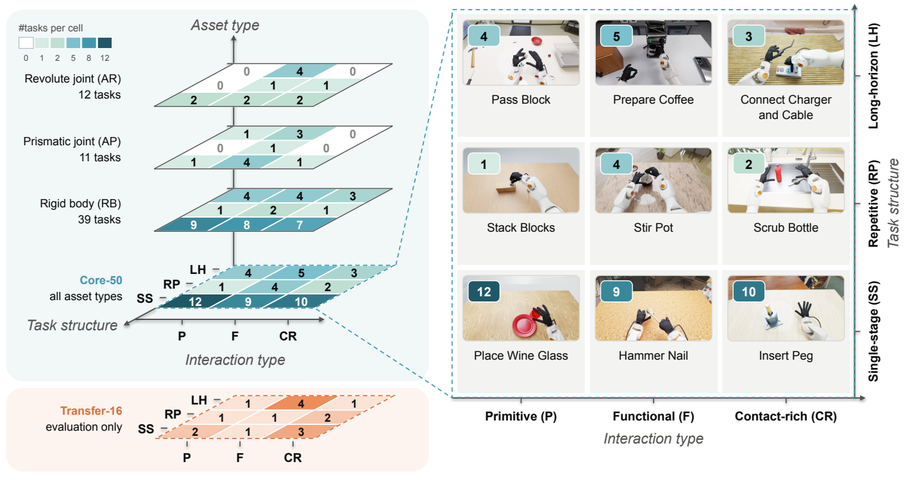
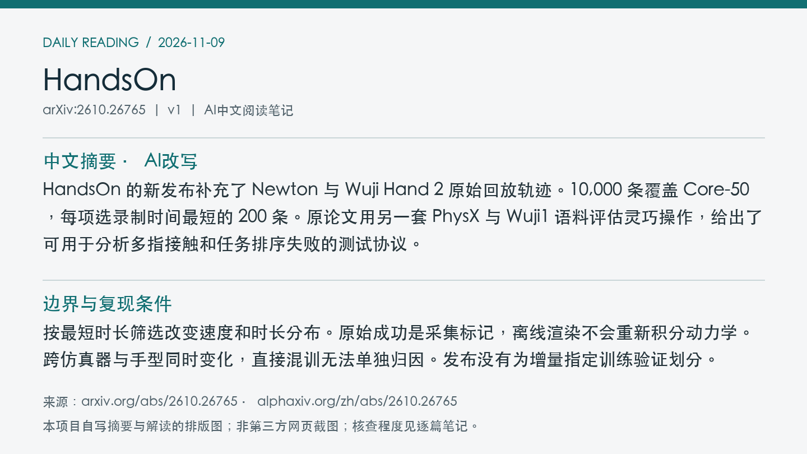
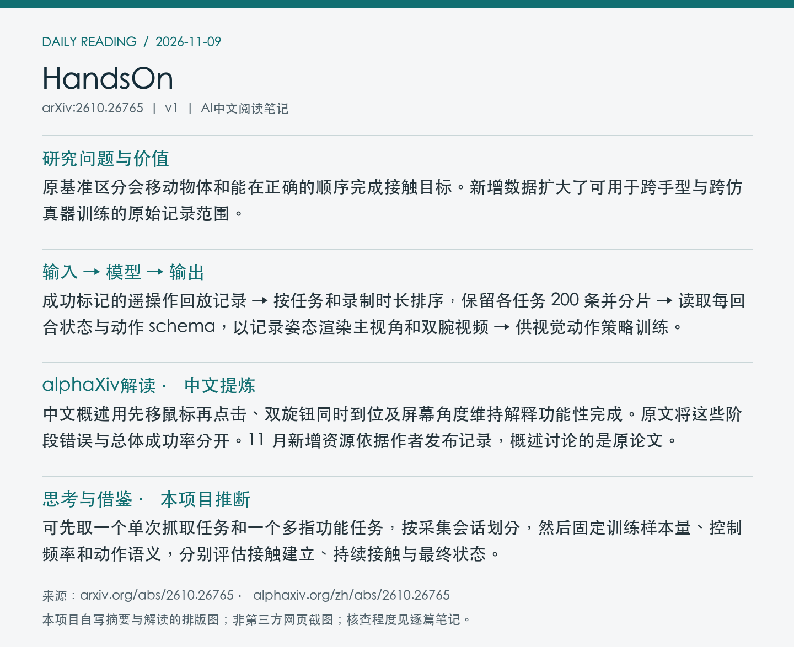

# 2610.26765 · HandsOn

HandsOn: A Large-Scale Simulation Benchmark for Generalizable Dexterous Manipulation

[arXiv原文](https://arxiv.org/abs/2610.26765) · [v1 HTML](https://arxiv.org/html/2610.26765v1) · [alphaXiv zh中文概述](https://www.alphaxiv.org/zh/abs/2610.26765) · [官方项目](https://github.com/TsinghuaC3I/HandsOn) · [新增数据和渲染说明](https://github.com/TsinghuaC3I/HandsOn/blob/main/docs/newton-wuji2-dataset.md) · [原论文权重](https://huggingface.co/Cyan666/HandsOn-Checkpoints)

v1首次提交于2026-10-20T01:22:48+08:00（Asia/Shanghai）。本次因新增数据发布首次收录原论文。研究方向包括dexterous-manipulation、dataset-release、simulation、benchmark。

**阅读程度**：选读原文第3节任务协议、第4节数据与第5节失败分析，核对PDF图3。已读alphaXiv中文AI概述。核对作者发布说明、GitHub提交、Hub提交与完成标记。未运行渲染或策略。

## 中文摘要 · 本项目AI改写

HandsOn 的新发布补充了 Newton 与 Wuji Hand 2 原始回放轨迹。10,000 条覆盖 Core-50，每项选录制时间最短的 200 条。原论文用另一套 PhysX 与 Wuji1 语料评估灵巧操作，给出了可用于分析多指接触和任务排序失败的测试协议。

## 核心问题与方法

原基准区分会移动物体和能在正确的顺序完成接触目标。新增数据扩大了可用于跨手型与跨仿真器训练的原始记录范围。

**输入 → 模型处理 → 输出**：成功标记的遥操作回放记录 → 按任务和录制时长排序，保留各任务 200 条并分片 → 读取每回合状态与动作 schema，以记录姿态渲染主视角和双腕视频 → 供视觉动作策略训练。

200 个 tar 分片保留原始 Zarr 回放及元数据，共 7,077,577 步，30 Hz，约 65.53 小时。录制时长相同按回合 ID 排序。渲染在 Isaac Sim 还原记录姿态，原始动作维度按 episode schema 解析。新增集独立于原始 PhysX/Wuji1 LeRobot 数据及归一化统计。

图3展示原论文按交互、任务结构和资产划分的任务体系，橙色为独立的 Transfer-16。 摘自[v1 PDF](https://arxiv.org/pdf/2610.26765v1)第7页。裁剪采用左上角point坐标[62, 119, 536, 369]，3倍渲染。已目视核查。PDF SHA256、抓取时间及图像哈希见[元数据](metadata.json)。

## 主要证据与局限

原论文的 18,000 条示范配 Core-50，Transfer-16 用于资产关系、技能组合和可变形物体泛化。原 Core-50 每训练策略每任务 100 回合，OpenWAM 的任务宏平均成功率为 29.1%。阶段诊断区分首次接触、动作转换和维持目标失败。新增 Newton/Wuji2 数据发布未给出相应新策略结果。

按最短时长筛选改变速度和时长分布。原始成功是采集标记，离线渲染不会重新积分动力学。跨仿真器与手型同时变化，直接混训无法单独归因。发布没有为增量指定训练验证划分。

原论文评测代码及 8 个多任务检查点已有公开文件入口，Hub 检查点库最后修改于北京时间 11-03 13:58。本次新增是数据与回放渲染工具。

## alphaXiv zh AI概述 · 中文提炼

中文概述用先移鼠标再点击、双旋钮同时到位及屏幕角度维持解释功能性完成。原文将这些阶段错误与总体成功率分开。11 月新增资源依据作者发布记录，概述讨论的是原论文。

[中文版来源](https://www.alphaxiv.org/zh/abs/2610.26765)，实际读取2026-11-09T10:48:56+08:00。已核实并独立提炼中文AI概述正文。

## 研究联系与下一步 · 本项目推断

可先取一个单次抓取任务和一个多指功能任务，按采集会话划分，然后固定训练样本量、控制频率和动作语义，分别评估接触建立、持续接触与最终状态。

## 代码、权重与数据状态

[代码确认提交](https://github.com/TsinghuaC3I/HandsOn/commit/fee28452fa50d3ee906445f1717ce2449cc83798)为北京时间 11-08 18:05:41，[Hub 发布提交](https://huggingface.co/datasets/Cyan666/HandsOn-Datasets/commit/731a1548fb40af8a3b575c7d3ce98e11c2941ee1)为 18:06:07。已读[完成标记](https://huggingface.co/datasets/Cyan666/HandsOn-Datasets/resolve/main/newton_wuji2/RELEASE_COMPLETE.json)，作者核验 200 分片。未下载全部数据，也未运行回放。

## 自写摘要与阅读卡片

以下两张卡片由本项目根据自写内容排版。

[论文目录](../README.md) · [当日日报](../../reports/2026/11/09.md)
