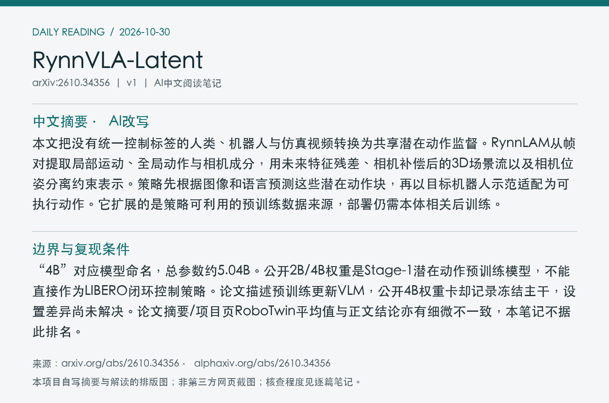
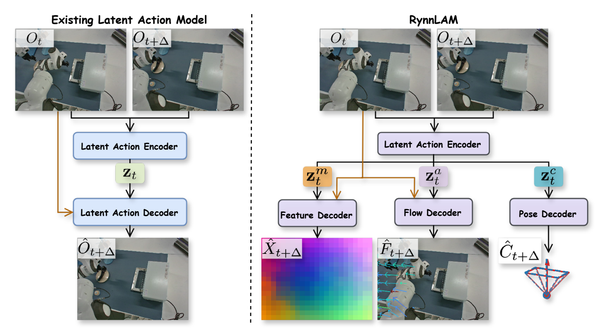
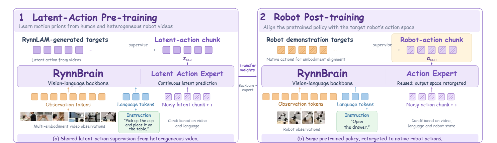
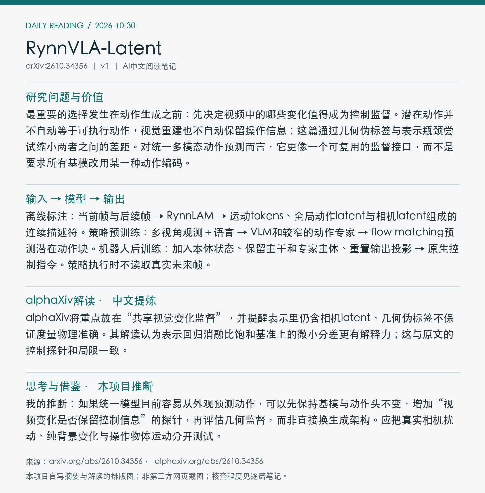

# 2610.34356 · RynnVLA-Latent

**论文全名：** RynnVLA-Latent: Scaling Robotic Manipulation Foundation Models with 3D-Grounded Latent Actions

[原文](https://arxiv.org/abs/2610.34356) · [PDF](https://arxiv.org/pdf/2610.34356v1) · [alphaXiv AI Overview](https://www.alphaxiv.org/abs/2610.34356) · [返回当日日报](../../reports/2026/10/30.md)

**论文版本：** v1；北京时间首发 2026-10-25。**归档：** 2026-10-30。**标签：** VLA, latent-action, cross-embodiment, flow-matching。

**阅读与核查程度：** 选读原文第3节方法、第4节主要实验、第5节局限与相关附录；核查官方仓库README、权重卡；未运行代码。

## 中文摘要（AI改写）

本文把没有统一控制标签的人类、机器人与仿真视频转换为共享潜在动作监督。RynnLAM从帧对提取局部运动、全局动作与相机成分，用未来特征残差、相机补偿后的3D场景流以及相机位姿分离约束表示。策略先根据图像和语言预测这些潜在动作块，再以目标机器人示范适配为可执行动作。它扩展的是策略可利用的预训练数据来源，部署仍需本体相关后训练。

## 论文介绍（AI撰写，基于原文）

最重要的选择发生在动作生成之前：先决定视频中的哪些变化值得成为控制监督。潜在动作并不自动等于可执行动作，视觉重建也不自动保留操作信息；这篇通过几何伪标签与表示瓶颈尝试缩小两者之间的差距。对统一多模态动作预测而言，它更像一个可复用的监督接口，而不是要求所有基模改用某一种动作编码。

## 输入 → 模型 → 输出

离线标注：当前帧与后续帧 → RynnLAM → 运动tokens、全局动作latent与相机latent组成的连续描述符。策略预训练：多视角观测＋语言 → VLM和较窄的动作专家 → flow matching预测潜在动作块。机器人后训练：加入本体状态、保留主干和专家主体、重置输出投影 → 原生控制指令。策略执行时不读取真实未来帧。

## 关键设计与训练信号

残差未来特征预测约束紧凑表示编码变化；3D流监督先补偿估计相机运动，减少把视角变化当作对象运动；相机分支和梯度反转鼓励信息分离。应注意：完整描述符仍含相机成分，论文没有建立严格视角不变性。总语料约30.1K小时、25个来源，包含人类交互、真实机器人与仿真视频。

*Figure 3：RynnLAM结构；将特征、运动与相机相关监督分支分开。 来源：[原文PDF，第6页](https://arxiv.org/pdf/2610.34356v1#page=6)；局部截图。*

*Figure 4：潜在动作预训练与机器人动作后训练的接口。 来源：[原文PDF，第8页](https://arxiv.org/pdf/2610.34356v1#page=8)；局部截图。*

## 实验证据

作者在LARY相对动作回归探针中报告，完整描述符平均MSE为0.38，移除3D流监督后为0.50，移除运动token残差约束后为0.57。这是冻结表示后低层动作可预测性的证据，不能解释为动作的因果可识别性。LIBERO微调后的4B版本在LIBERO-Plus上不额外适配得到84.7%，表中π₀.₅为84.4%；不应把0.3个百分点写成确定优势。

| 评测与指标 | 结果 | 条件与解释 |
| --- | --- | --- |
| LARY，相对动作，平均MSE↓ | 完整0.38；无3D流0.50；无残差约束0.57 | 表示探针，不是闭环成功率 |
| LIBERO-Plus，成功率↑ | 84.7%；π₀.₅ 84.4% | LIBERO微调后，无Plus额外适配；非显著性结论 |

## 局限、复现条件与待核实点

“4B”对应模型命名，总参数约5.04B。公开2B/4B权重是Stage-1潜在动作预训练模型，不能直接作为LIBERO闭环控制策略。论文描述预训练更新VLM，公开4B权重卡却记录冻结主干，设置差异尚未解决。论文摘要/项目页RoboTwin平均值与正文结论亦有细微不一致，本笔记不据此排名。

**开放状态：** 官方代码可访问；Stage-1权重卡可访问；未确认发布论文对应的Stage-2闭环策略权重和完整潜在动作语料。未独立核算训练成本。

## 与统一多模态动作预测的关系

我的推断：如果统一模型目前容易从外观预测动作，可以先保持基模与动作头不变，增加“视频变化是否保留控制信息”的探针，再评估几何监督，而非直接换生成架构。应把真实相机扰动、纯背景变化与操作物体运动分开测试。

## alphaXiv 解读补充（中文提炼）

alphaXiv将重点放在“共享视觉变化监督”，并提醒表示里仍含相机latent、几何伪标签不保证度量物理准确。其解读认为表示回归消融比饱和基准上的微小分差更有解释力；这与原文的控制探针和局限一致。

以上为对[alphaXiv AI Overview](https://www.alphaxiv.org/abs/2610.34356)的中文概括，非原文转载。原文核查以方法和实验证据为准；与本笔记中的作者结论、个人推断分开阅读。

## 来源与图像记录

论文：[arXiv 2610.34356v1](https://arxiv.org/abs/2610.34356v1)。解读来源：[alphaXiv](https://www.alphaxiv.org/abs/2610.34356)。抓取时间与PDF校验值见[metadata.json](metadata.json)。

图像为论文局部截图，图号、PDF页码及裁剪坐标见元数据。摘要卡片和阅读卡片为本项目AI撰写内容的排版图，不是alphaXiv网页截图。论文图像的权利归原作者；不包含完整PDF、模型权重或完整第三方文章。
