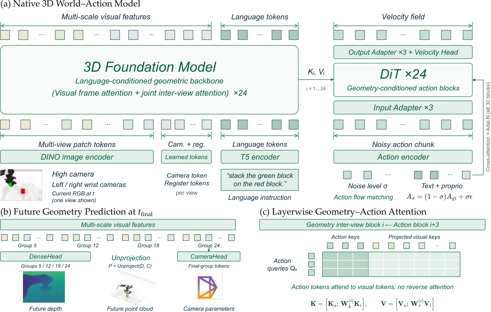
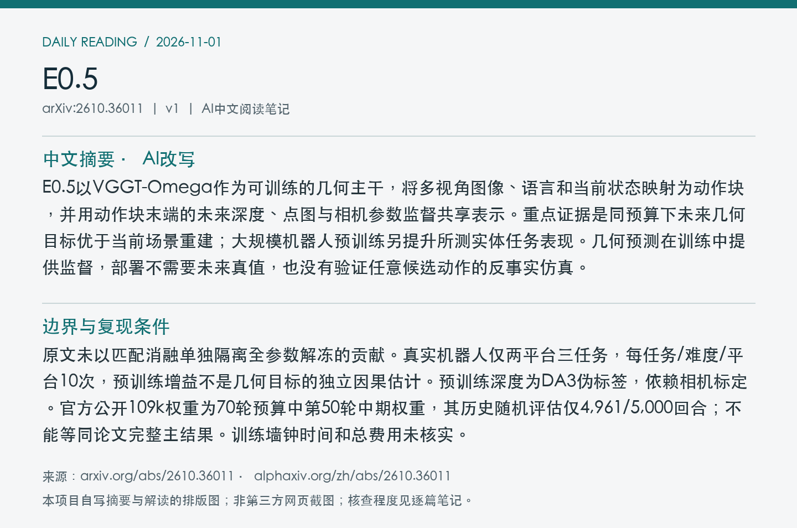
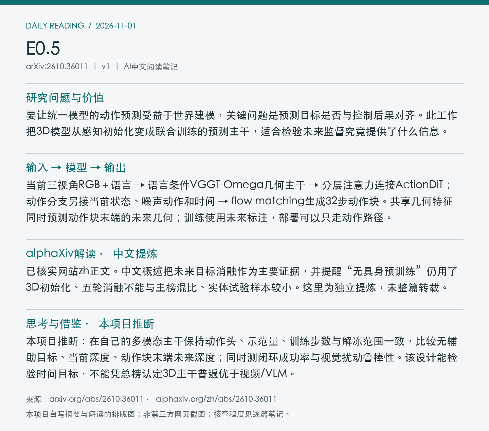

# 2610.36011 · E0.5

E0.5: From Reconstructive to Future-Predictive 3D Foundations for Robotic World-Action Modeling

[arXiv原文](https://arxiv.org/abs/2610.36011) · [v1 HTML](https://arxiv.org/html/2610.36011v1) · [alphaXiv zh中文概述](https://www.alphaxiv.org/zh/abs/2610.36011) · [作者项目页](https://www.x-era.com/e05/) · [官方发布README](https://github.com/X-EraAI/e05/blob/main/README.md) · [公开检查点模型卡](https://github.com/X-EraAI/e05/blob/main/docs/MODEL_CARD.md) · [RoboTwin策略权重入口（本次直连未取得）](https://huggingface.co/X-EraAI/e05-robotwin)

首次提交：2026-10-27T01:00:09+08:00（北京时间），v1；本次为近7天补漏、2026-11-01首次归档，不是今日新发或新版。方向：WAM、future-geometry、3D-foundation、flow-matching。

**阅读程度**：选读原文HTML第3节方法、第4节主实验与消融、附录A预训练和B评测协议；已读alphaXiv zh AI概述正文及官方README/模型卡。未核查实现、下载权重或运行实验。

## 中文摘要 · 本项目AI改写

E0.5以VGGT-Omega作为可训练的几何主干，将多视角图像、语言和当前状态映射为动作块，并用动作块末端的未来深度、点图与相机参数监督共享表示。重点证据是同预算下未来几何目标优于当前场景重建；大规模机器人预训练另提升所测实体任务表现。几何预测在训练中提供监督，部署不需要未来真值，也没有验证任意候选动作的反事实仿真。

## 问题与方法

要让统一模型的动作预测受益于世界建模，关键问题是预测目标是否与控制后果对齐。此工作把3D模型从感知初始化变成联合训练的预测主干，适合检验未来监督究竟提供了什么信息。

**输入 → 模型处理 → 输出**：当前三视角RGB＋语言 → 语言条件VGGT-Omega几何主干 → 分层注意力连接ActionDiT；动作分支另接当前状态、噪声动作和时间 → flow matching生成32步动作块。共享几何特征同时预测动作块末端的未来几何；训练使用未来标注，部署可以只走动作路径。

语言仅直接加入跨视角global attention，图像内frame attention不拼接语言。24层几何表示向动作专家提供条件，动作专家首尾各3层独立；预训练语言编码器冻结，其余相关模块联合优化。深度与相机预测通过反投影得到点图，不需要独立点云生成头。整体目标为动作损失加0.01倍几何损失。仿真32帧约2.13秒，30Hz预训练数据32帧约1.07秒，不能混同物理时长。

Figure 2：共享几何主干、未来几何监督与逐层条件化动作专家。注意动作token读取几何表示，不应将图理解为任意动作条件的可查询模拟器。 来源：[arXiv v1官方原图](https://arxiv.org/html/2610.36011v1/method.png)。本次直接保存HTML提供的原图，未裁剪PDF，PDF页码、坐标和PDF SHA256未核验（null）；原图SHA256、版本与抓取时间见[metadata.json](metadata.json)。已目视核对图号、边界和可读性。

## 实验证据与边界

RoboTwin 2.0，50任务，每任务50条clean示范；clean/random各100次，宏平均。主结果89.90%/50.09%，无机器人数据预训练但有3D初始化。同为5轮的目标消融：无几何73.22/19.84，当前几何75.94/20.12，未来几何82.72/29.20。未来相对当前提高6.78/9.08个百分点；消融训练预算小于主结果。

原文未以匹配消融单独隔离全参数解冻的贡献。真实机器人仅两平台三任务，每任务/难度/平台10次，预训练增益不是几何目标的独立因果估计。预训练深度为DA3伪标签，依赖相机标定。官方公开109k权重为70轮预算中第50轮中期权重，其历史随机评估仅4,961/5,000回合；不能等同论文完整主结果。训练墙钟时间和总费用未核实。

### 预训练、实体试验与发布检查点

原文附录A：筛选后AgiBotWorld-Beta有160,010条轨迹、177任务，约2,645.64小时同步轨迹时间；三视角不重复计时。深度由Depth Anything 3统一生成伪标签，点图由深度和标定导出。报告使用56张96GB PRO6000、有效batch 896，预算两轮626,360次更新；这些是原文配置，未核实墙钟时长和总费用。

实体后训练每平台3任务、每任务200示范。每任务在ID/OOD各10次，即每方法每平台60次；E0.5有/无机器人预训练的平均成功率在Piper上为85.0/70.0%，H1上约88.3/81.7%。这是整套预训练的比较，不能归因于某个几何损失。官方README另外注明，实体适配配方使用未来深度监督并关闭相机/点图损失；应与仿真和预训练配方区分。

官方模型卡记载109k中期策略的历史clean为89.48%（5,000次），random为49.431867%（4,961次/计划5,000次）。两个任务分别只跑87和74回合；该记录与论文表1的89.90/50.09不是同一份完整评估。我们只读了文档，没有执行独立复现。

## alphaXiv zh AI概述 · 中文提炼

已核实网站zh正文。中文概述把未来目标消融作为主要证据，并提醒“无具身预训练”仍用了3D初始化、五轮消融不能与主榜混比、实体试验样本较小。这里为独立提炼，未整篇转载。

来源：[网站中文版](https://www.alphaxiv.org/zh/abs/2610.36011)；于2026-11-01北京时间07:07读取“AI 概述”后中文正文。此段是本项目提炼，其他方法与数值已回查论文；未将摘要翻译或入口语言当作中文概述验证，也未整篇转载。

## 思考与借鉴 · 本项目推断

本项目推断：在自己的多模态主干保持动作头、示范量、训练步数与解冻范围一致，比较无辅助目标、当前深度、动作块末端未来深度；同时测闭环成功率与视觉扰动鲁棒性。该设计能检验时间目标，不能凭总榜认定3D主干普遍优于视频/VLM。

## 代码、权重与数据状态

官方GitHub README、模型卡可访问，提供训练/推理与RoboTwin评测说明，并列出109k策略、具身预训练VGGT和处理数据的Hub链接。Hub权重页本次不可访问，未下载核验文件；模型卡明确中期权重及历史评估缺回合。代码许可不替代上游模型和数据条款。

## 自写阅读卡片

以下是本项目摘要/解读的排版图，不是alphaXiv网页截图。

[返回论文目录](../README.md) · [当日日报](../../reports/2026/11/01.md)
