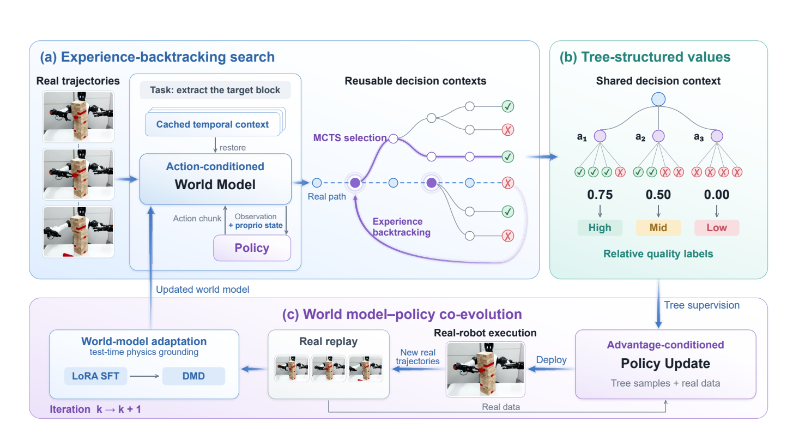
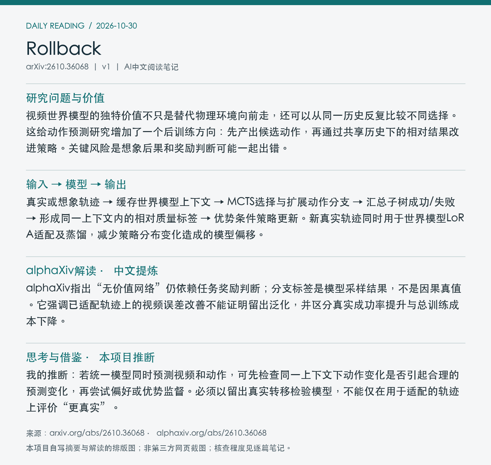

# 2610.36068 · Rollback

**论文全名：** Rollback: Experience Backtracking in World Models for Policy Improvement

[原文](https://arxiv.org/abs/2610.36068) · [PDF](https://arxiv.org/pdf/2610.36068v1) · [alphaXiv AI Overview](https://www.alphaxiv.org/abs/2610.36068) · [返回当日日报](../../reports/2026/10/30.md)

**论文版本：** v1；北京时间首发 2026-10-27。**归档：** 2026-10-30。**标签：** world-model, counterfactual-search, policy-improvement, online-adaptation。

**阅读与核查程度：** 选读原文回溯搜索、树监督、真机实验/消融与局限；阅读alphaXiv AI Overview及官方项目页；未完整阅读全文、未运行代码。

## 中文摘要（AI改写）

Rollback把动作条件世界模型当作可回退的训练环境：缓存动作块边界的历史上下文，在关键决策点恢复后尝试不同动作，比较各分支终局并形成相对动作监督。策略、想象搜索、真实机器人数据采集与世界模型适配异步协同。它不另训中间状态价值网络，但仍依赖任务奖励判别和世界模型预测质量。

## 论文介绍（AI撰写，基于原文）

视频世界模型的独特价值不只是替代物理环境向前走，还可以从同一历史反复比较不同选择。这给动作预测研究增加了一个后训练方向：先产出候选动作，再通过共享历史下的相对结果改进策略。关键风险是想象后果和奖励判断可能一起出错。

## 输入 → 模型 → 输出

真实或想象轨迹 → 缓存世界模型上下文 → MCTS选择与扩展动作分支 → 汇总子树成功/失败 → 形成同一上下文内的相对质量标签 → 优势条件策略更新。新真实轨迹同时用于世界模型LoRA适配及蒸馏，减少策略分布变化造成的模型偏移。

## 关键设计与训练信号

回退复用已有前缀，分支成本主要来自新后缀；树结构为动作块提供相对监督。无需单独训练value critic不代表无需reward judge，终局仍由任务相关模型判断。所谓test-time physics grounding发生在世界模型作为策略训练环境期间，不能理解为机器人每次策略推理都做适配。

*Figure 2：恢复缓存上下文、比较动作分支，并以真实交互持续校正模型。 来源：[原文PDF，第5页](https://arxiv.org/pdf/2610.36068v1#page=5)；局部截图。*

## 实验证据

真实机器人三项任务中，Rollback成功率为69.33%（积木抽取）、40.00%（投球）、64.44%（桌面冰壶）；较最强对照分别高10.67、11.11、11.85个百分点。积木抽取消融：完整69.33%，改成单轨迹直接奖励59.33%，冻结世界模型64.67%。这支持所测任务中的树监督与持续适配，但未完全分离回溯、搜索与训练标签贡献。

| 评测与指标 | 结果 | 条件与解释 |
| --- | --- | --- |
| 积木抽取，真实成功率↑ | 完整69.33%；直接奖励59.33%；冻结模型64.67% | 同文任务消融；不外推所有任务 |
| 投球，真实成功率↑ | 40.00% / RISE w GE-Sim2 28.89% | 同世界模型对照；未报告显著性结论 |

## 局限、复现条件与待核实点

每个策略对应单任务、单物理机器人；多机器人扩展未验证。模型与奖励误差可能误标分支，长时接触任务尤其敏感。不能把某些任务超过人类均值推广成通用超人能力，也未据此证明更少真实尝试、更低总算力或更短训练时间。

**开放状态：** 原文与官方项目页 https://rollback-wm.github.io/ 可访问；本期未核实代码、模型与原始轨迹发布。

## 与统一多模态动作预测的关系

我的推断：若统一模型同时预测视频和动作，可先检查同一上下文下动作变化是否引起合理的预测变化，再尝试偏好或优势监督。必须以留出真实转移检验模型，不能仅在用于适配的轨迹上评价“更真实”。

## alphaXiv 解读补充（中文提炼）

alphaXiv指出“无价值网络”仍依赖任务奖励判断；分支标签是模型采样结果，不是因果真值。它强调已适配轨迹上的视频误差改善不能证明留出泛化，并区分真实成功率提升与总训练成本下降。

以上为对[alphaXiv AI Overview](https://www.alphaxiv.org/abs/2610.36068)的中文概括，非原文转载。原文核查以方法和实验证据为准；与本笔记中的作者结论、个人推断分开阅读。

## 来源与图像记录

论文：[arXiv 2610.36068v1](https://arxiv.org/abs/2610.36068v1)。解读来源：[alphaXiv](https://www.alphaxiv.org/abs/2610.36068)。抓取时间与PDF校验值见[metadata.json](metadata.json)。

图像为论文局部截图，图号、PDF页码及裁剪坐标见元数据。摘要卡片和阅读卡片为本项目AI撰写内容的排版图，不是alphaXiv网页截图。论文图像的权利归原作者；不包含完整PDF、模型权重或完整第三方文章。
