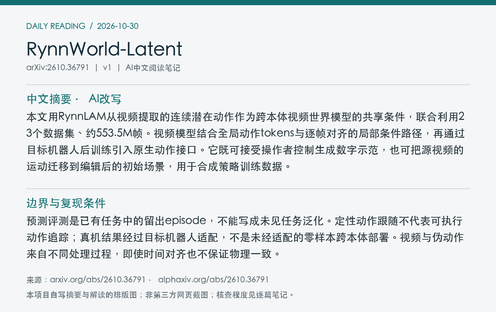
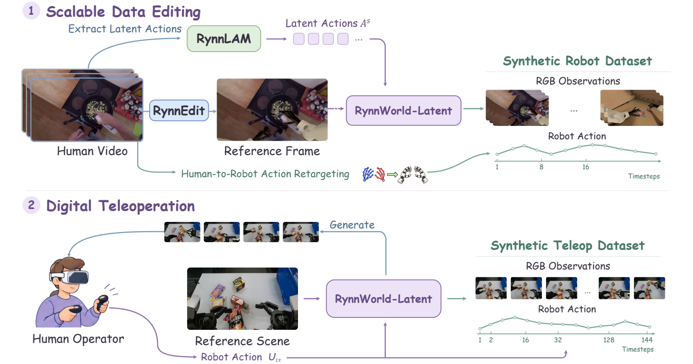
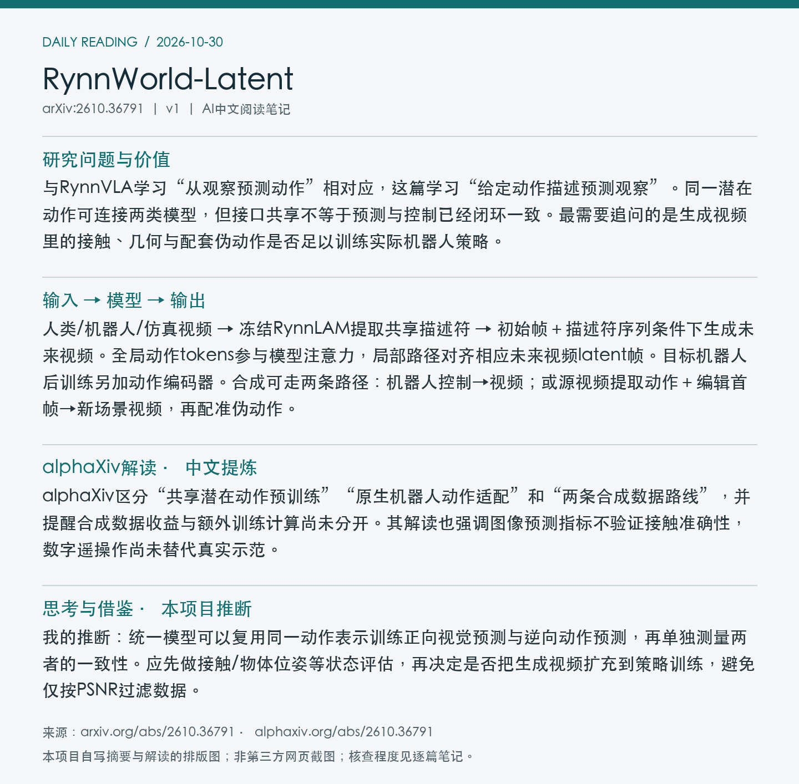

# 2610.36791 · RynnWorld-Latent

**论文全名：** RynnWorld-Latent: A Cross-Embodiment World Model Conditioned on Universal Latent Actions

[原文](https://arxiv.org/abs/2610.36791) · [PDF](https://arxiv.org/pdf/2610.36791v1) · [alphaXiv AI Overview](https://www.alphaxiv.org/abs/2610.36791) · [返回当日日报](../../reports/2026/10/30.md)

**论文版本：** v1；北京时间首发 2026-10-27。**归档：** 2026-10-30。**标签：** world-model, latent-action, synthetic-data, cross-embodiment。

**阅读与核查程度：** 选读PDF第3节接口与数据引擎、预测与合成数据实验/消融相关段落；阅读alphaXiv AI Overview、官方README；未运行代码。

## 中文摘要（AI改写）

本文用RynnLAM从视频提取的连续潜在动作作为跨本体视频世界模型的共享条件，联合利用23个数据集、约553.5M帧。视频模型结合全局动作tokens与逐帧对齐的局部条件路径，再通过目标机器人后训练引入原生动作接口。它既可接受操作者控制生成数字示范，也可把源视频的运动迁移到编辑后的初始场景，用于合成策略训练数据。

## 论文介绍（AI撰写，基于原文）

与RynnVLA学习“从观察预测动作”相对应，这篇学习“给定动作描述预测观察”。同一潜在动作可连接两类模型，但接口共享不等于预测与控制已经闭环一致。最需要追问的是生成视频里的接触、几何与配套伪动作是否足以训练实际机器人策略。

## 输入 → 模型 → 输出

人类/机器人/仿真视频 → 冻结RynnLAM提取共享描述符 → 初始帧＋描述符序列条件下生成未来视频。全局动作tokens参与模型注意力，局部路径对齐相应未来视频latent帧。目标机器人后训练另加动作编码器。合成可走两条路径：机器人控制→视频；或源视频提取动作＋编辑首帧→新场景视频，再配准伪动作。

## 关键设计与训练信号

局部视觉注入路径从恒等映射初始化，尽量保留预训练视频生成能力；动作时间步与视频latent时间压缩对应。预训练约6,190小时、23来源，与RynnVLA的30.1K小时语料不是同一个规模。描述符含相机成分，不能简单称为视角无关、可直接执行的动作。

*Figure 2：源运动迁移与数字遥操作两条数据生成通路。 来源：[原文PDF，第7页](https://arxiv.org/pdf/2610.36791v1#page=7)；局部截图。*

## 实验证据

Marvin-WUJI预测评测中，完整模型PSNR/SSIM/LPIPS为21.86/0.80/0.12；无逐帧对齐注入为21.14/0.76/0.18。该消融支持局部条件路径，但图像质量不等于接触动力学准确。作者还报告合成中训练改善下游策略，然而增加了数据与优化计算，未完全分离这些因素。

| 评测与指标 | 结果 | 条件与解释 |
| --- | --- | --- |
| Marvin-WUJI，预测图像PSNR↑ | 完整21.86 / 无对齐注入21.14 | PSNR；非策略成功率 |
| 同设置，SSIM↑ / LPIPS↓ | 0.80 / 0.12；对照0.76 / 0.18 | 已有任务留出episode；不能推出新任务泛化 |

## 局限、复现条件与待核实点

预测评测是已有任务中的留出episode，不能写成未见任务泛化。定性动作跟随不代表可执行动作追踪；真机结果经过目标机器人适配，不是未经适配的零样本跨本体部署。视频与伪动作来自不同处理过程，即使时间对齐也不保证物理一致。

**开放状态：** 代码、RynnWorld-Latent权重页面与少量样例可访问；基座权重存在访问条件。完整训练/评测语料与所有下游流程的可复现性未核实。

## 与统一多模态动作预测的关系

我的推断：统一模型可以复用同一动作表示训练正向视觉预测与逆向动作预测，再单独测量两者的一致性。应先做接触/物体位姿等状态评估，再决定是否把生成视频扩充到策略训练，避免仅按PSNR过滤数据。

## alphaXiv 解读补充（中文提炼）

**语言记录：**现有提炼最初依据英文版；[zh中文版入口](https://www.alphaxiv.org/zh/abs/2610.36791)的AI概述正文尚未核实，未冒充中文原文。

alphaXiv区分“共享潜在动作预训练”“原生机器人动作适配”和“两条合成数据路线”，并提醒合成数据收益与额外训练计算尚未分开。其解读也强调图像预测指标不验证接触准确性，数字遥操作尚未替代真实示范。

以上为对[alphaXiv AI Overview](https://www.alphaxiv.org/abs/2610.36791)的中文概括，非原文转载。原文核查以方法和实验证据为准；与本笔记中的作者结论、个人推断分开阅读。

## 来源与图像记录

论文：[arXiv 2610.36791v1](https://arxiv.org/abs/2610.36791v1)。解读来源：[alphaXiv](https://www.alphaxiv.org/abs/2610.36791)。抓取时间与PDF校验值见[metadata.json](metadata.json)。

图像为论文局部截图，图号、PDF页码及裁剪坐标见元数据。摘要卡片和阅读卡片为本项目AI撰写内容的排版图，不是alphaXiv网页截图。论文图像的权利归原作者；不包含完整PDF、模型权重或完整第三方文章。
