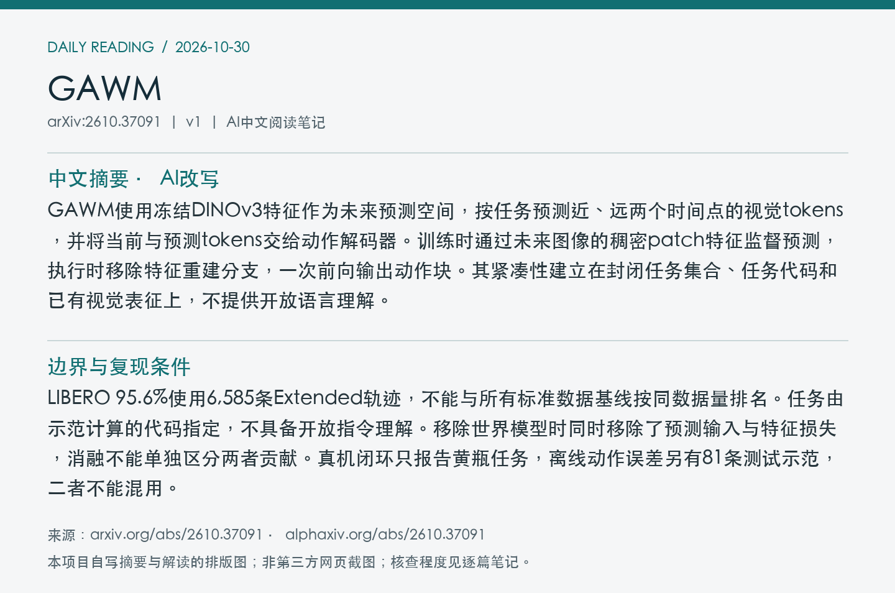
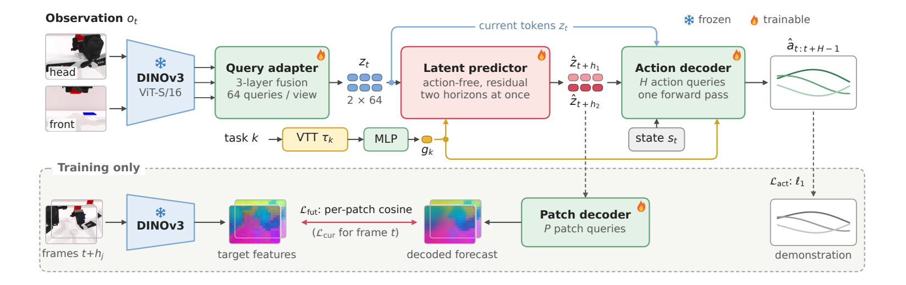
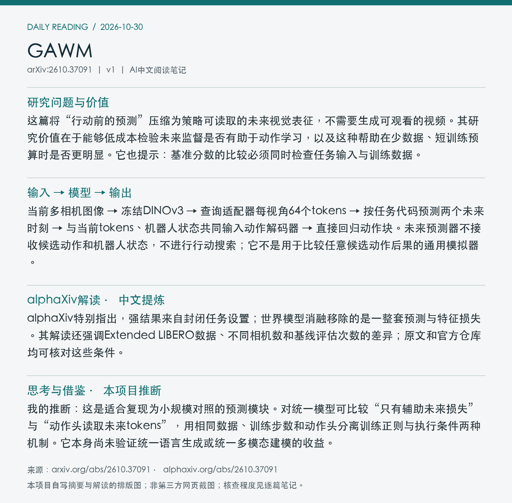

# 2610.37091 · GAWM

**论文全名：** GAWM: A Compact Latent World-Action Model for Multi-Task Robot Manipulation

[原文](https://arxiv.org/abs/2610.37091) · [PDF](https://arxiv.org/pdf/2610.37091v1) · [alphaXiv AI Overview](https://www.alphaxiv.org/abs/2610.37091) · [返回当日日报](../../reports/2026/10/30.md)

**论文版本：** v1；北京时间首发 2026-10-27。**归档：** 2026-10-30。**标签：** WAM, latent-forecast, efficient-control, JEPA。

**阅读与核查程度：** 选读原文方法、实验设置、消融、真机评测与局限；核查README及LIBERO/RoboTwin模型卡；未运行代码。

## 中文摘要（AI改写）

GAWM使用冻结DINOv3特征作为未来预测空间，按任务预测近、远两个时间点的视觉tokens，并将当前与预测tokens交给动作解码器。训练时通过未来图像的稠密patch特征监督预测，执行时移除特征重建分支，一次前向输出动作块。其紧凑性建立在封闭任务集合、任务代码和已有视觉表征上，不提供开放语言理解。

## 论文介绍（AI撰写，基于原文）

这篇将“行动前的预测”压缩为策略可读取的未来视觉表征，不需要生成可观看的视频。其研究价值在于能够低成本检验未来监督是否有助于动作学习，以及这种帮助在少数据、短训练预算时是否更明显。它也提示：基准分数的比较必须同时检查任务输入与训练数据。

## 输入 → 模型 → 输出

当前多相机图像 → 冻结DINOv3 → 查询适配器每视角64个tokens → 按任务代码预测两个未来时刻 → 与当前tokens、机器人状态共同输入动作解码器 → 直接回归动作块。未来预测器不接收候选动作和机器人状态，不进行行动搜索；它不是用于比较任意候选动作后果的通用模拟器。

## 关键设计与训练信号

训练用patch解码器把预测tokens映射回对应空间位置的未来特征，避免只有全局场景相似性。动作损失也经过未来预测通路回传。执行侧不运行patch解码器，不做多步扩散采样。LIBERO与RoboTwin配置分别约38M、77M参数，包含冻结编码器，不能只按可训练参数与其他策略比较。

*Figure 2：上半部分是执行通路；下半部分未来patch特征监督仅在训练使用。 来源：[原文PDF，第3页](https://arxiv.org/pdf/2610.37091v1#page=3)；局部截图。*

## 实验证据

四分之一LIBERO示范数据下，有世界模型为80.5%，移除后为71.0%，差值9.5个百分点，报告区间[5.2,14.2]；Object子集反向，说明收益有任务依赖。真机黄瓶交接任务46/50成功，对照π₀.₅为39/50。两者查询延迟在相同RTX PRO 5000、batch=1下为9.3ms与63.8ms，不含完整机器人系统时延。

| 评测与指标 | 结果 | 条件与解释 |
| --- | --- | --- |
| LIBERO，1/4示范，成功率↑ | 80.5% / 无世界模型71.0% | 相同论文消融；差值9.5pp [5.2,14.2] |
| 真机黄瓶任务，闭环成功↑ | 46/50 / π₀.₅ 39/50 | 两者60k微调；只覆盖一个闭环任务 |
| 真机，查询中位延迟↓ | 9.3ms / 63.8ms | 同RTX PRO 5000、batch=1；非端到端时延 |

## 局限、复现条件与待核实点

LIBERO 95.6%使用6,585条Extended轨迹，不能与所有标准数据基线按同数据量排名。任务由示范计算的代码指定，不具备开放指令理解。移除世界模型时同时移除了预测输入与特征损失，消融不能单独区分两者贡献。真机闭环只报告黄瓶任务，离线动作误差另有81条测试示范，二者不能混用。

**开放状态：** 官方说明10月26日发布推理/评测代码与LIBERO、RoboTwin权重；10月27日论文首发。训练代码仍标注Coming soon。完整训练语料发布状态未核实。

## 与统一多模态动作预测的关系

我的推断：这是适合复现为小规模对照的预测模块。对统一模型可比较“只有辅助未来损失”与“动作头读取未来tokens”，用相同数据、训练步数和动作头分离训练正则与执行条件两种机制。它本身尚未验证统一语言生成或统一多模态建模的收益。

## alphaXiv 解读补充（中文提炼）

alphaXiv特别指出，强结果来自封闭任务设置；世界模型消融移除的是一整套预测与特征损失。其解读还强调Extended LIBERO数据、不同相机数和基线评估次数的差异；原文和官方仓库均可核对这些条件。

以上为对[alphaXiv AI Overview](https://www.alphaxiv.org/abs/2610.37091)的中文概括，非原文转载。原文核查以方法和实验证据为准；与本笔记中的作者结论、个人推断分开阅读。

## 来源与图像记录

论文：[arXiv 2610.37091v1](https://arxiv.org/abs/2610.37091v1)。解读来源：[alphaXiv](https://www.alphaxiv.org/abs/2610.37091)。抓取时间与PDF校验值见[metadata.json](metadata.json)。

图像为论文局部截图，图号、PDF页码及裁剪坐标见元数据。摘要卡片和阅读卡片为本项目AI撰写内容的排版图，不是alphaXiv网页截图。论文图像的权利归原作者；不包含完整PDF、模型权重或完整第三方文章。
