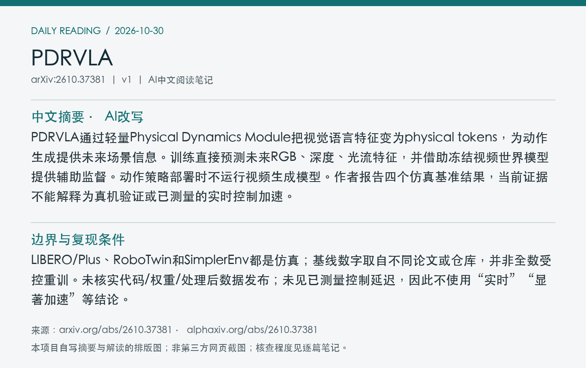
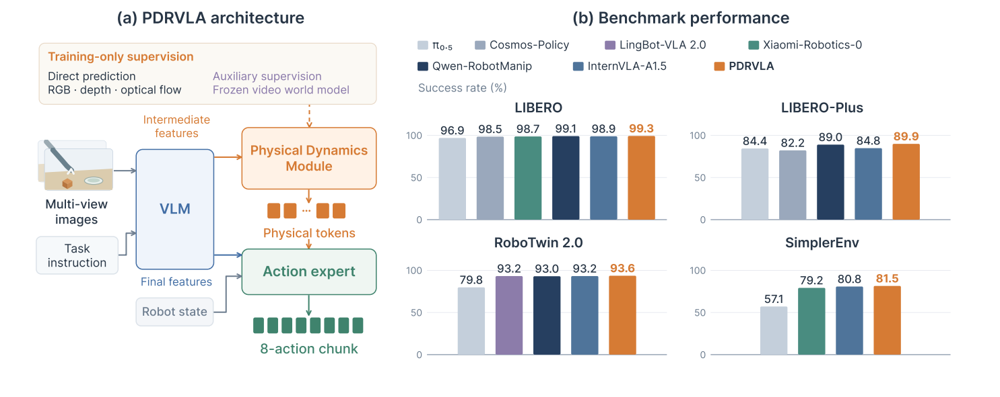
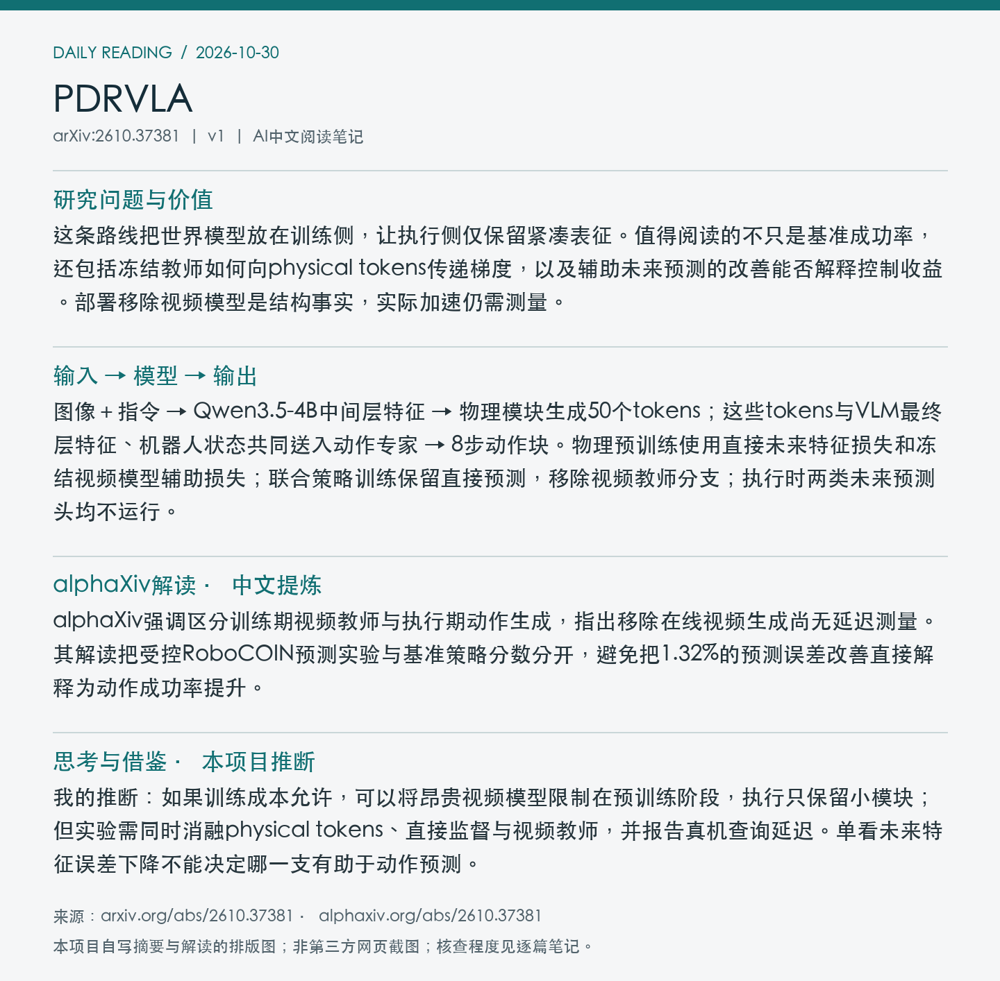

# 2610.37381 · PDRVLA

**论文全名：** PDRVLA: A Vision-Language-Action Model with Physical Dynamics Representations

[原文](https://arxiv.org/abs/2610.37381) · [PDF](https://arxiv.org/pdf/2610.37381v1) · [alphaXiv AI Overview](https://www.alphaxiv.org/abs/2610.37381) · [返回当日日报](../../reports/2026/10/30.md)

**论文版本：** v1；北京时间首发 2026-10-27。**归档：** 2026-10-30。**标签：** VLA, physical-tokens, future-supervision, world-model-distillation。

**阅读与核查程度：** 选读原文模型/训练流程与受控未来预测实验（含附录）；阅读alphaXiv AI Overview；未完整阅读全文、未核查代码实现。

## 中文摘要（AI改写）

PDRVLA通过轻量Physical Dynamics Module把视觉语言特征变为physical tokens，为动作生成提供未来场景信息。训练直接预测未来RGB、深度、光流特征，并借助冻结视频世界模型提供辅助监督。动作策略部署时不运行视频生成模型。作者报告四个仿真基准结果，当前证据不能解释为真机验证或已测量的实时控制加速。

## 论文介绍（AI撰写，基于原文）

这条路线把世界模型放在训练侧，让执行侧仅保留紧凑表征。值得阅读的不只是基准成功率，还包括冻结教师如何向physical tokens传递梯度，以及辅助未来预测的改善能否解释控制收益。部署移除视频模型是结构事实，实际加速仍需测量。

## 输入 → 模型 → 输出

图像＋指令 → Qwen3.5-4B中间层特征 → 物理模块生成50个tokens；这些tokens与VLM最终层特征、机器人状态共同送入动作专家 → 8步动作块。物理预训练使用直接未来特征损失和冻结视频模型辅助损失；联合策略训练保留直接预测，移除视频教师分支；执行时两类未来预测头均不运行。

## 关键设计与训练信号

读取32层主干的第8层特征；物理模块约57.3M参数。动作流匹配采样采用4次Euler步。冻结教师意味着不更新其权重，不意味着阻断梯度：训练物理模块仍需通过教师反传。动作专家同时接收原始VLM上下文，不能据此认定所有控制能力都来自physical tokens。

*Figure 1：架构与四个仿真基准概览；右侧分数不能跨条件直接排名。 来源：[原文PDF，第1页](https://arxiv.org/pdf/2610.37381v1#page=1)；局部截图。*

## 实验证据

受控实验固定基模、训练样本预算、学习率和直接损失计划，对比直接预测与增加世界模型辅助。100个留出RoboCOIN episode的828个clips上，三模态等权归一化MSE从0.6439到0.6354，相对下降1.32%。RGB和深度改善更清楚；光流改善0.62%，区间跨零。此证据验证未来特征预测，不直接隔离策略成功率的因果来源。

| 评测与指标 | 结果 | 条件与解释 |
| --- | --- | --- |
| RoboCOIN留出预测，平均归一化MSE↓ | 直接0.6439 / 加世界模型0.6354 | 100 episodes、828 clips；相对降1.32% |
| 同实验，光流MSE相对改善↑ | 0.62%；95%区间[-0.07%,1.28%] | 区间含零；不能宣称可靠光流收益 |

## 局限、复现条件与待核实点

LIBERO/Plus、RoboTwin和SimplerEnv都是仿真；基线数字取自不同论文或仓库，并非全数受控重训。未核实代码/权重/处理后数据发布；未见已测量控制延迟，因此不使用“实时”“显著加速”等结论。

**开放状态：** 论文可访问；官方代码、权重和处理后语料开放状态未核实。基模、模块参数与实验条件来自原文，训练总成本未独立核实。

## 与统一多模态动作预测的关系

我的推断：如果训练成本允许，可以将昂贵视频模型限制在预训练阶段，执行只保留小模块；但实验需同时消融physical tokens、直接监督与视频教师，并报告真机查询延迟。单看未来特征误差下降不能决定哪一支有助于动作预测。

## alphaXiv 解读补充（中文提炼）

**语言记录：**现有提炼最初依据英文版；[zh中文版入口](https://www.alphaxiv.org/zh/abs/2610.37381)的AI概述正文尚未核实，未冒充中文原文。

alphaXiv强调区分训练期视频教师与执行期动作生成，指出移除在线视频生成尚无延迟测量。其解读把受控RoboCOIN预测实验与基准策略分数分开，避免把1.32%的预测误差改善直接解释为动作成功率提升。

以上为对[alphaXiv AI Overview](https://www.alphaxiv.org/abs/2610.37381)的中文概括，非原文转载。原文核查以方法和实验证据为准；与本笔记中的作者结论、个人推断分开阅读。

## 来源与图像记录

论文：[arXiv 2610.37381v1](https://arxiv.org/abs/2610.37381v1)。解读来源：[alphaXiv](https://www.alphaxiv.org/abs/2610.37381)。抓取时间与PDF校验值见[metadata.json](metadata.json)。

图像为论文局部截图，图号、PDF页码及裁剪坐标见元数据。摘要卡片和阅读卡片为本项目AI撰写内容的排版图，不是alphaXiv网页截图。论文图像的权利归原作者；不包含完整PDF、模型权重或完整第三方文章。
