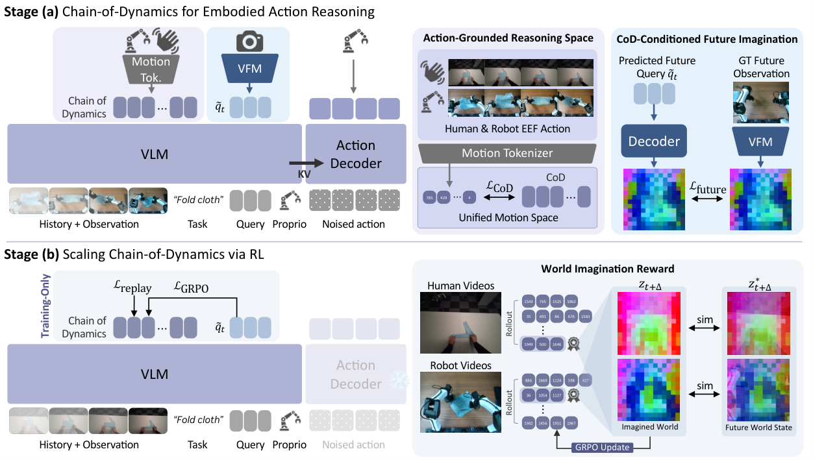
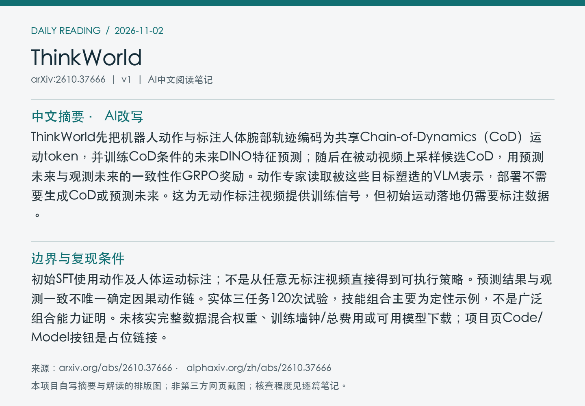
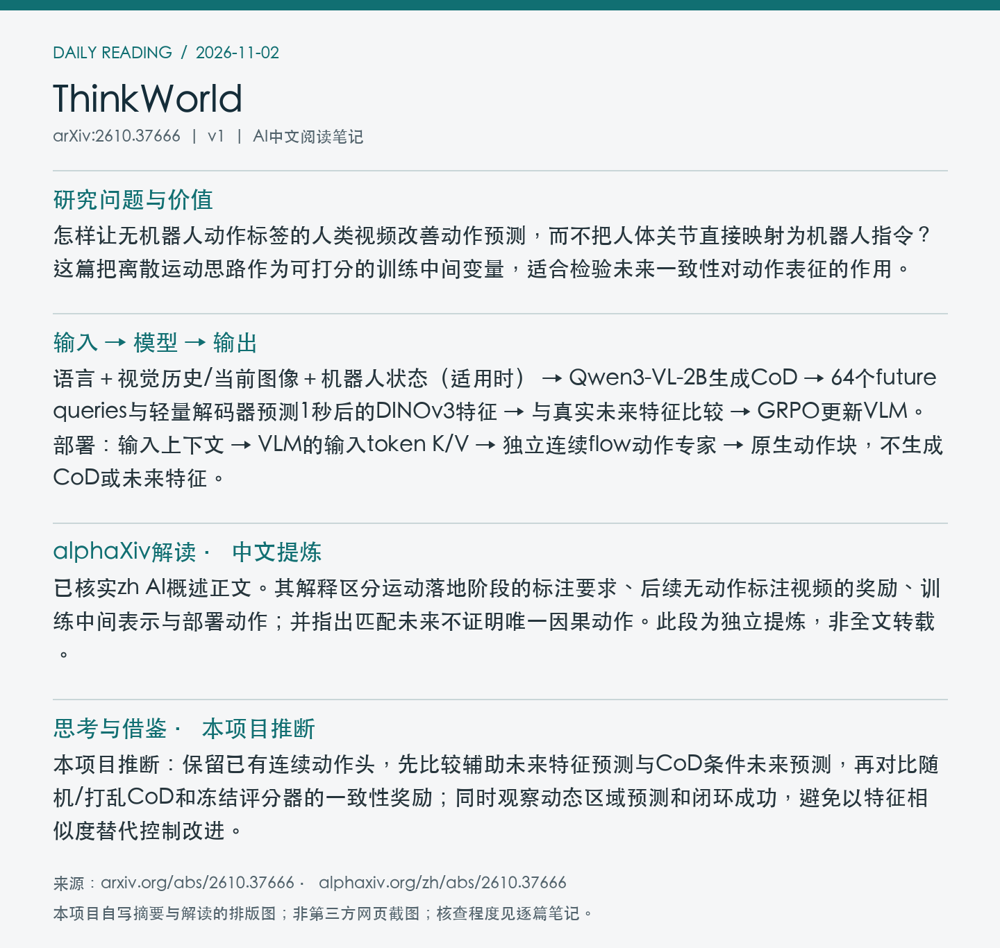

# 2610.37666 · ThinkWorld

ThinkWorld: World Imagination Reinforces Chain-of-Dynamics Reasoning

[arXiv原文](https://arxiv.org/abs/2610.37666) · [v1 HTML](https://arxiv.org/html/2610.37666v1) · [alphaXiv zh中文概述](https://www.alphaxiv.org/zh/abs/2610.37666) · [作者项目页](https://thinkworld-project.github.io/)

首次提交：2026-10-28T01:59:52+08:00（Asia/Shanghai），v1；2026-11-02首次收录，为近7天补漏，不是今日新发或新修订。方向：VLA、motion-token、future-feature、offline-RL、human-video。

**阅读程度**：选读原文第3节方法、第4节主实验与组件消融，附录A.1/A.2模型及token表示、A.6奖励、B实体评测及C.1结果；已读alphaXiv zh AI概述中文正文和作者项目页。未核查实现或复现实验。

## 中文摘要 · 本项目AI改写

ThinkWorld先把机器人动作与标注人体腕部轨迹编码为共享Chain-of-Dynamics（CoD）运动token，并训练CoD条件的未来DINO特征预测；随后在被动视频上采样候选CoD，用预测未来与观测未来的一致性作GRPO奖励。动作专家读取被这些目标塑造的VLM表示，部署不需要生成CoD或预测未来。这为无动作标注视频提供训练信号，但初始运动落地仍需要标注数据。

## 核心问题与方法

怎样让无机器人动作标签的人类视频改善动作预测，而不把人体关节直接映射为机器人指令？这篇把离散运动思路作为可打分的训练中间变量，适合检验未来一致性对动作表征的作用。

**输入 → 模型处理 → 输出**：语言＋视觉历史/当前图像＋机器人状态（适用时） → Qwen3-VL-2B生成CoD → 64个future queries与轻量解码器预测1秒后的DINOv3特征 → 与真实未来特征比较 → GRPO更新VLM。部署：输入上下文 → VLM的输入token K/V → 独立连续flow动作专家 → 原生动作块，不生成CoD或未来特征。

FAST式tokenizer把一秒腕部增量转为2048词表的CoD；单/双手为6/12维平移旋转，不含夹爪。人类使用重力对齐主体坐标，机器人使用基座坐标，不假定运动学等价。奖励平均全局和动态patch加权余弦相似度，避免静态背景主导。每上下文采4个候选；RL冻结未来投影器和动作专家，只更新VLM并少量回放规范CoD。动作专家直接上下文排除生成的CoD及future queries。

Figure 2：监督运动落地与世界想象RL两个阶段；下半部分动作专家冻结，未来一致性奖励训练VLM。该图是训练架构，不能解释为部署时的在线规划器。 [官方原图](https://arxiv.org/html/2610.37666v1/thinkworld_main_arch_full_blue.png)；本次采用arXiv HTML原图，未下载/核验PDF，PDF页码、裁剪坐标和PDF SHA256为null。图号、版本、抓取时间、原图及归档图SHA256见[元数据](metadata.json)。已目视检查内容对应、边界与清晰度。

## 主要证据与局限

仅标准LIBERO后训练，再无适应评估LIBERO-PRO。组件序列平均成功率：基础40.1%，加历史40.7%，再加未来预测50.4%，再加CoD54.4%，再加RL55.6%；RL相对前一项加1.2个百分点，不是全部收益来源。动态最高25% patch的一秒未来特征余弦相似度：CoD0.62，打乱0.55、空0.54、无CoD0.55；此指标不是任务成功率。

初始SFT使用动作及人体运动标注；不是从任意无标注视频直接得到可执行策略。预测结果与观测一致不唯一确定因果动作链。实体三任务120次试验，技能组合主要为定性示例，不是广泛组合能力证明。未核实完整数据混合权重、训练墙钟/总费用或可用模型下载；项目页Code/Model按钮是占位链接。

### 实体结果及适用范围

双臂YAM、顶视和两腕RGB，3090上查询与执行统一为15Hz，每块执行前半再规划。颜色匹配、挂杯、分类分别使用60/45/100条机器人示范；每任务另作专属微调。三任务ID/OOD六单元宏平均为94.4%，120次池化为93.3%；MolmoAct2分别为62.2/60.0%。ThinkWorld为ID 60/60、OOD 52/60，不能把宏平均和池化成功率混写。

烤箱组合实验联合使用100段机器人原子技能和90段人类完整序列训练。完整机器人序列未提供，但不是测试时只看一段人类演示就无训练掌握任意组合。论文的成功运行只支持被展示的组合。

## alphaXiv zh AI概述 · 中文提炼

已核实zh AI概述正文。其解释区分运动落地阶段的标注要求、后续无动作标注视频的奖励、训练中间表示与部署动作；并指出匹配未来不证明唯一因果动作。此段为独立提炼，非全文转载。

来源：[alphaXiv中文版](https://www.alphaxiv.org/zh/abs/2610.37666)，实际读取时间2026-11-02T09:43:33+08:00。已读取“AI 概述”之后的中文正文，非仅访问语言入口；未整篇转载，关键结论和数字已回查原文。

## 研究联系与下一步 · 本项目推断

本项目推断：保留已有连续动作头，先比较辅助未来特征预测与CoD条件未来预测，再对比随机/打乱CoD和冻结评分器的一致性奖励；同时观察动态区域预测和闭环成功，避免以特征相似度替代控制改进。

## 代码、权重与数据状态

作者项目页和原文可访问；页面Code与Model按钮均指向#，未取得可下载的本工作代码/权重。使用Qwen、MolmoAct2、DINO等公开组件不等于ThinkWorld模型已发布。未核查实现。

## 自写摘要与阅读卡片

以下为本项目自写内容排版，非alphaXiv截图。

[论文目录](../README.md) · [当日日报](../../reports/2026/11/02.md)
