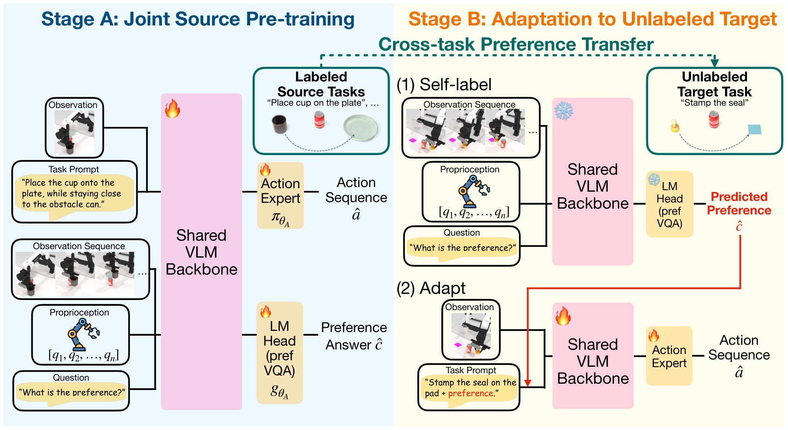
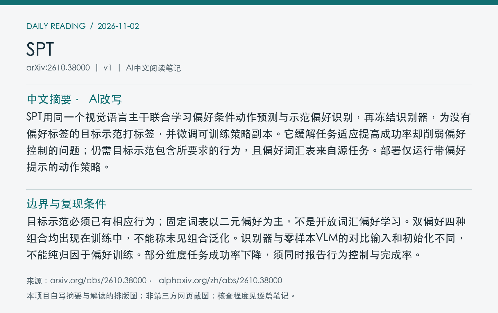
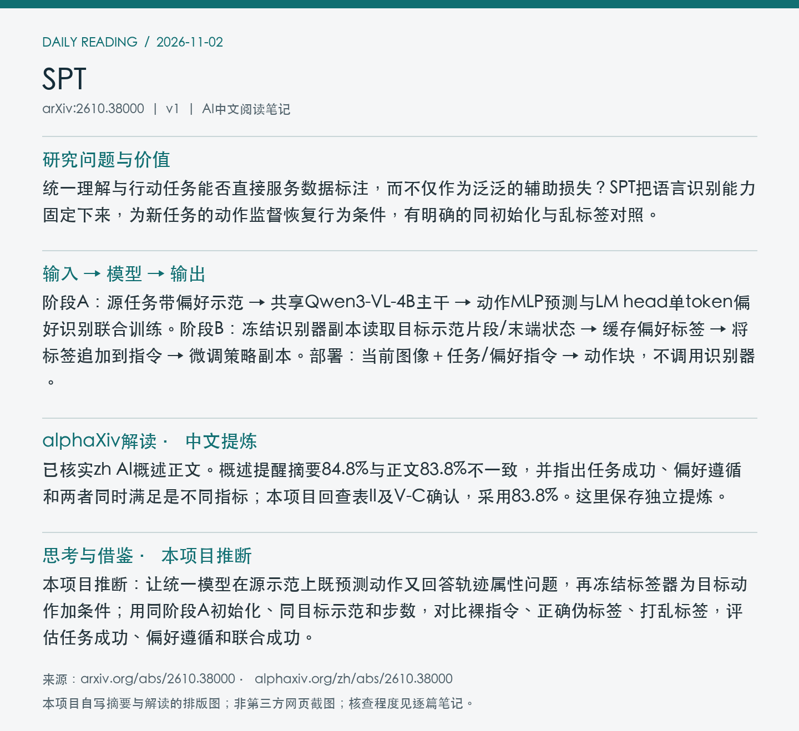

# 2610.38000 · SPT

Self-Labeled Preference Transfer for Steerable Robot Manipulation

[arXiv原文](https://arxiv.org/abs/2610.38000) · [v1 HTML](https://arxiv.org/html/2610.38000v1) · [alphaXiv zh中文概述](https://www.alphaxiv.org/zh/abs/2610.38000)

首次提交：2026-10-28T05:51:38+08:00（Asia/Shanghai），v1；2026-11-02首次收录，为近7天补漏，不是今日新发或新修订。方向：VLA、preference-transfer、self-labeling、multitask-training。

**阅读程度**：选读原文III问题、IV方法及V实验/消融、VI结论局限；核查表II正文与摘要数值差异；已读alphaXiv zh AI概述正文。未核查实现或复现实验。

## 中文摘要 · 本项目AI改写

SPT用同一个视觉语言主干联合学习偏好条件动作预测与示范偏好识别，再冻结识别器，为没有偏好标签的目标示范打标签，并微调可训练策略副本。它缓解任务适应提高成功率却削弱偏好控制的问题；仍需目标示范包含所要求的行为，且偏好词汇表来自源任务。部署仅运行带偏好提示的动作策略。

## 核心问题与方法

统一理解与行动任务能否直接服务数据标注，而不仅作为泛泛的辅助损失？SPT把语言识别能力固定下来，为新任务的动作监督恢复行为条件，有明确的同初始化与乱标签对照。

**输入 → 模型处理 → 输出**：阶段A：源任务带偏好示范 → 共享Qwen3-VL-4B主干 → 动作MLP预测与LM head单token偏好识别联合训练。阶段B：冻结识别器副本读取目标示范片段/末端状态 → 缓存偏好标签 → 将标签追加到指令 → 微调策略副本。部署：当前图像＋任务/偏好指令 → 动作块，不调用识别器。

仿真策略用三视角224×224图像，无本体状态输入，残差MLP以L1损失预测50步14维关节动作。识别器另接三帧头部视图和每帧9维末端状态token。源联合损失中识别权重0.5，训练10000步；目标100条示范适应1500步，batch64；冻结标签器，目标阶段只用动作损失，不持续自改标签。

Figure 2：源阶段共享主干联合学习，目标阶段冻结标签器副本并适应策略副本。图示不能理解为微调时一边更新标签器一边反复重打标签。 [官方原图](https://arxiv.org/html/2610.38000v1/method.png)；本次采用arXiv HTML原图，未下载/核验PDF，PDF页码、裁剪坐标和PDF SHA256为null。图号、版本、抓取时间、原图及归档图SHA256见[元数据](metadata.json)。已目视检查内容对应、边界与清晰度。

## 主要证据与局限

RoboTwin2.0五种二元偏好，每轴一个留出任务。三训练种子，每种子每命令50次，先平均两命令再种子：正文表II偏好遵循59.4→83.8%，任务成功88.0→89.2%；摘要84.8%与正文不一致，本笔记采用正文。UR5e两个任务迁移、每命令10次共40次：偏好21/40→37/40，任务36/40→38/40。

目标示范必须已有相应行为；固定词表以二元偏好为主，不是开放词汇偏好学习。双偏好四种组合均出现在训练中，不能称未见组合泛化。识别器与零样本VLM的对比输入和初始化不同，不能纯归因于偏好训练。部分维度任务成功率下降，须同时报告行为控制与完成率。

### 同初始化和乱标签对照

放置位置/抓取高度两轴，所有目标适应变体从同一阶段A检查点开始，使用同100条目标示范与1500步。裸指令微调的偏好遵循为52/50%，打乱标签为50/55%，SPT为83/90%；对应任务成功，裸指令69/95%，SPT86/95%。这比仅与完整Naive FT流程比较更直接支持标签分配的作用。

表II五轴遵循值为90、81、75、90、83%，均值83.8%。摘要84.8%不采用，未自行推测其原因。目标识别96.4%来自100条/轴示范，和上述策略rollout不是同一评估集或指标。

## alphaXiv zh AI概述 · 中文提炼

已核实zh AI概述正文。概述提醒摘要84.8%与正文83.8%不一致，并指出任务成功、偏好遵循和两者同时满足是不同指标；本项目回查表II及V-C确认，采用83.8%。这里保存独立提炼。

来源：[alphaXiv中文版](https://www.alphaxiv.org/zh/abs/2610.38000)，实际读取时间2026-11-02T09:43:40+08:00。已读取“AI 概述”之后的中文正文，非仅访问语言入口；未整篇转载，关键结论和数字已回查原文。

## 研究联系与下一步 · 本项目推断

本项目推断：让统一模型在源示范上既预测动作又回答轨迹属性问题，再冻结标签器为目标动作加条件；用同阶段A初始化、同目标示范和步数，对比裸指令、正确伪标签、打乱标签，评估任务成功、偏好遵循和联合成功。

## 代码、权重与数据状态

原文可访问；本次原文与定向检索未取得作者官方代码、权重、标注示范发布入口。所用StarVLA/Qwen基础组件的公开性不代表SPT训练产物已发布；训练总费用未核实。

## 自写摘要与阅读卡片

以下为本项目自写内容排版，非alphaXiv截图。

[论文目录](../README.md) · [当日日报](../../reports/2026/11/02.md)
