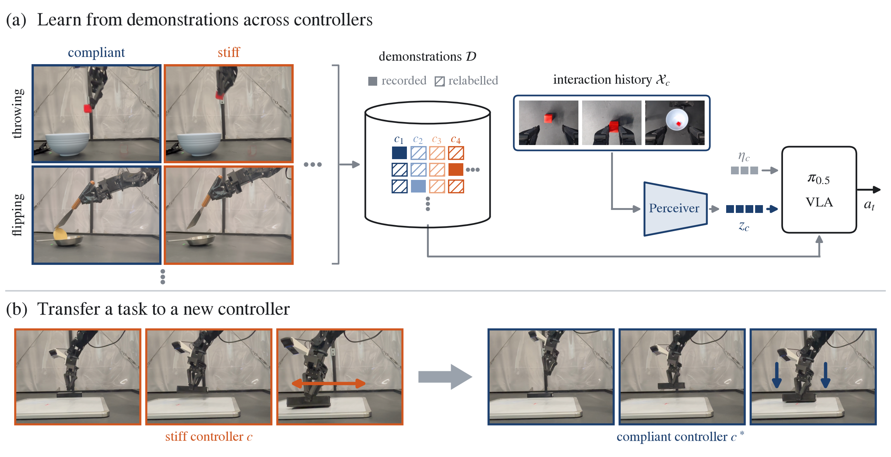
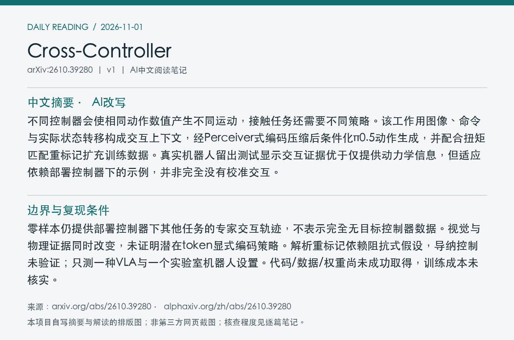
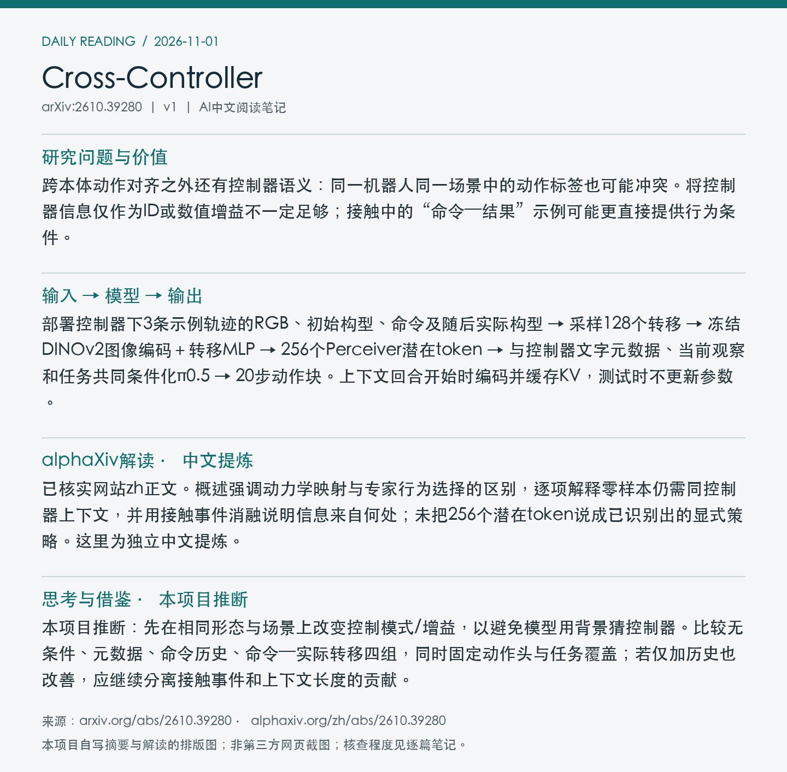

# 2610.39280 · Cross-Controller

Cross-Controller Transfer via In-Context Behavior Adaptation

[arXiv原文](https://arxiv.org/abs/2610.39280) · [v1 HTML](https://arxiv.org/html/2610.39280v1) · [alphaXiv zh中文概述](https://www.alphaxiv.org/zh/abs/2610.39280) · [作者项目页](https://controller-transfer.github.io) · [作者列出的仓库（本次404）](https://github.com/JonathanYang0127/icl_cross_controller)

首次提交：2026-10-29T11:31:22+08:00（北京时间），v1；本次为近7天补漏、2026-11-01首次归档，不是今日新发或新版。方向：VLA、in-context-adaptation、controller-transfer、contact。

**阅读程度**：选读原文HTML第III至VI节问题、方法与实验证据及结论局限；已读alphaXiv zh AI概述和作者项目页。项目代码链接返回404，未核查实现或运行实验。

## 中文摘要 · 本项目AI改写

不同控制器会使相同动作数值产生不同运动，接触任务还需要不同策略。该工作用图像、命令与实际状态转移构成交互上下文，经Perceiver式编码压缩后条件化π0.5动作生成，并配合扭矩匹配重标记扩充训练数据。真实机器人留出测试显示交互证据优于仅提供动力学信息，但适应依赖部署控制器下的示例，并非完全没有校准交互。

## 问题与方法

跨本体动作对齐之外还有控制器语义：同一机器人同一场景中的动作标签也可能冲突。将控制器信息仅作为ID或数值增益不一定足够；接触中的“命令—结果”示例可能更直接提供行为条件。

**输入 → 模型处理 → 输出**：部署控制器下3条示例轨迹的RGB、初始构型、命令及随后实际构型 → 采样128个转移 → 冻结DINOv2图像编码＋转移MLP → 256个Perceiver潜在token → 与控制器文字元数据、当前观察和任务共同条件化π0.5 → 20步动作块。上下文回合开始时编码并缓存KV，测试时不更新参数。

编码器以固定查询跨注意力汇聚视觉和交互token，再用6层潜在自注意力。训练用同任务/同控制器的独立上下文轨迹，禁止把目标轨迹本身输入；编码器与策略联合flow matching训练。解析重标记保留瞬时扭矩，可覆盖动作接口，却不会创造专家在另一控制器下的新接触策略。跨任务上下文复用是评测出来的泛化能力，非显式跨任务监督。

Figure 1：跨控制器示范、交互历史压缩及策略迁移。上半图的Perceiver上下文与控制器元数据共同条件化VLA，下半图展示控制器改变时的行为调整。 来源：[arXiv v1官方原图](https://arxiv.org/html/2610.39280v1/paper_figures/teaser_v2.png)。本次直接保存HTML提供的原图，未裁剪PDF，PDF页码、坐标和PDF SHA256未核验（null）；原图SHA256、版本与抓取时间见[metadata.json](metadata.json)。已目视核对图号、边界和可读性。

## 实验证据与边界

WidowX、π0.5、H=20；4源任务×6控制器×4增益×30示范，共2,880轨迹。留出任务—控制器单元的零样本评测每单元20次：行为上下文50.0%，SysID27.0%，仅控制器真值元数据12.0%。另一个留出控制器模式实验每模式汇总60次：50.3%对朴素混合17.5%。四组未见增益每组50次：52.0%对混合28.5%。这些设置不能合并成一个成功率。

零样本仍提供部署控制器下其他任务的专家交互轨迹，不表示完全无目标控制器数据。视觉与物理证据同时改变，未证明潜在token显式编码策略。解析重标记依赖阻抗式假设，导纳控制未验证；只测一种VLA与一个实验室机器人设置。代码/数据/权重尚未成功取得，训练成本未核实。

### 将两类泛化证据分开

留出任务—控制器组合时，目标任务在其他控制器下有数据；部署控制器提供其他任务的上下文。少样本版本额外增加5条目标组合示范。不要将这些结果与整类控制器都未参与训练的模式留出混合。

原文VI-C的条件消融中，仅重标记为15%，加上下文47%，全部条件50%；相应的上下文内容消融中，接触事件预言机50%，足够长的完整轨迹49%，自由空间或仅本体状态约30%。这些值支持交互内容有用，不证明token中存在一个可解释的策略变量。工具批头插入的上下文迁移到同一柔顺控制器下的USB插入达到35%，是20次试验的小规模证据。

## alphaXiv zh AI概述 · 中文提炼

已核实网站zh正文。概述强调动力学映射与专家行为选择的区别，逐项解释零样本仍需同控制器上下文，并用接触事件消融说明信息来自何处；未把256个潜在token说成已识别出的显式策略。这里为独立中文提炼。

来源：[网站中文版](https://www.alphaxiv.org/zh/abs/2610.39280)；于2026-11-01北京时间07:07读取“AI 概述”后中文正文。此段是本项目提炼，其他方法与数值已回查论文；未将摘要翻译或入口语言当作中文概述验证，也未整篇转载。

## 思考与借鉴 · 本项目推断

本项目推断：先在相同形态与场景上改变控制模式/增益，以避免模型用背景猜控制器。比较无条件、元数据、命令历史、命令—实际转移四组，同时固定动作头与任务覆盖；若仅加历史也改善，应继续分离接触事件和上下文长度的贡献。

## 代码、权重与数据状态

作者项目页可访问并链接JonathanYang0127/icl_cross_controller；该仓库README通过GitHub连接器查询返回404，本次不能确认代码、数据或权重已可用，不将社区“code released”标签当作发布证据。

## 自写阅读卡片

以下是本项目摘要/解读的排版图，不是alphaXiv网页截图。

[返回论文目录](../README.md) · [当日日报](../../reports/2026/11/01.md)
