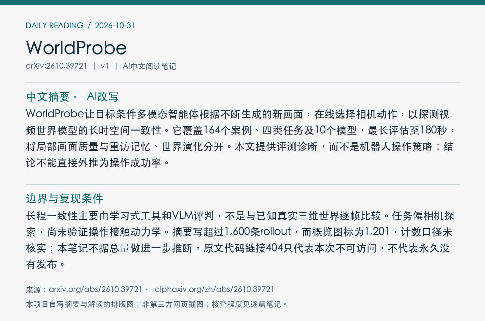
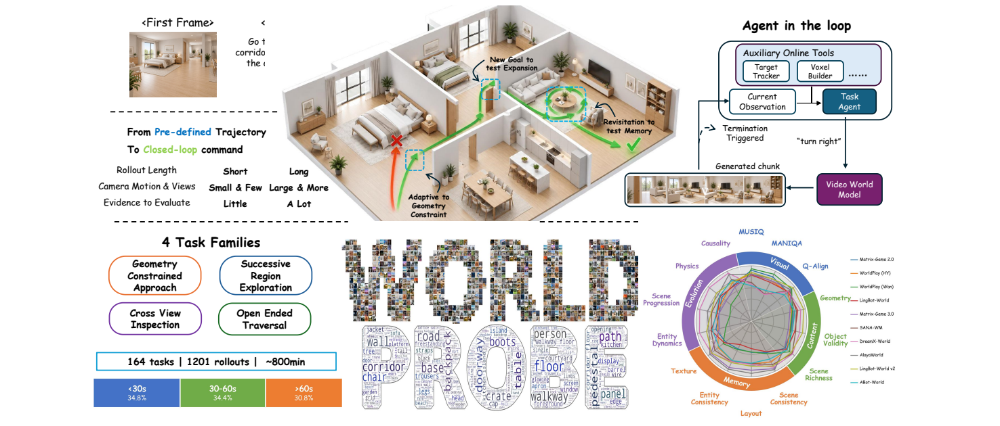
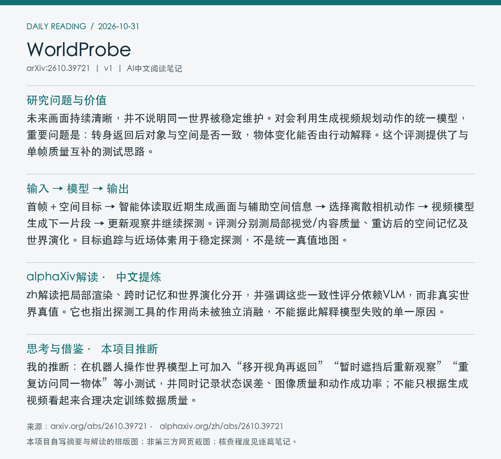

# 2610.39721 · WorldProbe

**论文全名：** WorldProbe: When Video World Models Fall Apart under Long-Horizon Spatial Exploration

[原文](https://arxiv.org/abs/2610.39721) · [HTML](https://arxiv.org/html/2610.39721v1) · [alphaXiv zh中文版](https://www.alphaxiv.org/zh/abs/2610.39721) · [当日日报](../../reports/2026/10/31.md)

**更新：**北京时间2026-10-29首发，v1；2026-10-31在7天重叠窗口补漏，首次入库，不是今天首发。**方向：** world-model, evaluation, long-horizon, spatial-consistency。

**阅读程度：** 选读原文第3节探测与指标、第4节结果和附录实现范围；已读alphaXiv zh AI概述；原文所给GitHub地址本次返回404，未核查实现。

## 中文摘要（本项目AI总结）

WorldProbe让目标条件多模态智能体根据不断生成的新画面，在线选择相机动作，以探测视频世界模型的长时空间一致性。它覆盖164个案例、四类任务及10个模型，最长评估至180秒，将局部画面质量与重访记忆、世界演化分开。本文提供评测诊断，而不是机器人操作策略；结论不能直接外推为操作成功率。

## 核心问题与阅读价值

未来画面持续清晰，并不说明同一世界被稳定维护。对会利用生成视频规划动作的统一模型，重要问题是：转身返回后对象与空间是否一致，物体变化能否由行动解释。这个评测提供了与单帧质量互补的测试思路。

## 输入 → 模型 → 输出

首帧＋空间目标 → 智能体读取近期生成画面与辅助空间信息 → 选择离散相机动作 → 视频模型生成下一片段 → 更新观察并继续探测。评测分别测局部视觉/内容质量、重访后的空间记忆及世界演化。目标追踪与近场体素用于稳定探测，不是统一真值地图。

## 关键设计与训练机制

四类任务包括几何约束接近、开放式行进、跨视角观察和连续区域探索。SAM3.1提供目标追踪，Depth-Anything 3支持近场几何检查。局部图像评分、单帧VLM内容评分与跨时刻记忆/演化评分使用不同证据，因此应分开解释。

*Figure 1：智能体根据生成画面闭环选择相机动作，同时诊断局部与长时一致性。 [来源](https://arxiv.org/pdf/2610.39721v1#page=2)。原文PDF第2页；局部截图。*

## 实验证据与比较条件

作者观察到较新模型能够维持局部图像质量更久，但重访与演化仍出现对象身份、布局和因果关系不一致。局部评价不能验证长期世界一致性。论文没有固定轨迹/评分协议下分别移除自适应控制、追踪和防碰撞的完整消融，不能将结果归因于某个单独机制。

| 指标/设置 | 结果 | 条件与边界 |
| --- | --- | --- |
| 评测范围 | 164案例，4类任务，10模型 | 最长180秒；属于空间探索评测 |
| 轨迹汇总口径 | 摘要>1,600；图1为1,201 | 尚未解释差异，不以总量支持额外结论 |

## 局限与开放状态

长程一致性主要由学习式工具和VLM评判，不是与已知真实三维世界逐帧比较。任务偏相机探索，尚未验证操作接触动力学。摘要写超过1,600条rollout，而概览图标为1,201，计数口径未核实；本笔记不据总量做进一步推断。原文代码链接404只代表本次不可访问，不代表永久没有发布。

**代码/权重/数据：** 原文称代码及基准可用，但 https://github.com/Untitled-W/WorldProbe 本次返回404；代码、基准实际下载和权重状态未核实。

## 对统一多模态动作预测的借鉴

我的推断：在机器人操作世界模型上可加入“移开视角再返回”“暂时遮挡后重新观察”“重复访问同一物体”等小测试，并同时记录状态误差、图像质量和动作成功率；不能只根据生成视频看起来合理决定训练数据质量。

## alphaXiv zh解读（中文提炼）

zh解读把局部渲染、跨时记忆和世界演化分开，并强调这些一致性评分依赖VLM，而非真实世界真值。它也指出探测工具的作用尚未被独立消融，不能据此解释模型失败的单一原因。

来源为已读取的[zh中文版AI概述](https://www.alphaxiv.org/zh/abs/2610.39721)；此处为独立提炼，不是网站原文全文。作者已验证结论与上文个人推断分开，重要机制和数值已回查原文所列章节。

## 来源记录

[arXiv 2610.39721v1](https://arxiv.org/abs/2610.39721v1)；图像来源、实际读取程度、时间及可获得的校验值见[metadata.json](metadata.json)。摘要/阅读卡片为本项目排版图，不是第三方页面截图；原文图像权利归原作者。
