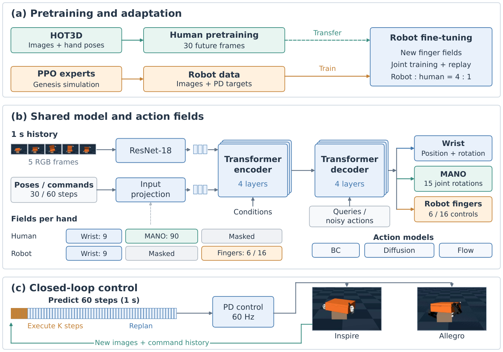
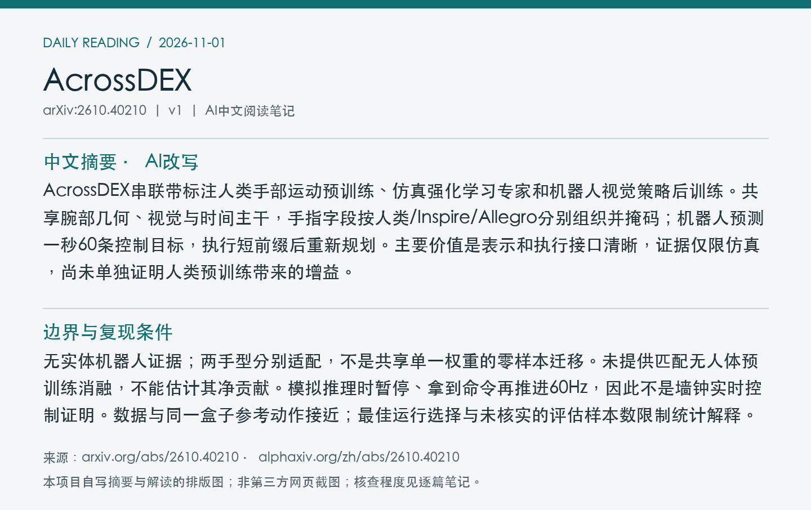
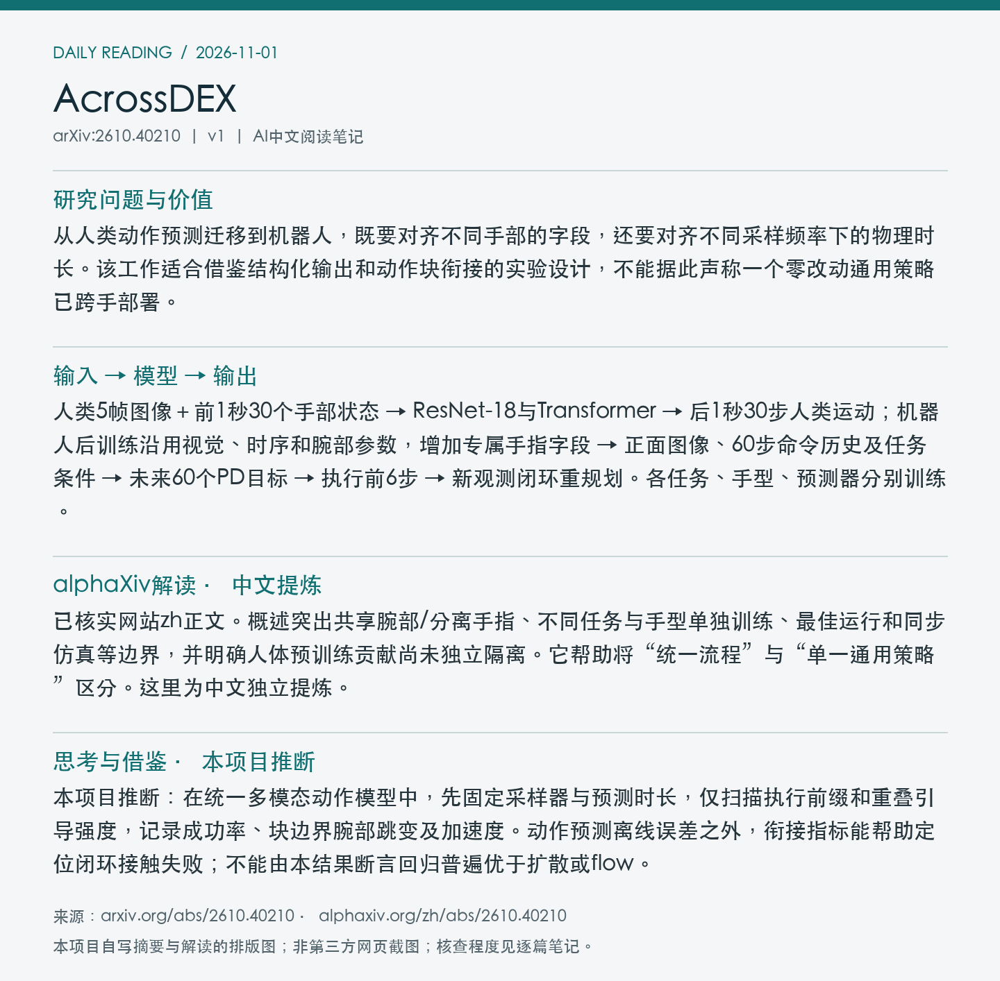

# 2610.40210 · AcrossDEX

AcrossDEX 1.0: From Human Motion Pretraining to Bimanual Dexterous Manipulation across Hand Embodiments

[arXiv原文](https://arxiv.org/abs/2610.40210) · [v1 HTML](https://arxiv.org/html/2610.40210v1) · [alphaXiv zh中文概述](https://www.alphaxiv.org/zh/abs/2610.40210)

首次提交：2026-10-29T22:56:30+08:00（北京时间），v1；本次为近7天补漏、2026-11-01首次归档，不是今日新发或新版。方向：human-motion、dexterous-manipulation、action-chunking、cross-embodiment。

**阅读程度**：选读原文HTML第II节表示、训练及执行，第III节数据与评测协议、第IV节结果；已读alphaXiv zh AI概述。未核查实现或复现实验，未取得作者代码/权重/数据发布入口。

## 中文摘要 · 本项目AI改写

AcrossDEX串联带标注人类手部运动预训练、仿真强化学习专家和机器人视觉策略后训练。共享腕部几何、视觉与时间主干，手指字段按人类/Inspire/Allegro分别组织并掩码；机器人预测一秒60条控制目标，执行短前缀后重新规划。主要价值是表示和执行接口清晰，证据仅限仿真，尚未单独证明人类预训练带来的增益。

## 问题与方法

从人类动作预测迁移到机器人，既要对齐不同手部的字段，还要对齐不同采样频率下的物理时长。该工作适合借鉴结构化输出和动作块衔接的实验设计，不能据此声称一个零改动通用策略已跨手部署。

**输入 → 模型处理 → 输出**：人类5帧图像＋前1秒30个手部状态 → ResNet-18与Transformer → 后1秒30步人类运动；机器人后训练沿用视觉、时序和腕部参数，增加专属手指字段 → 正面图像、60步命令历史及任务条件 → 未来60个PD目标 → 执行前6步 → 新观测闭环重规划。各任务、手型、预测器分别训练。

腕部位姿在固定相机坐标系表示，未来相对当前锚点；人类MANO与机器人手指字段分开，用有效性掩码选择。示范标签为专家最终发给控制器的裁剪后目标，不是原始参考动作。机器人联合训练按4:1混入人类批次。比较直接回归BC、DDPM-v扩散与flow matching；生成式策略用软前缀RTC约束新旧动作块重叠区。

Figure 1：人体预训练与仿真专家如何汇入机器人后训练；共享腕部、分离手指字段，以及60步预测/短前缀执行。图中两手型示例均为仿真。 来源：[arXiv v1官方原图](https://arxiv.org/html/2610.40210v1/architecture.png)。本次直接保存HTML提供的原图，未裁剪PDF，PDF页码、坐标和PDF SHA256未核验（null）；原图SHA256、版本与抓取时间见[metadata.json](metadata.json)。已目视核对图号、边界和可读性。

## 实验证据与边界

Genesis物理仿真，同一盒子资产局部扰动。Inspire开盖并复位BC/Flow/Diffusion成功率40.6/18.8/9.4%；Inspire重定向100.0/79.3/70.0%；Allegro重定向93.3/90.0/80.0%。每配置取完整评估批次中的最佳模型/运行，非跨种子均值。配对固定模型/场景的Inspire重定向中，RTC将Flow51.7→79.3%，Diffusion41.4→62.1%；这是另一配对组，不替换主结果。

无实体机器人证据；两手型分别适配，不是共享单一权重的零样本迁移。未提供匹配无人体预训练消融，不能估计其净贡献。模拟推理时暂停、拿到命令再推进60Hz，因此不是墙钟实时控制证明。数据与同一盒子参考动作接近；最佳运行选择与未核实的评估样本数限制统计解释。

### 复现实验时需要保留的条件

开盖成功条件同时要求完整200步、峰值开盖至少90°、最后角度不超过25°、盒子始终高于0.9米。重定向为40步，末端旋转误差不超过10°、盒盖角度始终不超过5°，并满足同样高度条件。不能将局部动作完成计作整任务成功。

人类数据优化使用99段HOT3D记录、195,300帧（约108.5分钟，30Hz）；并非互联网无标注视频训练。机器人开盖/两类重定向分别使用1,413/239/233条优化轨迹。每配置均独立后训练。当前实验比较的是整合后的系统，人体运动先验、专家数据与联合回放的贡献没有分别识别。

## alphaXiv zh AI概述 · 中文提炼

已核实网站zh正文。概述突出共享腕部/分离手指、不同任务与手型单独训练、最佳运行和同步仿真等边界，并明确人体预训练贡献尚未独立隔离。它帮助将“统一流程”与“单一通用策略”区分。这里为中文独立提炼。

来源：[网站中文版](https://www.alphaxiv.org/zh/abs/2610.40210)；于2026-11-01北京时间07:07读取“AI 概述”后中文正文。此段是本项目提炼，其他方法与数值已回查论文；未将摘要翻译或入口语言当作中文概述验证，也未整篇转载。

## 思考与借鉴 · 本项目推断

本项目推断：在统一多模态动作模型中，先固定采样器与预测时长，仅扫描执行前缀和重叠引导强度，记录成功率、块边界腕部跳变及加速度。动作预测离线误差之外，衔接指标能帮助定位闭环接触失败；不能由本结果断言回归普遍优于扩散或flow。

## 代码、权重与数据状态

原文可访问；未取得作者官方代码、权重或整理数据的可核实发布链接。HOT3D、DexMachina等先前资源不等于AcrossDEX本身已开源。未披露/未核实的总参数量和训练总费用不估算。

## 自写阅读卡片

以下是本项目摘要/解读的排版图，不是alphaXiv网页截图。

[返回论文目录](../README.md) · [当日日报](../../reports/2026/11/01.md)
