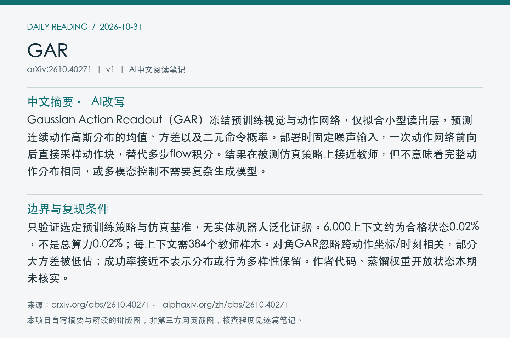
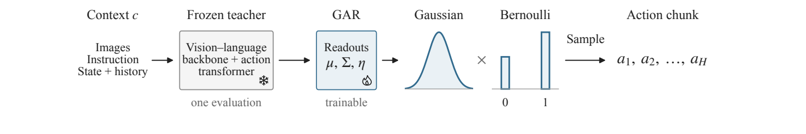
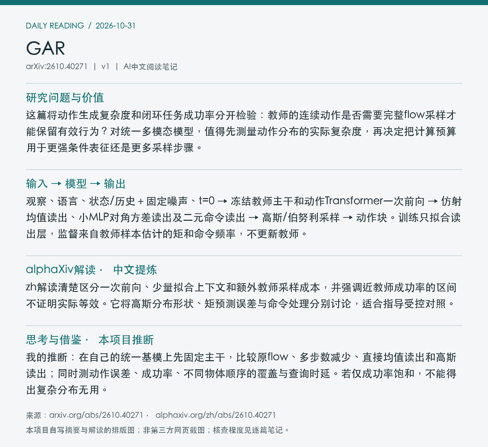

# 2610.40271 · GAR

**论文全名：** Gaussian Distillation of Flow Policies

[原文](https://arxiv.org/abs/2610.40271) · [HTML](https://arxiv.org/html/2610.40271v1) · [alphaXiv zh中文版](https://www.alphaxiv.org/zh/abs/2610.40271) · [当日日报](../../reports/2026/10/31.md)

**更新：**北京时间2026-10-29首发，v1；2026-10-31在7天重叠窗口补漏，首次入库，不是今天首发。**方向：** flow-matching, policy-distillation, gaussian-readout, inference-efficiency。

**阅读程度：** 选读原文第3至5节方法与主要实验、附录F延迟/区间及H局限；已读alphaXiv zh AI概述；未核查作者实现或复现实验。

## 中文摘要（本项目AI总结）

Gaussian Action Readout（GAR）冻结预训练视觉与动作网络，仅拟合小型读出层，预测连续动作高斯分布的均值、方差以及二元命令概率。部署时固定噪声输入，一次动作网络前向后直接采样动作块，替代多步flow积分。结果在被测仿真策略上接近教师，但不意味着完整动作分布相同，或多模态控制不需要复杂生成模型。

## 核心问题与阅读价值

这篇将动作生成复杂度和闭环任务成功率分开检验：教师的连续动作是否需要完整flow采样才能保留有效行为？对统一多模态模型，值得先测量动作分布的实际复杂度，再决定把计算预算用于更强条件表征还是更多采样步骤。

## 输入 → 模型 → 输出

观察、语言、状态/历史＋固定噪声、t=0 → 冻结教师主干和动作Transformer一次前向 → 仿射均值读出、小MLP对角方差读出及二元命令读出 → 高斯/伯努利采样 → 动作块。训练只拟合读出层，监督来自教师样本估计的矩和命令频率，不更新教师。

## 关键设计与训练机制

在理想流场中，噪声端点速度与均值有关，但不能直接给方差；GAR从该处的内部特征学习方差。有限Euler步教师采样与理想场恒等式不同，因此仍需拟合部署教师的样本统计。对角协方差、独立二元命令是假设；闭式似然成立于该近似模型，不是教师完整联合似然。

*Figure 3：冻结教师一次前向，训练小读出层，直接采样连续动作与二元命令。 [来源](https://arxiv.org/pdf/2610.40271v1#page=4)。原文PDF第4页；局部截图。*

## 实验证据与比较条件

RoboCasa365的50任务、每任务50次共2,500非配对episode：Xiaomi教师58.24%，6,000上下文对角GAR57.64%；GR00T教师23.08%，GAR21.92%。Xiaomi差值-0.60个百分点，95%区间[-2.84,1.60]，不建立等效。RTX4090/Threadripper主机batch=1且含视觉语言处理，Xiaomi调用220.25→115.36ms，1.91倍；其他系统加速不同。

| 指标/设置 | 结果 | 条件与边界 |
| --- | --- | --- |
| RoboCasa365，Xiaomi成功率↑ | 教师58.24%；GAR57.64% | 50任务×50次；差值区间[-2.84,1.60]pp |
| 同基准，GR00T成功率↑ | 教师23.08%；GAR21.92% | 低成功组别接近不代表强泛化 |
| RTX4090，Xiaomi完整调用↓ | 220.25 → 115.36ms（1.91×） | batch=1，含VLM；Threadripper PRO5955WX主机 |
| 读出拟合数据 | 6,000上下文，约0.02%合格状态 | 每上下文384教师样本；不是总计算0.02% |

## 局限与开放状态

只验证选定预训练策略与仿真基准，无实体机器人泛化证据。6,000上下文约为合格状态0.02%，不是总算力0.02%；每上下文需384个教师样本。对角GAR忽略跨动作坐标/时刻相关，部分大方差被低估；成功率接近不表示分布或行为多样性保留。作者代码、蒸馏权重开放状态本期未核实。

**代码/权重/数据：** 原文及附录可访问；作者发布代码、GAR权重和拟合上下文下载入口未核实。依赖教师模型的访问条件与许可，未下载或训练。

## 对统一多模态动作预测的借鉴

我的推断：在自己的统一基模上先固定主干，比较原flow、多步数减少、直接均值读出和高斯读出；同时测动作误差、成功率、不同物体顺序的覆盖与查询时延。若仅成功率饱和，不能得出复杂分布无用。

## alphaXiv zh解读（中文提炼）

zh解读清楚区分一次前向、少量拟合上下文和额外教师采样成本，并强调近教师成功率的区间不证明实际等效。它将高斯分布形状、矩预测误差与命令处理分别讨论，适合指导受控对照。

来源为已读取的[zh中文版AI概述](https://www.alphaxiv.org/zh/abs/2610.40271)；此处为独立提炼，不是网站原文全文。作者已验证结论与上文个人推断分开，重要机制和数值已回查原文所列章节。

## 来源记录

[arXiv 2610.40271v1](https://arxiv.org/abs/2610.40271v1)；图像来源、实际读取程度、时间及可获得的校验值见[metadata.json](metadata.json)。摘要/阅读卡片为本项目排版图，不是第三方页面截图；原文图像权利归原作者。
