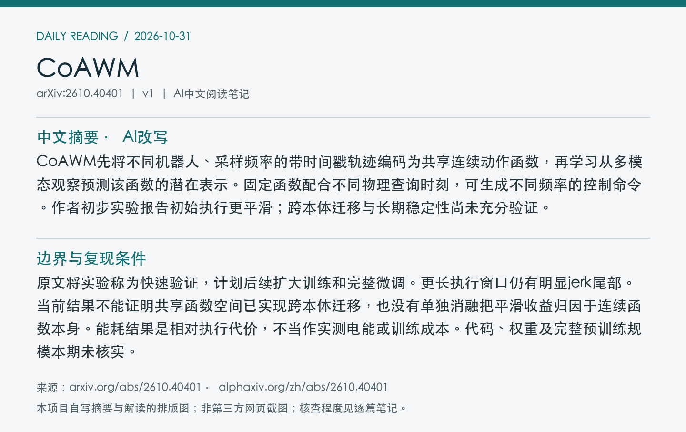
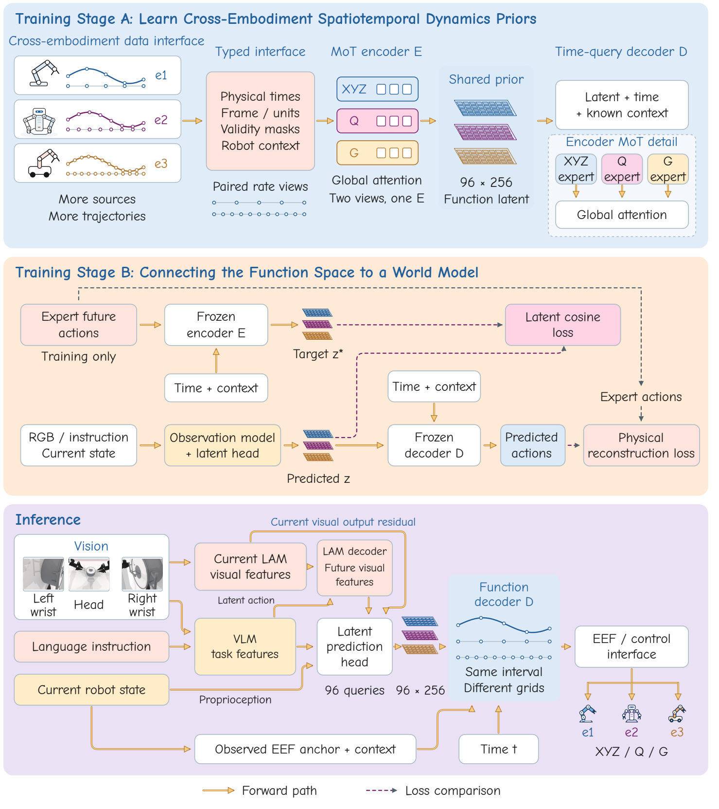
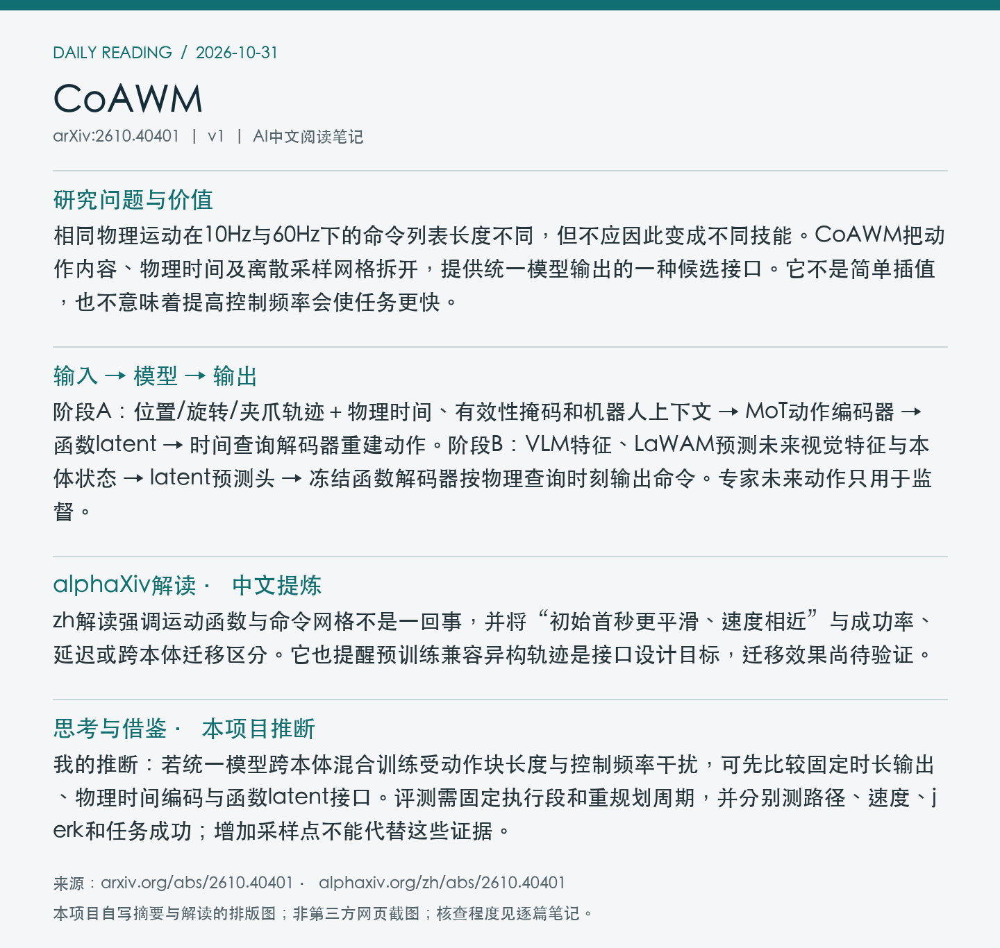

# 2610.40401 · CoAWM

**论文全名：** Continuous-Action World Models: Learning Cross-Embodiment Spatiotemporal Dynamics Priors

[原文](https://arxiv.org/abs/2610.40401) · [HTML](https://arxiv.org/html/2610.40401v1) · [alphaXiv zh中文版](https://www.alphaxiv.org/zh/abs/2610.40401) · [当日日报](../../reports/2026/10/31.md)

**更新：**北京时间2026-10-30首发，v1；2026-10-31在7天重叠窗口补漏，首次入库，不是今天首发。**方向：** WAM, continuous-time-actions, cross-frequency, latent-function。

**阅读程度：** 选读原文第3节函数空间与LaWAM连接、第4节初步实验及第5节讨论；已读alphaXiv zh AI概述；未核查作者代码或复现实验。

## 中文摘要（本项目AI总结）

CoAWM先将不同机器人、采样频率的带时间戳轨迹编码为共享连续动作函数，再学习从多模态观察预测该函数的潜在表示。固定函数配合不同物理查询时刻，可生成不同频率的控制命令。作者初步实验报告初始执行更平滑；跨本体迁移与长期稳定性尚未充分验证。

## 核心问题与阅读价值

相同物理运动在10Hz与60Hz下的命令列表长度不同，但不应因此变成不同技能。CoAWM把动作内容、物理时间及离散采样网格拆开，提供统一模型输出的一种候选接口。它不是简单插值，也不意味着提高控制频率会使任务更快。

## 输入 → 模型 → 输出

阶段A：位置/旋转/夹爪轨迹＋物理时间、有效性掩码和机器人上下文 → MoT动作编码器 → 函数latent → 时间查询解码器重建动作。阶段B：VLM特征、LaWAM预测未来视觉特征与本体状态 → latent预测头 → 冻结函数解码器按物理查询时刻输出命令。专家未来动作只用于监督。

## 关键设计与训练机制

阶段A结合原生时间与额外查询网格重建，以及同一运动不同采样视图的latent一致性。阶段B冻结函数编码/解码器与保留的世界预测分支，训练latent预测及适配；当前视觉特征以残差加入。固定1.2秒执行段改变查询点密度只改变频率，若改变物理区间本身才可能改变运动时序。

*Figure 1：动作函数预训练、连接世界模型，以及按时间查询执行的三个阶段。 [来源](https://arxiv.org/pdf/2610.40401v1#page=2)。原文PDF第2页；局部截图。*

## 实验证据与比较条件

16任务800对匹配初始条件的首秒执行，对比LaWAM：位置jerk RMS150.87→95.46，旋转746.06→341.73，分别下降36.7%与54.2%；平移速度RMS0.338与0.332相近。同评估任务成功率75.1%。跨频率测试每频率150次、50任务每任务3次，属于初步证据。

| 指标/设置 | 结果 | 条件与边界 |
| --- | --- | --- |
| 首秒位置jerk RMS↓ | LaWAM150.87 → CoAWM95.46 | 16任务，800对初始条件；下降36.7% |
| 首秒旋转jerk RMS↓ | 746.06 → 341.73 | 同条件；下降54.2% |
| 平移速度RMS | 0.338 / 0.332 | 速度相近；不等于任务更快 |
| 跨频率初测 | 10/15/20/30/50/60Hz | 固定1.2秒段；每频率50任务×3次 |

## 局限与开放状态

原文将实验称为快速验证，计划后续扩大训练和完整微调。更长执行窗口仍有明显jerk尾部。当前结果不能证明共享函数空间已实现跨本体迁移，也没有单独消融把平滑收益归因于连续函数本身。能耗结果是相对执行代价，不当作实测电能或训练成本。代码、权重及完整预训练规模本期未核实。

**代码/权重/数据：** 原文v1可访问；作者代码、权重、全量训练数据与规模未核实。当前结果为初步验证，不按标题推断已实现大规模跨本体泛化。

## 对统一多模态动作预测的借鉴

我的推断：若统一模型跨本体混合训练受动作块长度与控制频率干扰，可先比较固定时长输出、物理时间编码与函数latent接口。评测需固定执行段和重规划周期，并分别测路径、速度、jerk和任务成功；增加采样点不能代替这些证据。

## alphaXiv zh解读（中文提炼）

zh解读强调运动函数与命令网格不是一回事，并将“初始首秒更平滑、速度相近”与成功率、延迟或跨本体迁移区分。它也提醒预训练兼容异构轨迹是接口设计目标，迁移效果尚待验证。

来源为已读取的[zh中文版AI概述](https://www.alphaxiv.org/zh/abs/2610.40401)；此处为独立提炼，不是网站原文全文。作者已验证结论与上文个人推断分开，重要机制和数值已回查原文所列章节。

## 来源记录

[arXiv 2610.40401v1](https://arxiv.org/abs/2610.40401v1)；图像来源、实际读取程度、时间及可获得的校验值见[metadata.json](metadata.json)。摘要/阅读卡片为本项目排版图，不是第三方页面截图；原文图像权利归原作者。
