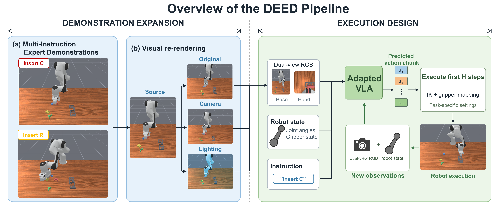
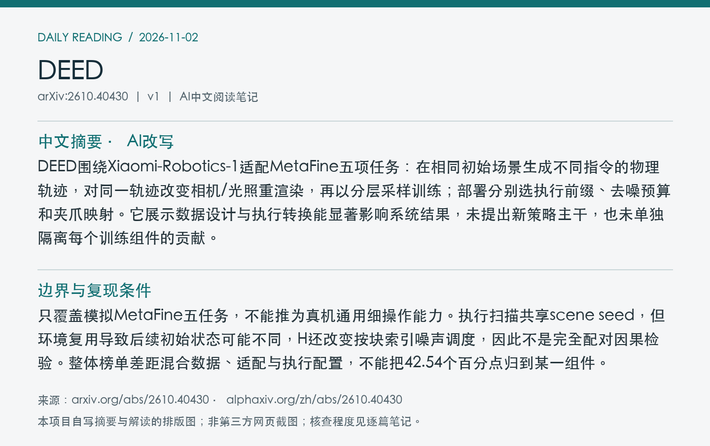
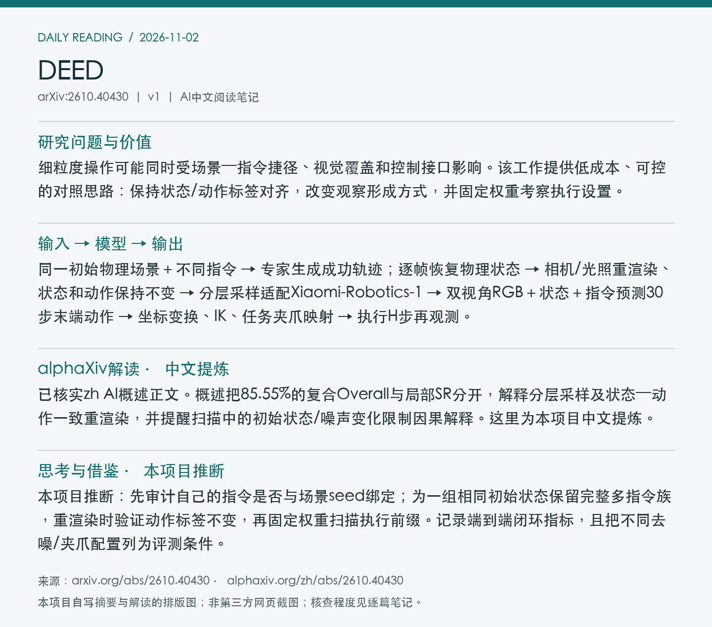

# 2610.40430 · DEED

Improving Fine-Grained Manipulation through Demonstration Expansion and Execution Design

[arXiv原文](https://arxiv.org/abs/2610.40430) · [v1 HTML](https://arxiv.org/html/2610.40430v1) · [alphaXiv zh中文概述](https://www.alphaxiv.org/zh/abs/2610.40430) · [MetaFine基准仓库](https://github.com/Hiangx-robotics/MetaFine-Challenge_CoRL) · [原文所列官方数据](https://huggingface.co/datasets/hiangx/MetaFine_CoRL26)

首次提交：2026-10-30T00:51:45+08:00（Asia/Shanghai），v1；2026-11-02首次收录，为近7天补漏，不是今日新发或新修订。方向：data-augmentation、instruction-grounding、VLA、execution-design。

**阅读程度**：选读原文1至3节问题、数据/执行方法和全部主要实验；已读alphaXiv zh AI概述正文。未核查作者实现或独立复现，官方榜单值按论文报告注明。

## 中文摘要 · 本项目AI改写

DEED围绕Xiaomi-Robotics-1适配MetaFine五项任务：在相同初始场景生成不同指令的物理轨迹，对同一轨迹改变相机/光照重渲染，再以分层采样训练；部署分别选执行前缀、去噪预算和夹爪映射。它展示数据设计与执行转换能显著影响系统结果，未提出新策略主干，也未单独隔离每个训练组件的贡献。

## 核心问题与方法

细粒度操作可能同时受场景—指令捷径、视觉覆盖和控制接口影响。该工作提供低成本、可控的对照思路：保持状态/动作标签对齐，改变观察形成方式，并固定权重考察执行设置。

**输入 → 模型处理 → 输出**：同一初始物理场景＋不同指令 → 专家生成成功轨迹；逐帧恢复物理状态 → 相机/光照重渲染、状态和动作保持不变 → 分层采样适配Xiaomi-Robotics-1 → 双视角RGB＋状态＋指令预测30步末端动作 → 坐标变换、IK、任务夹爪映射 → 执行H步再观测。

先抽增强类别、指令、基础轨迹，再抽渲染副本和窗口，防止副本多的轨迹被过度加权。指令族仅在全部变体成功时保留，可能排除困难初始场景。T5有2800条不同成功轨迹与7840份记录，其中2000条新动作来自500个四指令场景；记录数不能当作独立物理轨迹数。H、去噪步数与夹爪阈值按任务选择，T3保留连续夹爪值。

Figure 1：指令配对、同轨迹视觉重渲染、适配模型，以及任务相关的IK/夹爪映射和闭环执行。 [官方原图](https://arxiv.org/html/2610.40430v1/pipeline_graph.png)；本次采用arXiv HTML原图，未下载/核验PDF，PDF页码、裁剪坐标和PDF SHA256为null。图号、版本、抓取时间、原图及归档图SHA256见[元数据](metadata.json)。已目视检查内容对应、边界与清晰度。

## 主要证据与局限

原文报告MetaFine官方Overall85.55%，已发布π0基线43.01%；该指标先平均每任务的感知AUSC/理解/行为，再跨五任务平均，不是统一episode成功率，也不是匹配训练消融。固定策略T1：H=10/25/5的池化SR90.19/80.93/81.30%，每H60场景540回合；更短前缀并不总更好。

只覆盖模拟MetaFine五任务，不能推为真机通用细操作能力。执行扫描共享scene seed，但环境复用导致后续初始状态可能不同，H还改变按块索引噪声调度，因此不是完全配对因果检验。整体榜单差距混合数据、适配与执行配置，不能把42.54个百分点归到某一组件。

### 指令干预与执行设置

T5八个经专家筛选的场景，保持初始物理状态和图像对一致，正确指令成功21/32，循环替换字母后0/32。它支持这些场景中策略依赖指令，但未隔离指令配对训练的净贡献。

T1扫描每场景两个clean指令回合和七个感知回合等权池化；T3每配置40场景360回合，D=3和5池化SR同为98.06%，D=10为96.67%。两者并不建立“更多去噪总更差”的普遍规律。局部扫描与官方Overall的指标和评估条件不同。

## alphaXiv zh AI概述 · 中文提炼

已核实zh AI概述正文。概述把85.55%的复合Overall与局部SR分开，解释分层采样及状态—动作一致重渲染，并提醒扫描中的初始状态/噪声变化限制因果解释。这里为本项目中文提炼。

来源：[alphaXiv中文版](https://www.alphaxiv.org/zh/abs/2610.40430)，实际读取时间2026-11-02T09:43:45+08:00。已读取“AI 概述”之后的中文正文，非仅访问语言入口；未整篇转载，关键结论和数字已回查原文。

## 研究联系与下一步 · 本项目推断

本项目推断：先审计自己的指令是否与场景seed绑定；为一组相同初始状态保留完整多指令族，重渲染时验证动作标签不变，再固定权重扫描执行前缀。记录端到端闭环指标，且把不同去噪/夹爪配置列为评测条件。

## 代码、权重与数据状态

原文链接官方MetaFine评测仓库/数据、排行榜和Xiaomi基模仓库；这些为基准和上游资源。本次未取得DEED专属适配代码、训练后权重或扩展数据发布链接，不将上游开源等同本方案已复现。

## 自写摘要与阅读卡片

以下为本项目自写内容排版，非alphaXiv截图。

[论文目录](../README.md) · [当日日报](../../reports/2026/11/02.md)
