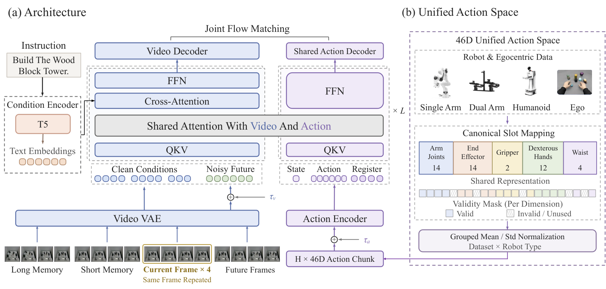
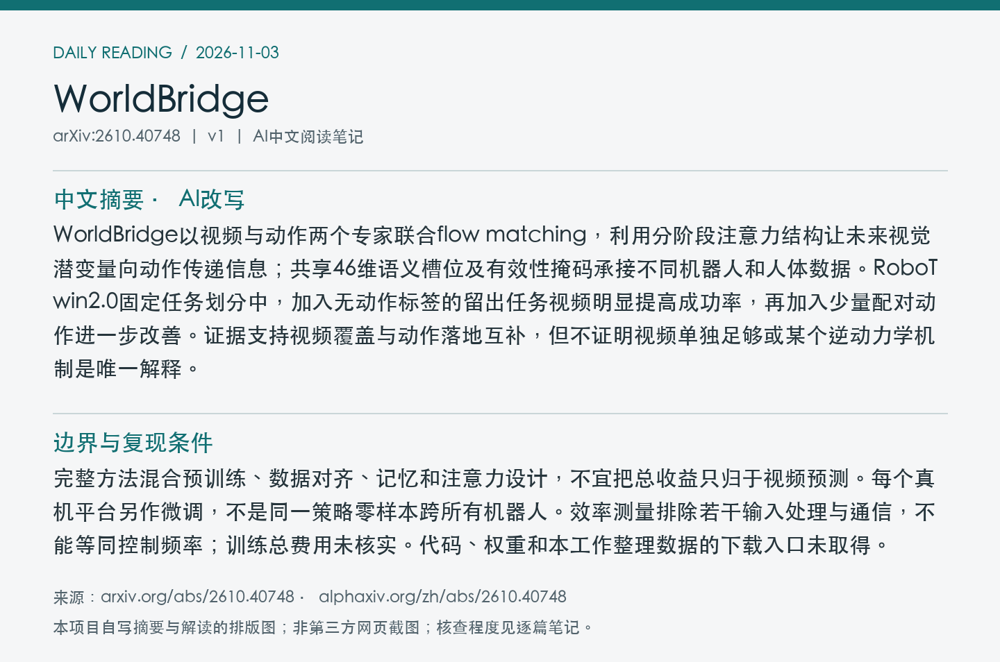
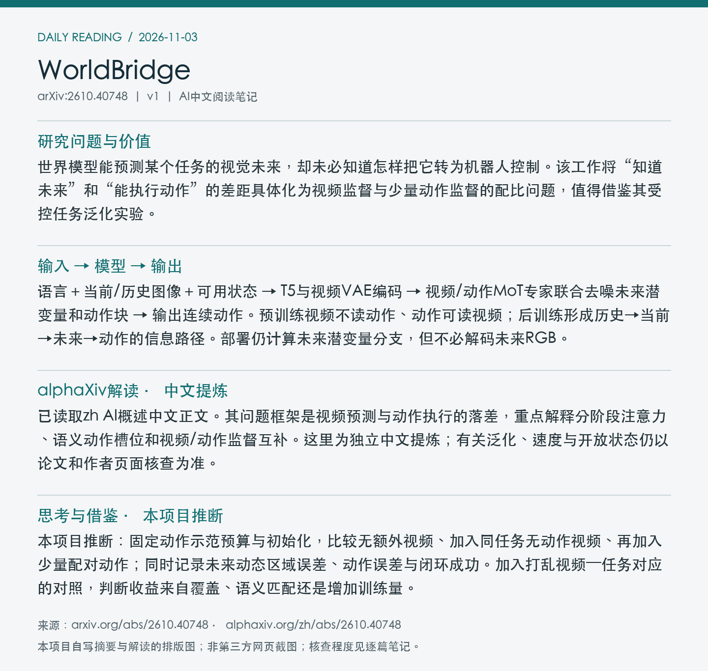

# 2610.40748 · WorldBridge

WorldBridge: Bridging Video and Action for Task Generalization in World Action Models

[arXiv原文](https://arxiv.org/abs/2610.40748) · [v1 HTML](https://arxiv.org/html/2610.40748v1) · [alphaXiv zh中文概述](https://www.alphaxiv.org/zh/abs/2610.40748) · [作者项目页](https://worldbridge-jd.github.io/)

首次提交：2026-10-30T00:00:06+08:00（Asia/Shanghai），v1；2026-11-03首次归档。本期在11-02 arXiv新列表与近7天重叠窗口中发现，不称今日首发或新修订。方向：WAM、video-action、task-generalization、cross-embodiment。

**阅读程度**：选读原文2.1架构、记忆与注意力/动作forcing，2.2数据处理相关部分、2.3.3训练配方、2.4效率，以及3.1任务泛化表2和3.3真机/延迟结果；已读alphaXiv zh AI概述中文正文及作者项目页。未通读全部附录、核查实现或复现。

## 中文摘要 · 本项目AI改写

WorldBridge以视频与动作两个专家联合flow matching，利用分阶段注意力结构让未来视觉潜变量向动作传递信息；共享46维语义槽位及有效性掩码承接不同机器人和人体数据。RoboTwin2.0固定任务划分中，加入无动作标签的留出任务视频明显提高成功率，再加入少量配对动作进一步改善。证据支持视频覆盖与动作落地互补，但不证明视频单独足够或某个逆动力学机制是唯一解释。

## 核心问题与方法

世界模型能预测某个任务的视觉未来，却未必知道怎样把它转为机器人控制。该工作将“知道未来”和“能执行动作”的差距具体化为视频监督与少量动作监督的配比问题，值得借鉴其受控任务泛化实验。

**输入 → 模型处理 → 输出**：语言＋当前/历史图像＋可用状态 → T5与视频VAE编码 → 视频/动作MoT专家联合去噪未来潜变量和动作块 → 输出连续动作。预训练视频不读动作、动作可读视频；后训练形成历史→当前→未来→动作的信息路径。部署仍计算未来潜变量分支，但不必解码未来RGB。

两种时间尺度各取4帧记忆。共享46维槽位包括双臂关节14、末端位姿14、夹爪2、灵巧手12、腰部4；缺失维度通过有效性掩码处理，不能视作零动作标签。自我中心人体腕部转换到固定的当前相机坐标。action forcing在一个动作块内采用不同噪声等级训练、推理共享时间步；论文列出的预训练配方关闭此项，不应说所有阶段都启用。

Figure 3：视频/动作专家、分阶段注意力及46维动作槽位。预训练与后训练的可见性不同；图中联合预测不等于部署时必须生成未来RGB。 [官方原图](https://arxiv.org/html/2610.40748v1/model.png)。采用arXiv HTML官方原图，未下载/核验PDF，PDF页码、裁剪坐标及PDF SHA256为null；版本、抓取时间、原图与归档图哈希见[元数据](metadata.json)。已目视检查。

## 主要证据与局限

RoboTwin2.0固定ID/OOD任务划分，ID视频/动作均550条每任务保持不变：OOD视频0/动作0时成功25.07%；550段视频/无动作55.90%；550段视频/每任务1条动作70.70%；20条动作90.03%。具体任务数和每条件rollout数在本次阅读范围未披露。留出是相对该任务划分，不等于证明任务从未出现在所有预训练数据。

完整方法混合预训练、数据对齐、记忆和注意力设计，不宜把总收益只归于视频预测。每个真机平台另作微调，不是同一策略零样本跨所有机器人。效率测量排除若干输入处理与通信，不能等同控制频率；训练总费用未核实。代码、权重和本工作整理数据的下载入口未取得。

### 受控监督实验

表2中ID视频和动作预算固定为550条/任务，下表仅改变OOD监督；指标均为同一任务划分下的OOD成功率。

| OOD视频/任务 | OOD动作示范/任务 | OOD成功率 |
| ---: | ---: | ---: |
| 0 | 0 | 25.07% |
| 550 | 0 | 55.90% |
| 550 | 1 | 70.70% |
| 550 | 20 | 90.03% |
| 550 | 100 | 93.17% |
| 550 | 550 | 92.83% |

视频补充带来30.83个百分点，再加1条配对动作带来14.80个百分点；后段并不单调增长。作者以逆动力学桥接解释互补关系，但该实验不独立识别唯一机制，也不直接给出普遍的数据扩展规律。

### 真机与效率边界

G2/ARX AC1共六项任务，每项20次，扰动物体位置/朝向，完整成功率WorldBridge72.5%、π0.5为57.5%、无联合预训练变体46.7%。后者仍保留Wan视频初始化，不能叫完全从零训练；同一预训练检查点分别适配平台，不能称零样本跨本体部署。

预训练配方为32步动作与8帧未来；效率部署设置动作块为48步，两者不可混写。延迟测试采用记录观测、预计算T5、无历史观测、BF16、预热及CUDA同步60次，排除JPEG解码、文本编码、通信与机器人执行。视频/动作各10步去噪P50为957.2ms，视频1步/动作10步为269.7ms，最终编译与CUDA Graph为103.9ms；视频分支仍运行，只复用同步一步后的逐层K/V。近7Hz真机端到端报告也不等于100Hz底层伺服。未核实硬件型号，不用这些数值作跨系统速度排名。

## alphaXiv zh AI概述 · 中文提炼

已读取zh AI概述中文正文。其问题框架是视频预测与动作执行的落差，重点解释分阶段注意力、语义动作槽位和视频/动作监督互补。这里为独立中文提炼；有关泛化、速度与开放状态仍以论文和作者页面核查为准。

来源：[alphaXiv zh页面](https://www.alphaxiv.org/zh/abs/2610.40748)，核查时间2026-11-03T10:53:59+08:00。已读取“AI 概述”后的中文正文，非仅访问语言入口；未整篇转载。

## 研究联系与下一步 · 本项目推断

本项目推断：固定动作示范预算与初始化，比较无额外视频、加入同任务无动作视频、再加入少量配对动作；同时记录未来动态区域误差、动作误差与闭环成功。加入打乱视频—任务对应的对照，判断收益来自覆盖、语义匹配还是增加训练量。

## 代码、权重与数据状态

作者项目页可访问，检查到论文与展示资源，但未取得官方代码、权重或本工作数据的可下载发布入口。使用公开上游数据不等于新训练混合已发布；未核查实现，训练总成本未核实。

## 自写摘要与阅读卡片

以下为本项目自写内容排版，非alphaXiv截图。

[论文目录](../README.md) · [当日日报](../../reports/2026/11/03.md)
