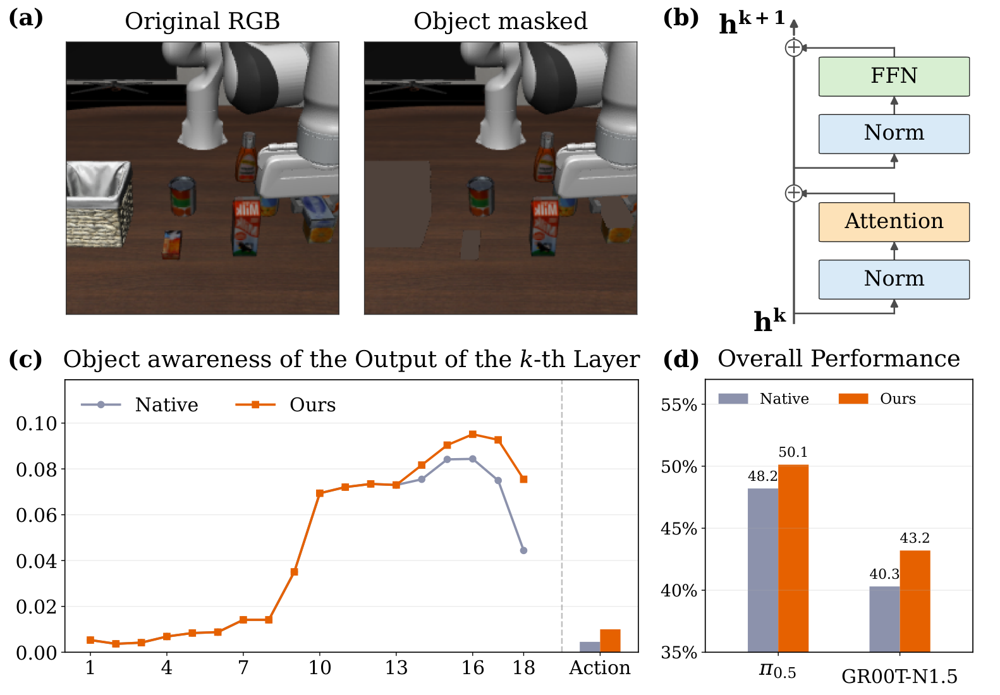
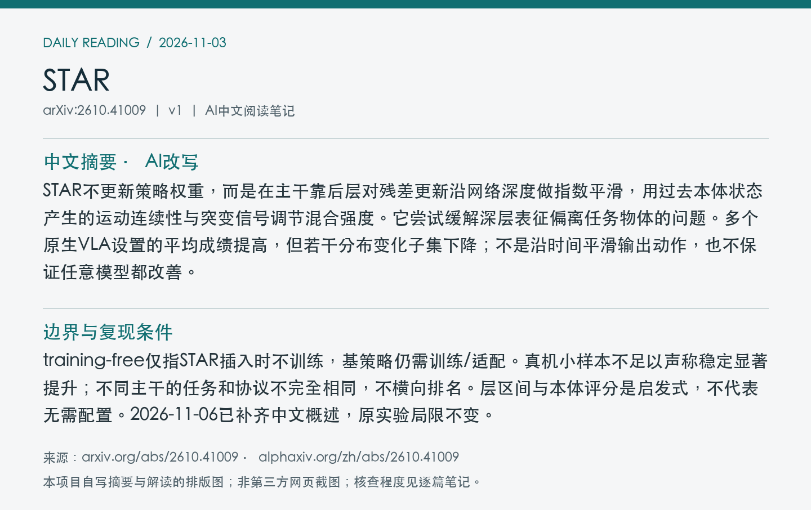
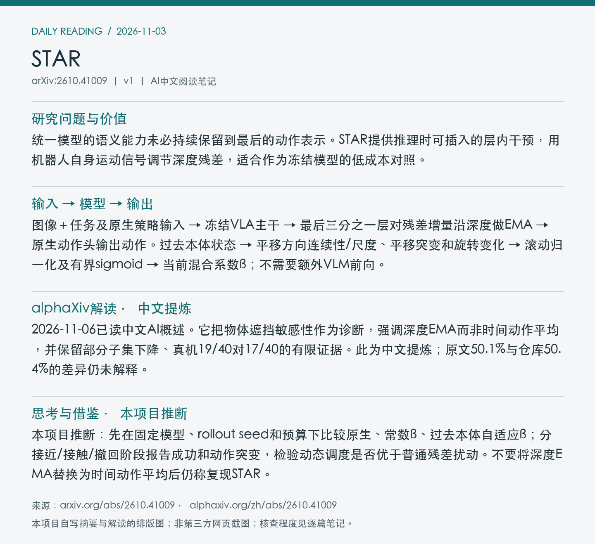

# 2610.41009 · STAR

STAR: Steering Action Representations during Inference

[arXiv原文](https://arxiv.org/abs/2610.41009) · [v1 HTML](https://arxiv.org/html/2610.41009v1) · [alphaXiv zh入口（概述缺失）](https://www.alphaxiv.org/zh/abs/2610.41009) · [官方仓库](https://github.com/PKU-VaLuE-Lab/STAR) · [仓库README](https://github.com/PKU-VaLuE-Lab/STAR/blob/main/README.md)

首次提交：2026-10-30T05:42:17+08:00（Asia/Shanghai），v1；2026-11-03首次归档。本期在11-02 arXiv新列表与近7天重叠窗口中发现，不称今日首发或新修订。方向：VLA、inference-time-adaptation、proprioception、representation。

**阅读程度**：选读原文第3节机制、第4节主实验/协议和4.5真机结果、图1诊断；已读官方仓库README，未检查实现或运行代码。已检查alphaXiv zh页面，但AI概述缺失，不能声称已读中文版。

## 中文摘要 · 本项目AI改写

STAR不更新策略权重，而是在主干靠后层对残差更新沿网络深度做指数平滑，用过去本体状态产生的运动连续性与突变信号调节混合强度。它尝试缓解深层表征偏离任务物体的问题。多个原生VLA设置的平均成绩提高，但若干分布变化子集下降；不是沿时间平滑输出动作，也不保证任意模型都改善。

## 核心问题与方法

统一模型的语义能力未必持续保留到最后的动作表示。STAR提供推理时可插入的层内干预，用机器人自身运动信号调节深度残差，适合作为冻结模型的低成本对照。

**输入 → 模型处理 → 输出**：图像＋任务及原生策略输入 → 冻结VLA主干 → 最后三分之一层对残差增量沿深度做EMA → 原生动作头输出动作。过去本体状态 → 平移方向连续性/尺度、平移突变和旋转变化 → 滚动归一化及有界sigmoid → 当前混合系数β；不需要额外VLM前向。

深度递推为m_k=β_t m_(k−1)+(1−β_t)Δh_k，再将平滑增量加入上一层隐藏状态；它不累积过去时刻的动作。ρ=2/3之前层不干预。连续平稳运动倾向增强混合，突变/转向时更保守；采用仅依赖过去的滚动中位数/IQR统计与有界调度。物体遮挡前后的隐藏范数差仅作物体感知诊断，不是因果能力证明。

Figure 1：隐藏状态与物体感知诊断、例子及成功率。物体遮挡是诊断工具，不是策略每次部署的必需输入；π0.5结果采用图/表中的50.1%，保留与仓库50.4%的差异。 [官方原图](https://arxiv.org/html/2610.41009v1/motivation.png)。采用arXiv HTML官方原图，未下载/核验PDF，PDF页码、裁剪坐标及PDF SHA256为null；版本、抓取时间、原图与归档图哈希见[元数据](metadata.json)。已目视检查。

## 主要证据与局限

LIBERO-PRO π0.5五个10任务划分、每任务50回合，共2500回合：论文表2和正文平均48.2→50.1%；task子集6.8→18.8%，language/swap/environment下降。官方README写50.4%，与原文不一致；本笔记采用50.1%，原因未核实。真机同一微调检查点的梨入碗17/40→19/40，仅多2次成功。

training-free仅指STAR插入时不训练，基策略仍需训练/适配。真机小样本不足以声称稳定显著提升；不同主干的任务和协议不完全相同，不横向排名。层区间与本体评分是启发式，不代表无需配置。alphaXiv zh未取得中文AI概述。

### 跨主干与真机证据

SimplerEnv中GR00T-N1.5六任务平均41.0→46.3%，OpenVLA五个可用任务30.3→36.0%；两组设置不同，不可据数值互相排名。LIBERO-PRO上不同子集有升有降，不能说所有分布变化均受益。

真机基策略用100条示范微调15000步，然后原生和STAR共用检查点。每种策略40次梨入碗试验，17与19次成功；RTX3090测得推理开销增加3.3%，不代表所有硬件和机器人闭环开销。该工作对小幅提升的稳定性还需更多重复与置信区间。

## alphaXiv zh AI概述 · 2026-11-03缺失记录

中文版AI概述未取得：zh页面实际显示“暂无概述”，摘要仍为英文。没有把英文摘要或本项目解读冒充alphaXiv中文原文；本篇中文介绍来自已选读论文。

来源：[alphaXiv zh页面](https://www.alphaxiv.org/zh/abs/2610.41009)，核查时间2026-11-03T10:54:00+08:00。页面显示“暂无概述”，摘要实际为英文；中文版AI概述未取得。本项目中文介绍基于论文，不冒充网站中文原文。

## 研究联系与下一步 · 本项目推断

本项目推断：先在固定模型、rollout seed和预算下比较原生、常数β、过去本体自适应β；分接近/接触/撤回阶段报告成功和动作突变，检验动态调度是否优于普通残差扰动。不要将深度EMA替换为时间动作平均后仍称复现STAR。

## 代码、权重与数据状态

官方STAR仓库公开，README明确只提供OpenPI/π0.5的LIBERO-PRO路径；OpenVLA、GR00T、SimplerEnv和真机代码不在此发布范围。检查点使用既有pi05_libero入口，未核实STAR独立权重或新数据下载。仅读README，未核查实现。

## 自写摘要与阅读卡片

以下为本项目自写内容排版，非alphaXiv截图。

[论文目录](../README.md) · [当日日报](../../reports/2026/11/03.md)

## 2026-11-06 中文AI概述补齐

本次已读取[alphaXiv zh](https://www.alphaxiv.org/zh/abs/2610.41009)“AI概述”后的中文正文，核查时间10:59:33 Asia/Shanghai；此前“暂无概述”是11-03/04的历史状态，不覆盖旧记录。

中文提炼：概述将物体遮挡响应视为隐藏表示诊断，不能用来证明晚层信号下降导致失败；STAR沿网络深度延续更新动量，近期本体状态调节强度，并非按时间平滑输出动作。它同时保留LIBERO-PRO部分划分下降和单项真机19/40对17/40的限制。关键机制/数值在原笔记已依据论文核查，未新增未核实实验。论文50.1%与仓库50.4%的差异仍未解释。

以上为独立中文提炼，不是全文转载。两张自写卡片已更新语言状态；原文图和v1依据保留。
