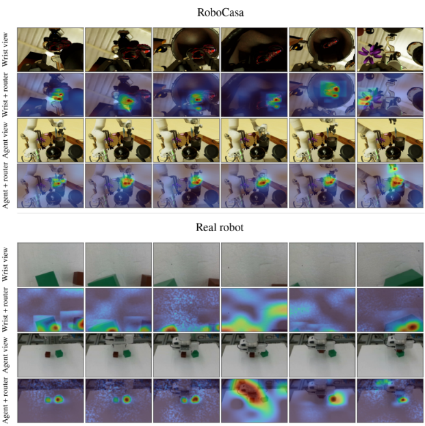
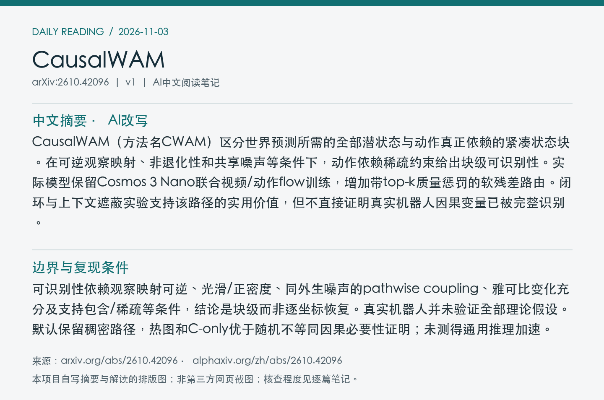
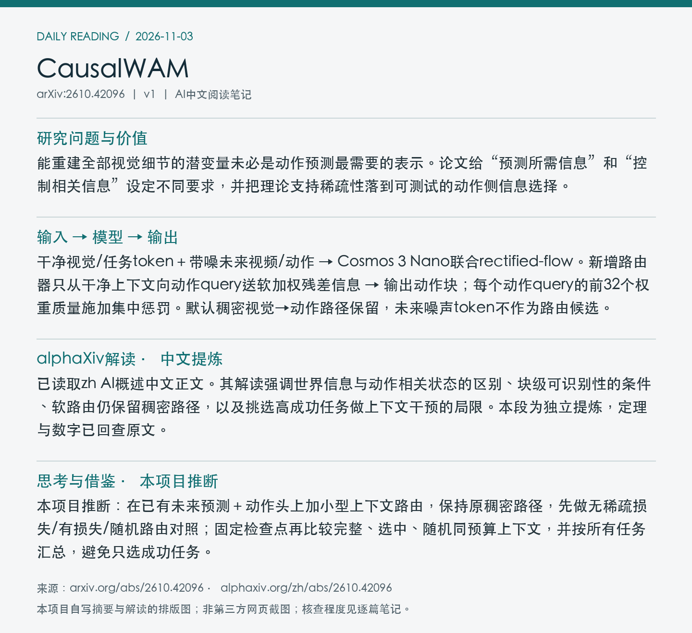

# 2610.42096 · CausalWAM

CausalWAM: Learning the Causes of Actions in World Action Models

[arXiv原文](https://arxiv.org/abs/2610.42096) · [v1 HTML](https://arxiv.org/html/2610.42096v1) · [alphaXiv zh中文概述](https://www.alphaxiv.org/zh/abs/2610.42096)

首次提交：2026-10-31T01:40:00+08:00（Asia/Shanghai），v1；2026-11-03首次归档。本期在11-02 arXiv新列表与近7天重叠窗口中发现，不称今日首发或新修订。方向：WAM、causal-representation、sparse-routing、post-training。

**阅读程度**：选读原文第2节设置、第3节定理陈述/假设与证明概述、第4节方法、第5节实验，以及附录E任务结果、F后训练/评估、H路由细节；已读alphaXiv zh AI概述中文正文。未逐项验证附录证明、核查实现或复现。

## 中文摘要 · 本项目AI改写

CausalWAM（方法名CWAM）区分世界预测所需的全部潜状态与动作真正依赖的紧凑状态块。在可逆观察映射、非退化性和共享噪声等条件下，动作依赖稀疏约束给出块级可识别性。实际模型保留Cosmos 3 Nano联合视频/动作flow训练，增加带top-k质量惩罚的软残差路由。闭环与上下文遮蔽实验支持该路径的实用价值，但不直接证明真实机器人因果变量已被完整识别。

## 核心问题与方法

能重建全部视觉细节的潜变量未必是动作预测最需要的表示。论文给“预测所需信息”和“控制相关信息”设定不同要求，并把理论支持稀疏性落到可测试的动作侧信息选择。

**输入 → 模型处理 → 输出**：干净视觉/任务token＋带噪未来视频/动作 → Cosmos 3 Nano联合rectified-flow。新增路由器只从干净上下文向动作query送软加权残差信息 → 输出动作块；每个动作query的前32个权重质量施加集中惩罚。默认稠密视觉→动作路径保留，未来噪声token不作为路由候选。

路由维度512、8头，含位置/模态/动作块偏置，残差门初始0.01；top-k质量损失权重0.01，1000步后经4000步线性升至目标。k=32是每query的质量集中目标，不是整段动作只看总共32个token，也不是默认硬剪枝。实际token路由是理论支持约束的替代目标，不能直接套用定理保证。

Figure 3：所选RoboCasa及真机帧的路由质量热图，多数落在操作物及目标。热图是描述性可视化，部分帧也集中到墙面/机器人，不能单独证明因果分离。 [官方原图](https://arxiv.org/html/2610.42096v1/fig_router_mass_combined_stack_v7.png)。采用arXiv HTML官方原图，未下载/核验PDF，PDF页码、裁剪坐标及PDF SHA256为null；版本、抓取时间、原图与归档图哈希见[元数据](metadata.json)。已目视检查。

## 主要证据与局限

与共享后训练配方的Cosmos基线比较，RoboCasa365选定17任务、每任务100回合，宏平均成功0.24→0.43，13任务赢、4任务输；不是全365任务。固定50k检查点、选CWAM成功最高4任务，完整/C-only/等大小随机上下文平均71.3/60.3/24.5%，有选择偏差；不能以该子集代表全基准。

可识别性依赖观察映射可逆、光滑/正密度、同外生噪声的pathwise coupling、雅可比变化充分及支持包含/稀疏等条件，结论是块级而非逐坐标恢复。真实机器人并未验证全部理论假设。默认保留稠密路径，热图和C-only优于随机不等同因果必要性证明；未测得通用推理加速。

### 理论保证的实际边界

观察由潜状态的微分同胚映射生成；估计过程与真实过程不仅要求观测分布一致，还使用同一外生噪声与可逆状态变换的pathwise coupling。动作雅可比的变化需张成真实父坐标子空间，并满足支持包含/无偶然抵消和估计支持不多于真实支持等条件。于是依赖支持可在置换意义下识别，动作相关块可在块内可逆变换下恢复；不保证每个潜变量具独立语义，也不要求其与无关块统计独立。

理论不依赖跨时间结构或主动干预，但不能省略以上假设。模拟实验用20维潜状态、4维相关块、5个种子检查已知真值的恢复；机器人token级top-k质量损失只作结构启发，不能凭其稀疏就宣称满足潜状态支持条件。

### 上下文干预与闭环协议

保持50k训练步的同一检查点，按CWAM成功率选择最高的四任务，每种上下文100回合/任务：

| 任务 | 完整上下文 | C-only | 等大小随机 |
| --- | ---: | ---: | ---: |
| Pick place sink to counter | 74% | 63% | 28% |
| Pick place toaster to counter | 72% | 61% | 21% |
| Open drawer | 70% | 59% | 33% |
| Open stand mixer head | 69% | 58% | 16% |
| 四任务均值（论文四舍五入） | 71.3% | 60.3% | 24.5% |

该对照支持选中上下文比随机子集更保留控制信息，但C-only仍弱于完整上下文。默认模型没有移除原MoT稠密路径；表格是固定模型的评估干预，不能改写成默认只靠稀疏块执行。

LIBERO使用四套共40任务、每任务100回合，四套平均均改善；与RoboCasa17任务不是同一评估集合。后训练先训练至10000步，再从该点续训至总50000步，基线保持相同训练设置；本笔记不把不同基准分数合成统一优势。未核验真机结果图中的全部数字，因此不重复其量化主张。

## alphaXiv zh AI概述 · 中文提炼

已读取zh AI概述中文正文。其解读强调世界信息与动作相关状态的区别、块级可识别性的条件、软路由仍保留稠密路径，以及挑选高成功任务做上下文干预的局限。本段为独立提炼，定理与数字已回查原文。

来源：[alphaXiv zh页面](https://www.alphaxiv.org/zh/abs/2610.42096)，核查时间2026-11-03T10:54:00+08:00。已读取“AI 概述”后的中文正文，非仅访问语言入口；未整篇转载。

## 研究联系与下一步 · 本项目推断

本项目推断：在已有未来预测＋动作头上加小型上下文路由，保持原稠密路径，先做无稀疏损失/有损失/随机路由对照；固定检查点再比较完整、选中、随机同预算上下文，并按所有任务汇总，避免只选成功任务。

## 代码、权重与数据状态

本次原文及定向检索未取得作者官方实现、CWAM权重或专属数据下载入口；Cosmos 3 Nano公开不等于本工作产物已公开。配方报告单节点8×H200后训练，不能据此猜总训练费用或墙钟。未核查实现。

## 自写摘要与阅读卡片

以下为本项目自写内容排版，非alphaXiv截图。

[论文目录](../README.md) · [当日日报](../../reports/2026/11/03.md)
