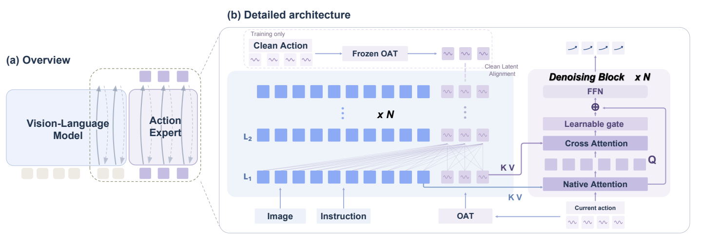
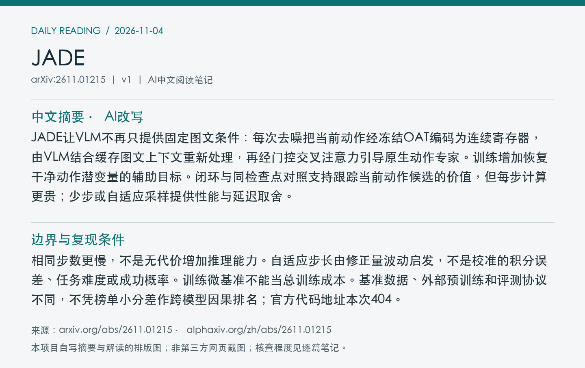
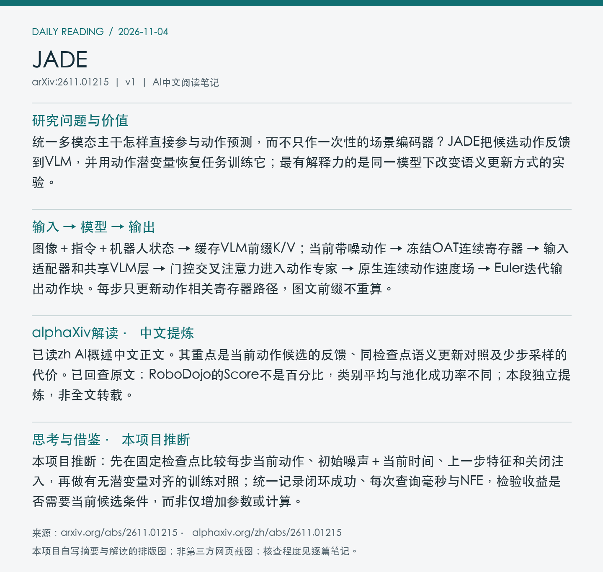

# 2611.01215 · JADE

Vision-Language Models Are Joint Denoisers in Robotic Action Generation

[arXiv原文](https://arxiv.org/abs/2611.01215) · [v1 HTML](https://arxiv.org/html/2611.01215v1) · [alphaXiv zh中文概述](https://www.alphaxiv.org/zh/abs/2611.01215) · [原文所列代码（本次404）](https://github.com/gxccc123/JADE)

v1首次提交：2026-11-01T03:29:39+08:00（Asia/Shanghai）。2026-11-04首次收录，在11-03列表及近7天重叠窗口发现；不是今日首发。方向：VLA、joint-denoising、action-representation、adaptive-sampling。

**阅读程度**：选读原文第3节完整方法、4.1–4.6主实验/消融/开销，以及附录D.1协议、E计时、F同检查点语义更新对照和G实体设置；PDF第4页架构图已查看并截图。已读alphaXiv zh AI概述中文正文。官方代码地址查询404，未核查实现或复现；未通读全部证明。

## 中文摘要 · 本项目AI改写

JADE让VLM不再只提供固定图文条件：每次去噪把当前动作经冻结OAT编码为连续寄存器，由VLM结合缓存图文上下文重新处理，再经门控交叉注意力引导原生动作专家。训练增加恢复干净动作潜变量的辅助目标。闭环与同检查点对照支持跟踪当前动作候选的价值，但每步计算更贵；少步或自适应采样提供性能与延迟取舍。

## 核心问题与方法

统一多模态主干怎样直接参与动作预测，而不只作一次性的场景编码器？JADE把候选动作反馈到VLM，并用动作潜变量恢复任务训练它；最有解释力的是同一模型下改变语义更新方式的实验。

**输入 → 模型处理 → 输出**：图像＋指令＋机器人状态 → 缓存VLM前缀K/V；当前带噪动作 → 冻结OAT连续寄存器 → 输入适配器和共享VLM层 → 门控交叉注意力进入动作专家 → 原生连续动作速度场 → Euler迭代输出动作块。每步只更新动作相关寄存器路径，图文前缀不重算。

OAT使用FSQ取整前的连续值，每基准预训练并冻结8个4维寄存器；动作仍在原生空间去噪，不由VLM直接输出最终指令。寄存器读前缀且彼此双向注意，前缀不反读动作。动作专家保留原注意力域，另加独立归一化的交叉注意力及初始为零的残差门。训练为flow损失加0.1倍SmoothL1干净潜变量对齐；除OAT外共同更新。预测50步、执行前25步再规划。

Figure 2：带噪动作进入VLM，逐层寄存器特征通过门控残差引导动作专家；干净潜变量对齐仅在训练使用。 [原始来源](https://arxiv.org/pdf/2611.01215v1)。取自v1 PDF第4页，以左上角为原点的point坐标[68,60,548,228]裁剪、3倍渲染；PDF SHA256见元数据。已逐张目视核查；版本、时间及哈希见[元数据](metadata.json)。

## 主要证据与局限

RoboDojo42任务五类别等权平均，π0.5→10步JADE：成功率6.91→12.67%，官方Score11.41→18.29；全6300回合池化成功13.10%与类别平均12.67%不同。同检查点10任务、每任务100场景，Dynamic/Fixed/Static/Lagged/RF-Off成功15.0/12.1/11.9/14.3/11.1%。该对照只覆盖子集，不与全基准数混写。

相同步数更慢，不是无代价增加推理能力。自适应步长由修正量波动启发，不是校准的积分误差、任务难度或成功概率。训练微基准不能当总训练成本。基准数据、外部预训练和评测协议不同，不凭榜单小分差作跨模型因果排名；官方代码地址本次404。

### 成功率与延迟不能合并为一个指标

模型端每次查询生成50个动作；计时排除通信、仿真与机器人执行。10步π0.5约74ms；10步JADE203ms；Balanced约132ms、平均约5次函数评估；2步78ms。RoboDojo完整基准成功率分别为6.91%、12.67%、12.48%、9.67%。2步JADE仍略慢于10步基线，不能写成整体加速；推理计时硬件未在本次所查段落明确核实。

RoboTwin2.0：50任务，每任务50条clean示范；Clean和Random各100回合/任务，JADE成功79.3/54.4%，均值66.9%；π0.5为68.5/46.0%，均值57.3%。RoboDojo训练3500条/35任务，评估42任务、162个评估单元、6300回合，五类别回合数不同。

PiPER双臂四任务，各用相同100条示范训练基线与JADE，每策略30次/任务；四任务平均49.2→70.0%。JADE另在这些示范预训练任务相关OAT。对照支持所测设置，不能宣称VLM已独立学会通用规划。

训练微基准为双H100 80GB、BF16/FSDP、global batch2；30次同步更新的中位耗时162.7→200.6ms（+23.3%），不含加载/编译，不是完整训练预算。附录仅证明自适应时间推进和有限终止等基本性质，没有给出校准误差保证。

## alphaXiv zh AI概述 · 中文提炼

已读zh AI概述中文正文。其重点是当前动作候选的反馈、同检查点语义更新对照及少步采样的代价。已回查原文：RoboDojo的Score不是百分比，类别平均与池化成功率不同；本段独立提炼，非全文转载。

[中文版来源](https://www.alphaxiv.org/zh/abs/2611.01215)，读取时间2026-11-04T07:31:07+08:00；已读取AI概述中文正文，非只核对zh入口。摘要、第三方提炼与本项目推断分别标注。

## 研究联系与下一步 · 本项目推断

本项目推断：先在固定检查点比较每步当前动作、初始噪声＋当前时间、上一步特征和关闭注入，再做有无潜变量对齐的训练对照；统一记录闭环成功、每次查询毫秒与NFE，检验收益是否需要当前候选条件，而非仅增加参数或计算。

## 代码、权重与数据状态

原文给出https://github.com/gxccc123/JADE；本次GitHub连接器查询仓库及README均404，故不能确认代码已可用。未取得作者权重、OAT检查点或整理数据下载入口。未核查实现、未复现；总参数量和总训练成本未核实。

## 自写摘要与阅读卡片

以下为本项目自写内容的排版，非第三方网页截图。

[论文目录](../README.md) · [当日日报](../../reports/2026/11/04.md)
