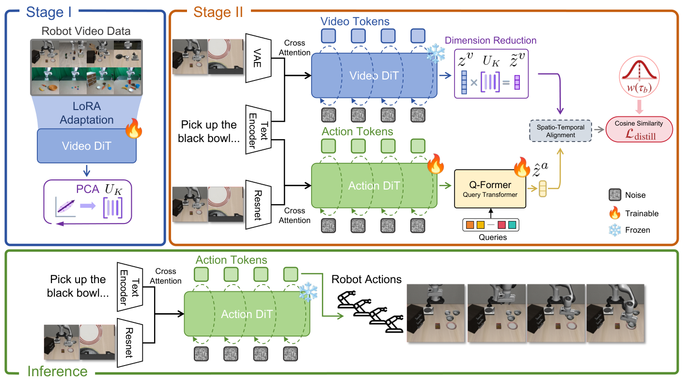
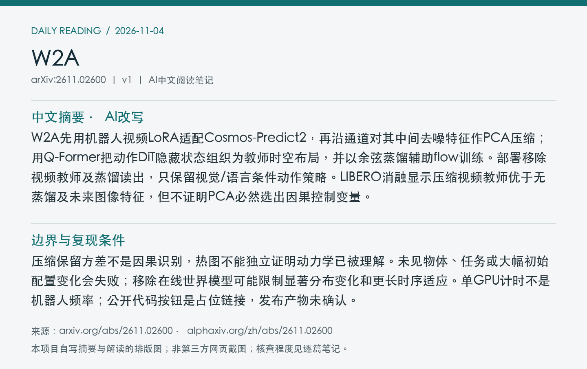
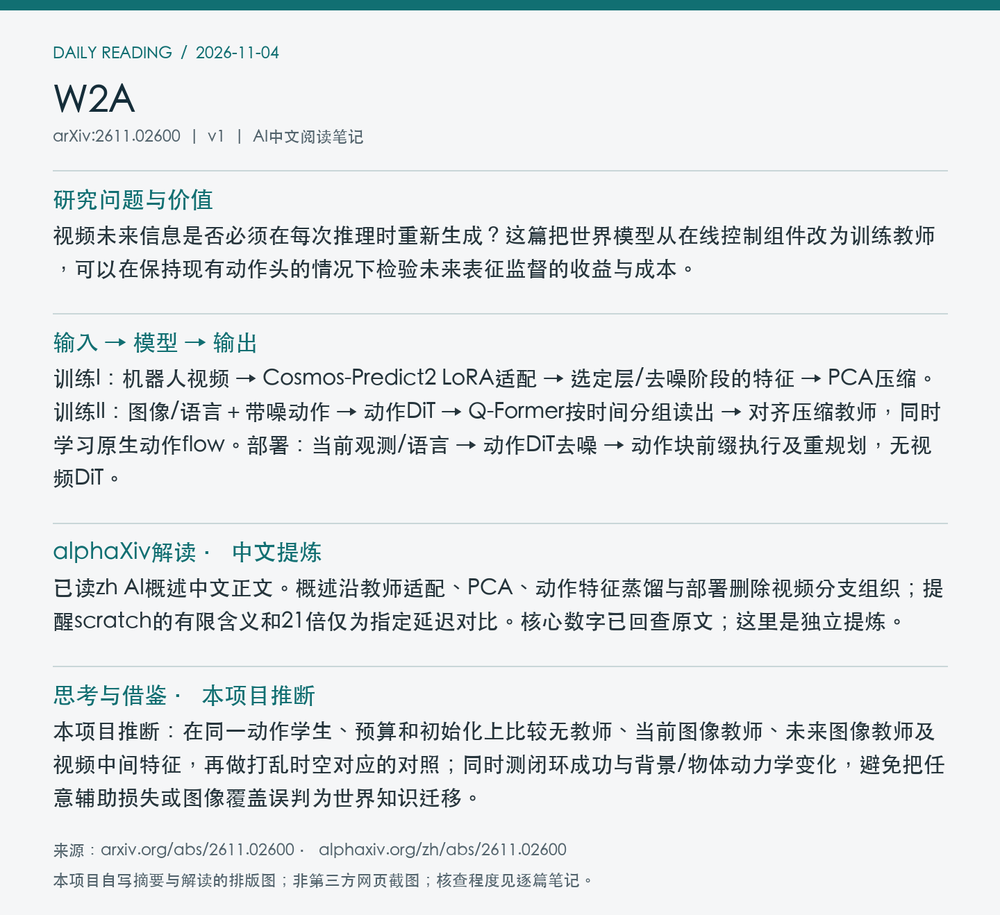

# 2611.02600 · W2A

W2A: Distilling World Priors into Action Models for Real-Time Robotic Control

[arXiv原文](https://arxiv.org/abs/2611.02600) · [v1 HTML](https://arxiv.org/html/2611.02600v1) · [alphaXiv zh中文概述](https://www.alphaxiv.org/zh/abs/2611.02600) · [作者项目页](https://misaka0502.github.io/W2A/)

v1首次提交：2026-11-02T14:25:24+08:00（Asia/Shanghai）。2026-11-04首次收录，在11-03列表及近7天重叠窗口发现；不是今日首发。方向：WAM、video-distillation、PCA、efficient-policy。

**阅读程度**：选读原文第4节方法、5.1–5.4实验/消融、第7节局限及附录A.3教师替换对照和部分实现设置；已读alphaXiv zh AI概述中文正文、作者项目页。PDF下载缺失有效尾部、无法解析，使用完整可访问HTML与官方原图；未核查实现或复现。

## 中文摘要 · 本项目AI改写

W2A先用机器人视频LoRA适配Cosmos-Predict2，再沿通道对其中间去噪特征作PCA压缩；用Q-Former把动作DiT隐藏状态组织为教师时空布局，并以余弦蒸馏辅助flow训练。部署移除视频教师及蒸馏读出，只保留视觉/语言条件动作策略。LIBERO消融显示压缩视频教师优于无蒸馏及未来图像特征，但不证明PCA必然选出因果控制变量。

## 核心问题与方法

视频未来信息是否必须在每次推理时重新生成？这篇把世界模型从在线控制组件改为训练教师，可以在保持现有动作头的情况下检验未来表征监督的收益与成本。

**输入 → 模型处理 → 输出**：训练I：机器人视频 → Cosmos-Predict2 LoRA适配 → 选定层/去噪阶段的特征 → PCA压缩。训练II：图像/语言＋带噪动作 → 动作DiT → Q-Former按时间分组读出 → 对齐压缩教师，同时学习原生动作flow。部署：当前观测/语言 → 动作DiT去噪 → 动作块前缀执行及重规划，无视频DiT。

默认教师通道2048压到482，约保留99%解释方差；只压通道，保留时间和空间布局。Q-Former按视频VAE时间压缩比例对动作token分组，产生匹配空间格点的读出；余弦蒸馏按动作flow时间与教师提取时间的距离作高斯加权。部署可复用未执行动作后缀，加噪至中间时间再warmstart；仍是迭代动作去噪，不是一遍前向。

Figure 2：上部两阶段教师适配与蒸馏，下部部署仅保留动作DiT及视觉/语言输入；Q-Former是训练读出，不输出机器人指令。 [原始来源](https://arxiv.org/html/2611.02600v1/framework.png)。PDF未完整取得/解析，采用arXiv HTML官方原图；PDF页码、裁剪坐标及PDF SHA256为null，不虚构。已逐张目视核查；版本、时间及哈希见[元数据](metadata.json)。

## 主要证据与局限

LIBERO四套各10任务、三随机种子，四套平均95.9%，无蒸馏84.4%、无PCA88.6%；保持学生/Q-Former/损失权重，改用未来帧ResNet教师87.8%。这些支持该教师及对应结构的效用。π0.5表中96.9%但用外部动作预训练；W2A称scratch仅指无额外机器人动作数据，仍有视频预训练，不能叫完全从零。

压缩保留方差不是因果识别，热图不能独立证明动力学已被理解。未见物体、任务或大幅初始配置变化会失败；移除在线世界模型可能限制显著分布变化和更长时序适应。单GPU计时不是机器人频率；公开代码按钮是占位链接，发布产物未确认。

### 实验与速度的适用范围

同一A100 40GB计算节点的平均推理耗时，W2A为55ms/动作预测，mimic-video约高21倍。作者报告部署约6GB显存；本次未独立测量。该对比不能转为少尝试21倍、训练快21倍或机器人伺服频率。模型仍用20步动作去噪，且部署含动作前缀与warmstart机制。

LIBERO教师信号替换保持学生、Q-Former、余弦损失及权重，只换教师并匹配维度/布局：

| 教师/训练设置 | LIBERO四套平均成功率 |
| --- | ---: |
| 无蒸馏 | 84.4% |
| 打乱教师时空对应 | 78.2% |
| 同维随机教师 | 69.2% |
| 当前图像ResNet特征 | 82.2% |
| 未来帧ResNet特征 | 87.8% |
| 完整压缩视频教师 | 95.9% |

打乱/随机教师比无蒸馏还低，因此坏监督可能有害，而非任何辅助损失都有收益。原始教师不经PCA为88.6%，也不足以证明PCA一般性地删除了全部无关信息。

CALVIN ABC→D三随机种子，平均完成链长4.30（VPP4.33），连续完成五任务77.1%；不是全指标最好。Franka Research3前置与腕部相机，共15子任务、每项50条示范共750条、每项30次评估；PnP/Cube/Long各含4子任务，W2A宏平均78.3/65.0/54.2%。此证据支持所测数据与场景，不能替代任意新动力学泛化测试。

## alphaXiv zh AI概述 · 中文提炼

已读zh AI概述中文正文。概述沿教师适配、PCA、动作特征蒸馏与部署删除视频分支组织；提醒scratch的有限含义和21倍仅为指定延迟对比。核心数字已回查原文；这里是独立提炼。

[中文版来源](https://www.alphaxiv.org/zh/abs/2611.02600)，读取时间2026-11-04T07:31:07+08:00；已读取AI概述中文正文，非只核对zh入口。摘要、第三方提炼与本项目推断分别标注。

## 研究联系与下一步 · 本项目推断

本项目推断：在同一动作学生、预算和初始化上比较无教师、当前图像教师、未来图像教师及视频中间特征，再做打乱时空对应的对照；同时测闭环成功与背景/物体动力学变化，避免把任意辅助损失或图像覆盖误判为世界知识迁移。

## 代码、权重与数据状态

作者项目页可访问，但Code及arXiv按钮实际为#，未取得W2A官方实现、训练后权重、PCA基或扩展数据下载。上游Cosmos代码公开不等于W2A已发布；未核查实现或复现，训练总费用未核实。

## 自写摘要与阅读卡片

以下为本项目自写内容的排版，非第三方网页截图。

[论文目录](../README.md) · [当日日报](../../reports/2026/11/04.md)
