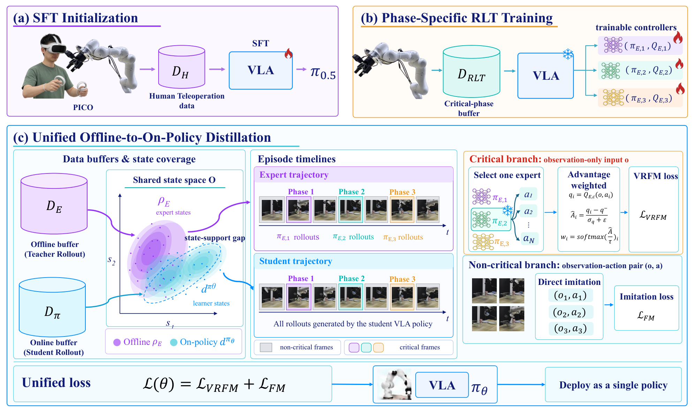
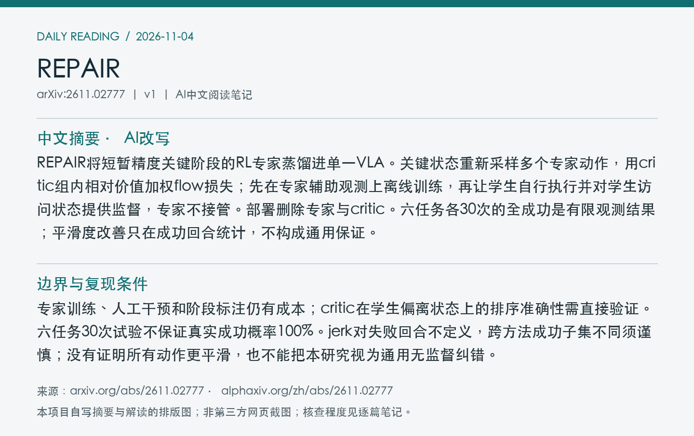
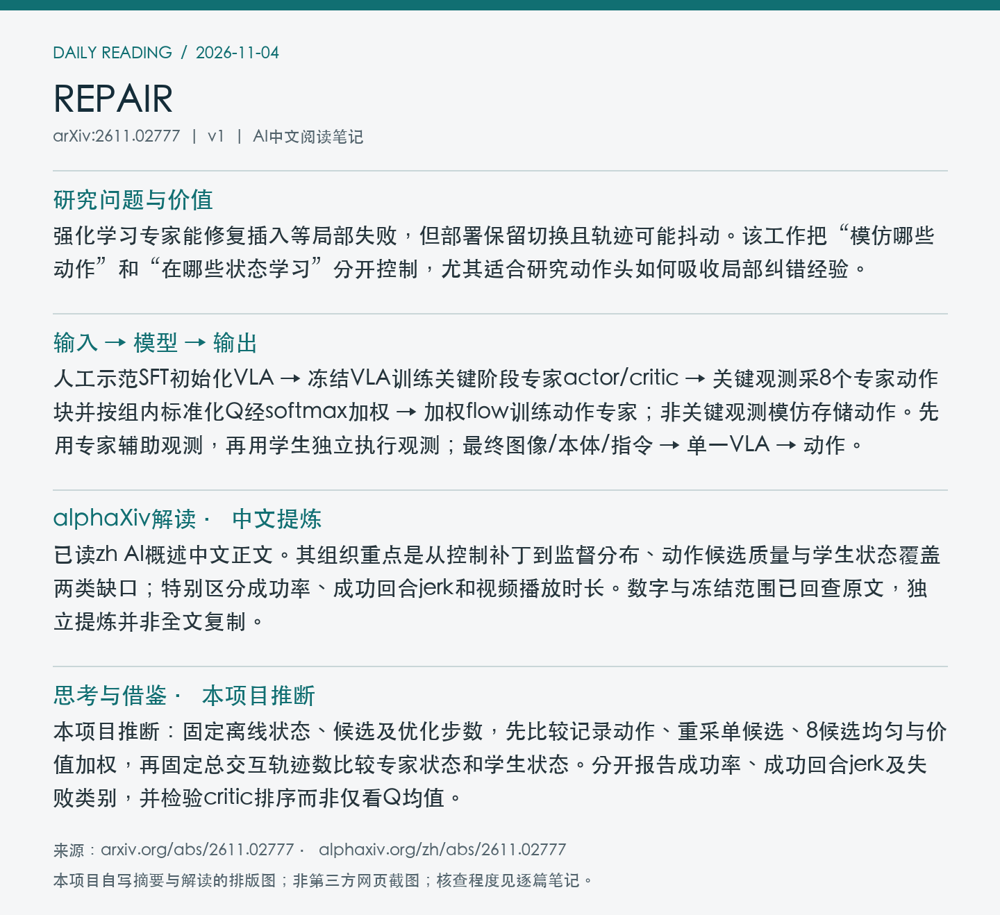

# 2611.02777 · REPAIR

Beyond Policy Patches: Distilling RL Specialists into Vision-Language-Action Policies

[arXiv原文](https://arxiv.org/abs/2611.02777) · [v1 HTML](https://arxiv.org/html/2611.02777v1) · [alphaXiv zh中文概述](https://www.alphaxiv.org/zh/abs/2611.02777) · [作者项目页](https://repair-vla.github.io/)

v1首次提交：2026-11-02T16:53:49+08:00（Asia/Shanghai）。2026-11-04首次收录，在11-03列表及近7天重叠窗口发现；不是今日首发。方向：VLA、post-training、RL-distillation、on-policy-repair。

**阅读程度**：选读原文第3节问题分析、4节完整方法、5节预算/主结果、6节消融与结论，以及附录B.1–B.2冻结范围和专家设置；已读alphaXiv zh AI概述中文正文及作者项目页。PDF超时，图像取自官方HTML；未核查实现或复现。

## 中文摘要 · 本项目AI改写

REPAIR将短暂精度关键阶段的RL专家蒸馏进单一VLA。关键状态重新采样多个专家动作，用critic组内相对价值加权flow损失；先在专家辅助观测上离线训练，再让学生自行执行并对学生访问状态提供监督，专家不接管。部署删除专家与critic。六任务各30次的全成功是有限观测结果；平滑度改善只在成功回合统计，不构成通用保证。

## 核心问题与方法

强化学习专家能修复插入等局部失败，但部署保留切换且轨迹可能抖动。该工作把“模仿哪些动作”和“在哪些状态学习”分开控制，尤其适合研究动作头如何吸收局部纠错经验。

**输入 → 模型处理 → 输出**：人工示范SFT初始化VLA → 冻结VLA训练关键阶段专家actor/critic → 关键观测采8个专家动作块并按组内标准化Q经softmax加权 → 加权flow训练动作专家；非关键观测模仿存储动作。先用专家辅助观测，再用学生独立执行观测；最终图像/本体/指令 → 单一VLA → 动作。

训练依赖实验者给定阶段标注；蒸馏更新VLA动作专家，主干、RL-token编码器及专家actor冻结。critic离线冻结、在线修复时更新，候选取双target critic较小值，温度0.1；回放关键/非关键状态各半。学生回合中的非关键标签为其存储预测，属于自蒸馏；不是在线让专家接管后再模仿轨迹。

Figure 4：SFT、阶段专家训练、离线至学生状态蒸馏。右侧分布是机制示意，不是量化证明；部署仅保留VLA。 [原始来源](https://arxiv.org/html/2611.02777v1/REPAIR_Refined_Framework.png)。PDF未完整取得/解析，采用arXiv HTML官方原图；PDF页码、裁剪坐标及PDF SHA256为null，不虚构。已逐张目视核查；版本、时间及哈希见[元数据](metadata.json)。

## 主要证据与局限

六个真机任务、每方法30次/任务，REPAIR与RLT均各任务30/30；双臂插销jerk为6.5±1.6对10.3±0.9 m/s³，只在成功回合统计。固定专家状态及8候选，均匀/价值加权成功76.7/90.0%，jerk7.28/6.7。相同20条蒸馏轨迹，20专家对10专家＋10学生：双插销90/100%、清桌80/100%。

专家训练、人工干预和阶段标注仍有成本；critic在学生偏离状态上的排序准确性需直接验证。六任务30次试验不保证真实成功概率100%。jerk对失败回合不定义，跨方法成功子集不同须谨慎；没有证明所有动作更平滑，也不能把本研究视为通用无监督纠错。

### 预算、指标与消融

所有方法SFT短任务各50条、长任务各100条人工轨迹，另有每任务50条适应轨迹预算。REPAIR分为30条专家训练、10条专家辅助离线收集、10条学生自行执行；不能只把后20条当作全部交互成本。蒸馏专家actor固定，在线critic更新不等于对完整VLA作策略梯度RL。

固定Dual Peg专家状态、初始化、观测采样和优化预算，每方案30次：

| 监督动作 | 候选数 | 成功率 | 成功回合jerk均值±SD（m/s³） |
| --- | ---: | ---: | ---: |
| 记录执行动作 | — | 60.0% | 11.1±1.1 |
| 重查询单动作 | 1 | 66.7% | 9.2±0.8 |
| 均匀候选 | 8 | 76.7% | 7.28±1.3 |
| 价值加权候选 | 8 | 90.0% | 6.7±1.1 |

这是离线动作目标对照，不单独证明学生状态覆盖的作用。另一组固定价值监督下20专家轨迹与10专家＋10学生的对比支持覆盖收益，但并未固定每条轨迹长度/状态数，不应称每个训练样本完全匹配。

双插销30个成功回合的平均长度RLT249.7±21.9、REPAIR238.0±9.6步；更少切换纠正是作者推测的解释，未直接验证。与HG-DAgger相比REPAIR并非每任务jerk最低，主要优势是所测预算下保留高成功并去掉部署专家。

## alphaXiv zh AI概述 · 中文提炼

已读zh AI概述中文正文。其组织重点是从控制补丁到监督分布、动作候选质量与学生状态覆盖两类缺口；特别区分成功率、成功回合jerk和视频播放时长。数字与冻结范围已回查原文，独立提炼并非全文复制。

[中文版来源](https://www.alphaxiv.org/zh/abs/2611.02777)，读取时间2026-11-04T07:31:07+08:00；已读取AI概述中文正文，非只核对zh入口。摘要、第三方提炼与本项目推断分别标注。

## 研究联系与下一步 · 本项目推断

本项目推断：固定离线状态、候选及优化步数，先比较记录动作、重采单候选、8候选均匀与价值加权，再固定总交互轨迹数比较专家状态和学生状态。分开报告成功率、成功回合jerk及失败类别，并检验critic排序而非仅看Q均值。

## 代码、权重与数据状态

原文链接作者演示页，页面提供视频及方法简介，但未取得官方代码、权重或真实轨迹下载入口。使用RLinf实现不代表本工作配置已发布；未核查实现或运行实验，总训练费用未核实。

## 自写摘要与阅读卡片

以下为本项目自写内容的排版，非第三方网页截图。

[论文目录](../README.md) · [当日日报](../../reports/2026/11/04.md)
