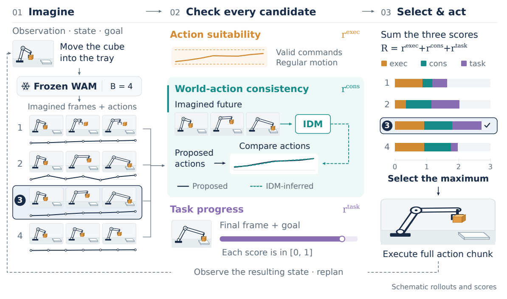
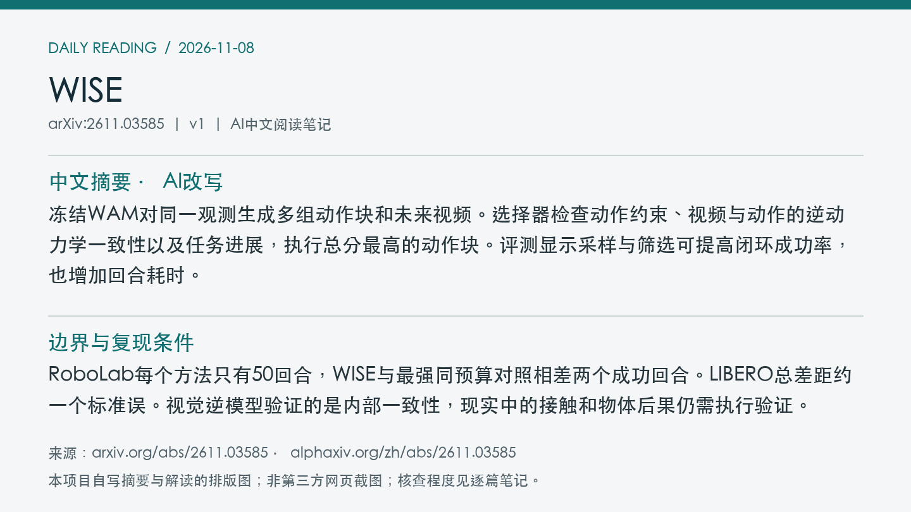
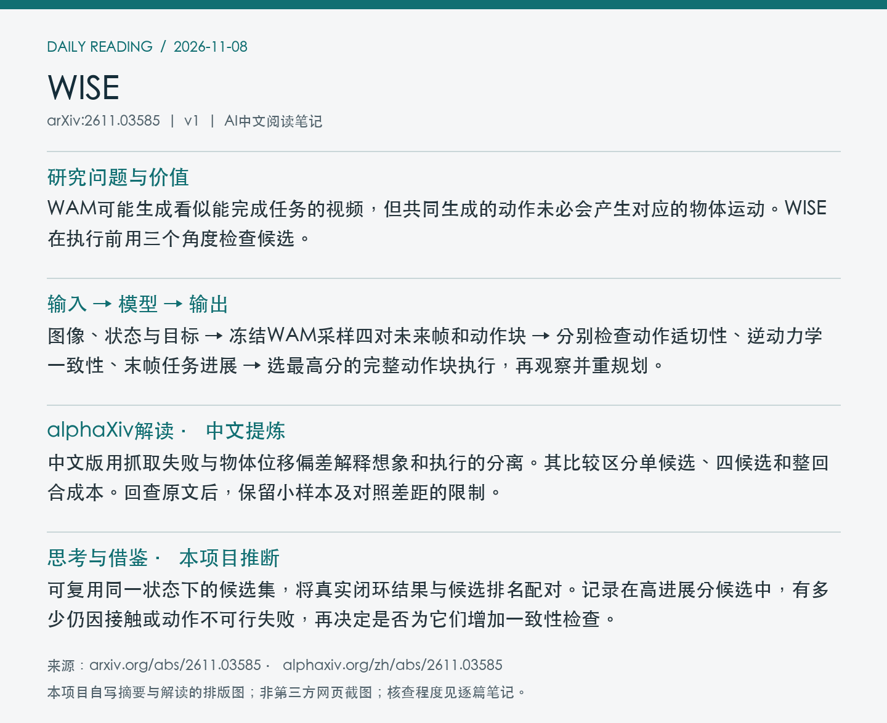

# 2611.03585 · WISE

Seeing Through the Illusion: Test-Time Scaling for World Action Models

[arXiv原文](https://arxiv.org/abs/2611.03585) · [v1 HTML](https://arxiv.org/html/2611.03585v1) · [alphaXiv zh中文概述](https://www.alphaxiv.org/zh/abs/2611.03585)

v1首次提交于2026-11-03T02:32:18+08:00（Asia/Shanghai）。本次在7天重叠检索中首次收录。研究方向包括WAM、test-time-scaling、inverse-dynamics、closed-loop。

**阅读程度**：选读原文第3至5节及表2至7，核对PDF图2。已读alphaXiv中文AI概述。未核查选择器实现或复现。

## 中文摘要 · 本项目AI改写

冻结WAM对同一观测生成多组动作块和未来视频。选择器检查动作约束、视频与动作的逆动力学一致性以及任务进展，执行总分最高的动作块。评测显示采样与筛选可提高闭环成功率，也增加回合耗时。

## 核心问题与方法

WAM可能生成看似能完成任务的视频，但共同生成的动作未必会产生对应的物体运动。WISE在执行前用三个角度检查候选。

**输入 → 模型处理 → 输出**：图像、状态与目标 → 冻结WAM采样四对未来帧和动作块 → 分别检查动作适切性、逆动力学一致性、末帧任务进展 → 选最高分的完整动作块执行，再观察并重规划。

三个分数各在[0,1]，直接相加。动作适切性按接口范围和适用的时间规律评估。与本体匹配的视觉逆动力学模型从生成帧反推动作，和共同生成的动作比较。冻结Robometer根据指令为末帧打进展分。RoboLab用DROID训练逆模型，LIBERO用官方示范。选择过程只访问执行前可见的信息。

图2展示采样、三项执行前评分及闭环重规划。图中任务和分值用于示意。 摘自[v1 PDF](https://arxiv.org/pdf/2611.03585v1)第4页。裁剪采用左上角point坐标[106, 73, 504, 308]，3倍渲染。已目视核查。PDF SHA256、抓取时间及图像哈希见[元数据](metadata.json)。

## 主要证据与局限

RoboLab上Cosmos 3 Edge的10任务各5回合，单候选成功率6.0%，四候选WISE为24.0%，同预算GeoBoN与Robometer均为20.0%。LIBERO四套件共2,000回合，DreamZero从75.1%到78.3%，同预算最强对照Robometer为77.4%。RoboLab与LIBERO平均整回合耗时分别约为单候选的3.4倍和3.5倍。

RoboLab每个方法只有50回合，WISE与最强同预算对照相差两个成功回合。LIBERO总差距约一个标准误。视觉逆模型验证的是内部一致性，现实中的接触和物体后果仍需执行验证。

RoboLab的单信号消融为动作适切性10.0%、逆动力学一致性16.0%、进展20.0%。离线把进展分从总分移除会改变47.1%的RoboLab选择及48.5%的LIBERO选择，不能据此量化其对闭环成功率的独立贡献。原文未核实完整训练成本。

## alphaXiv zh AI概述 · 中文提炼

中文版用抓取失败与物体位移偏差解释想象和执行的分离。其比较区分单候选、四候选和整回合成本。回查原文后，保留小样本及对照差距的限制。

[中文版来源](https://www.alphaxiv.org/zh/abs/2611.03585)，实际读取2026-11-08T06:58:44+08:00。已核实并独立提炼中文AI概述正文。

## 研究联系与下一步 · 本项目推断

可复用同一状态下的候选集，将真实闭环结果与候选排名配对。记录在高进展分候选中，有多少仍因接触或动作不可行失败，再决定是否为它们增加一致性检查。

## 代码、权重与数据状态

未找到WISE选择器或专用逆模型的作者发布入口。原文使用已有[RoboLab基准](https://arxiv.org/html/2611.03585v1#S5)与[RLinf DreamZero检查点](https://huggingface.co/RLinf/RLinf-DreamZero-WAN2.2-5B-LIBERO-SFT-Step26000)，未核实此次有新增数据或权重。

## 自写摘要与阅读卡片

以下两张卡片由本项目根据自写内容排版。

[论文目录](../README.md) · [当日日报](../../reports/2026/11/08.md)
