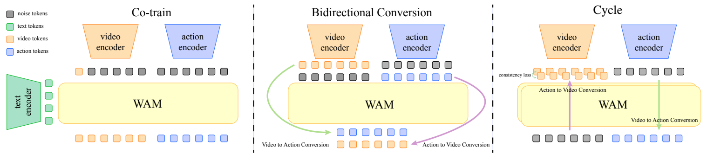
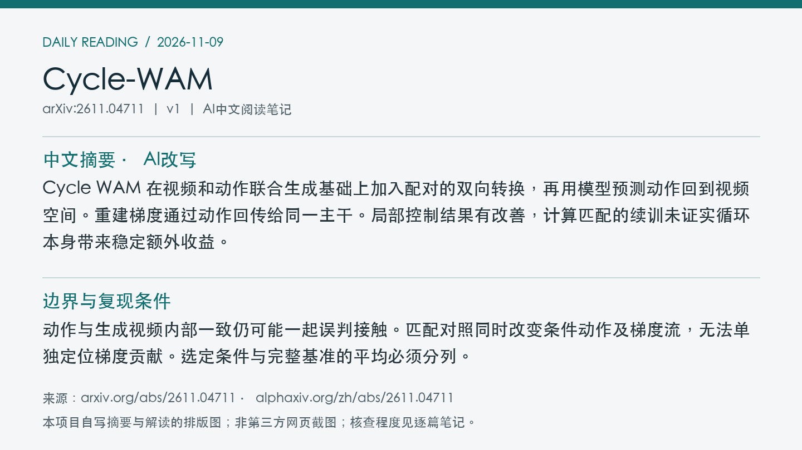
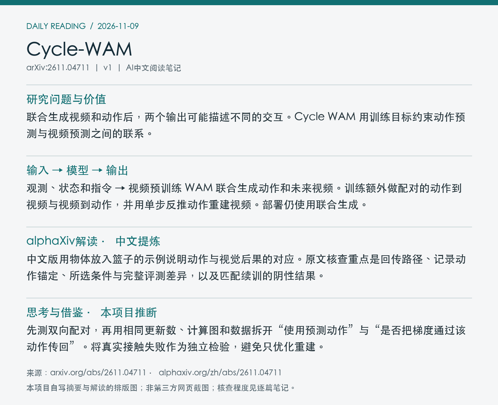

# 2611.04711 · Cycle-WAM

Cycle WAM: Coupling Action and Video through Cycle Consistency

[arXiv原文](https://arxiv.org/abs/2611.04711) · [v1 HTML](https://arxiv.org/html/2611.04711v1) · [alphaXiv zh中文概述](https://www.alphaxiv.org/zh/abs/2611.04711)

v1首次提交于2026-11-03T19:33:51+08:00（Asia/Shanghai）。本次在7天重叠检索中首次收录。研究方向包括WAM、cycle-consistency、forward-dynamics、inverse-dynamics。

**阅读程度**：选读原文第IV节、第V节实验及匹配续训对照，核对PDF图2。已读alphaXiv中文AI概述。未复现或核查实现。

## 中文摘要 · 本项目AI改写

Cycle WAM 在视频和动作联合生成基础上加入配对的双向转换，再用模型预测动作回到视频空间。重建梯度通过动作回传给同一主干。局部控制结果有改善，计算匹配的续训未证实循环本身带来稳定额外收益。

## 核心问题与方法

联合生成视频和动作后，两个输出可能描述不同的交互。Cycle WAM 用训练目标约束动作预测与视频预测之间的联系。

**输入 → 模型处理 → 输出**：观测、状态和指令 → 视频预训练 WAM 联合生成动作和未来视频。训练额外做配对的动作到视频与视频到动作，并用单步反推动作重建视频。部署仍使用联合生成。

回环从真实未来视频经单步 flow 读出归一化动作，截断到有效区间，再条件化原生视频 flow 匹配。视频损失沿中间动作反传到逆向查询。独立的逆向监督把输出绑定到记录的控制量，混合联合预测保持部署接口。多个查询共享模型参数。

图2分别展示联合生成、配对双向转换和视频经动作回到视频的训练查询。 摘自[v1 PDF](https://arxiv.org/pdf/2611.04711v1)第4页。裁剪采用左上角point坐标[53, 48, 559, 163]，3倍渲染。已目视核查。PDF SHA256、抓取时间及图像哈希见[元数据](metadata.json)。

## 主要证据与局限

LIBERO-Pro 四个选定条件各 100 回合，DreamZero 13.5%，双向转换 17.0%，完整 Cycle 17.8%，全 Pro 汇总变化小。DROID 仿真三场景每场景 20 回合为 52、58、59 次成功，训练预算和种子不完全匹配。原文 3,000 步、rank-32 LoRA 的匹配续训对照以记录动作替代反推条件，未得到一致的 Cycle 增益。五个真机场景完整方法完成三个，DreamZero 为零，未报告重复试验可靠性。

动作与生成视频内部一致仍可能一起误判接触。匹配对照同时改变条件动作及梯度流，无法单独定位梯度贡献。选定条件与完整基准的平均必须分列。

LIBERO 原文从 Wan2.2-TI2V-5B 初始化 DreamZero 式模型，报告联合训练 27,000 步、双向 5,000 步、循环阶段 3,000 步。完整训练 GPU 小时未核实。

## alphaXiv zh AI概述 · 中文提炼

中文版用物体放入篮子的示例说明动作与视觉后果的对应。原文核查重点是回传路径、记录动作锚定、所选条件与完整评测差异，以及匹配续训的阴性结果。

[中文版来源](https://www.alphaxiv.org/zh/abs/2611.04711)，实际读取2026-11-09T10:48:57+08:00。已核实并独立提炼中文AI概述正文。

## 研究联系与下一步 · 本项目推断

先测双向配对，再用相同更新数、计算图和数据拆开“使用预测动作”与“是否把梯度通过该动作传回”。将真实接触失败作为独立检验，避免只优化重建。

## 代码、权重与数据状态

论文说明以既有 RLinf/DreamZero、LIBERO 和 DROID 为基础。未找到可核实的 Cycle WAM 专用代码、权重或新增数据入口。

## 自写摘要与阅读卡片

以下两张卡片由本项目根据自写内容排版。

[论文目录](../README.md) · [当日日报](../../reports/2026/11/09.md)
