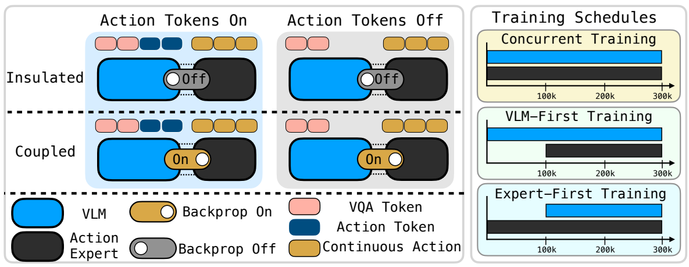
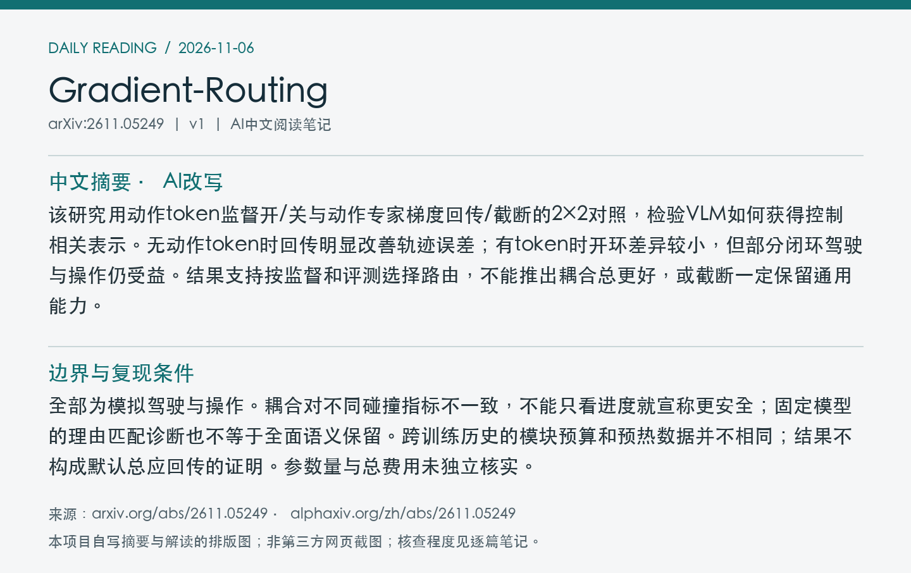
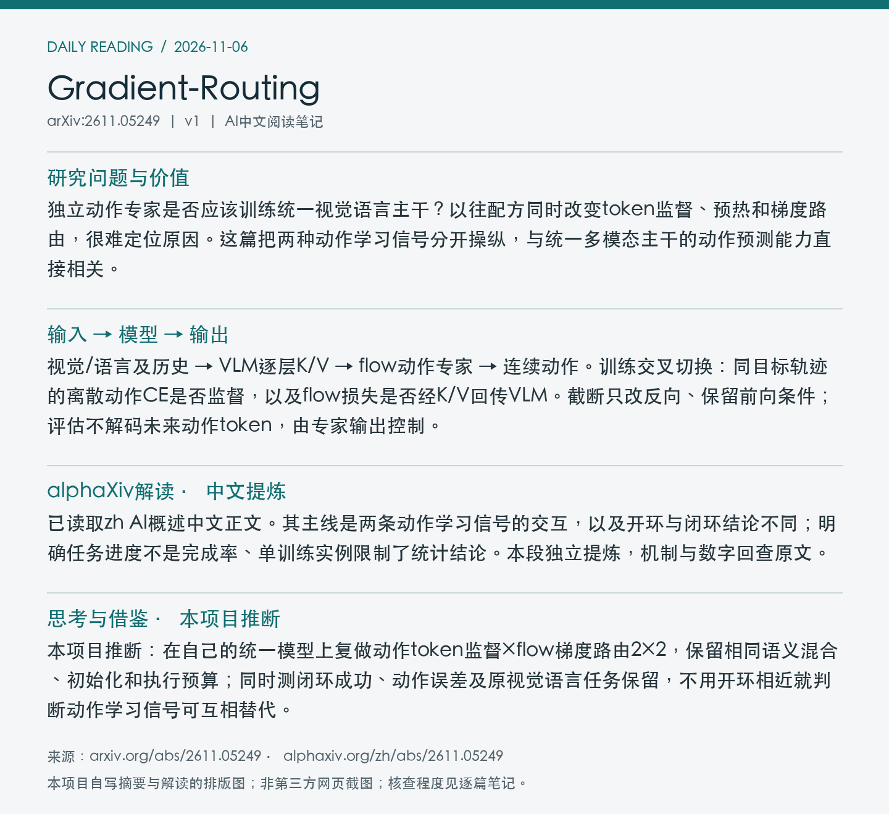

# 2611.05249 · Gradient-Routing

Should the Action Expert Train the VLM? Action-Token Supervision and Gradient Routing in Mixture-of-Transformer VLAs

[arXiv原文](https://arxiv.org/abs/2611.05249) · [v1 HTML](https://arxiv.org/html/2611.05249v1) · [alphaXiv zh中文概述](https://www.alphaxiv.org/zh/abs/2611.05249) · [作者项目页](https://mot-vla-gradient-routing.github.io/)

v1首次提交：2026-11-04T01:35:27+08:00（Asia/Shanghai）；2026-11-06首次收录。方向：VLA、gradient-routing、action-token-supervision、closed-loop-evaluation。此次为首次归档；早于成功边界的提交纳入7天补漏，不把归档日期当首发日期。

**阅读程度**：选读原文第3节完整受控设计、第4节驾驶/操作结果与第5节讨论，部分实现及评估协议；已读alphaXiv zh AI概述中文正文及作者项目页，已检查PDF第4页图2。未通读全部附录，未核查实现或复现。

## 中文摘要 · 本项目AI改写

该研究用动作token监督开/关与动作专家梯度回传/截断的2×2对照，检验VLM如何获得控制相关表示。无动作token时回传明显改善轨迹误差；有token时开环差异较小，但部分闭环驾驶与操作仍受益。结果支持按监督和评测选择路由，不能推出耦合总更好，或截断一定保留通用能力。

## 核心问题与方法

独立动作专家是否应该训练统一视觉语言主干？以往配方同时改变token监督、预热和梯度路由，很难定位原因。这篇把两种动作学习信号分开操纵，与统一多模态主干的动作预测能力直接相关。

**输入 → 模型处理 → 输出**：视觉/语言及历史 → VLM逐层K/V → flow动作专家 → 连续动作。训练交叉切换：同目标轨迹的离散动作CE是否监督，以及flow损失是否经K/V回传VLM。截断只改反向、保留前向条件；评估不解码未来动作token，由专家输出控制。

语义/VQA监督始终保留；关闭动作CE只屏蔽未来动作值的CE，token仍teacher-forced，专家K/V排除未来动作token状态。驾驶比较300k总步并行训练，以及100k单模块预热＋200k联合；总步匹配不代表各模块更新次数相同。操作复做π0.5和MolmoAct2并行2×2，各家内部固定数据、初始化与优化。

Figure 2：动作token监督、专家到VLM梯度路由的四条件，以及三种300k总步训练历史。总步数相同不保证模块梯度暴露相同。 来源：[v1 PDF](https://arxiv.org/pdf/2611.05249v1)第4页；左上角point坐标[108, 81, 503, 234]，3倍渲染。PDF SHA256、抓取时间及图像哈希见[元数据](metadata.json)。已逐张目视核查；完整PDF不入Git。

## 主要证据与局限

PolaRiS三个任务、每条件每任务50次相同初始状态rollout，指标为等权归一化任务进度而非成功率。π0.5重实现：FAST开时截断19.5%→回传30.7%，FAST关10.3→32.9%；MolmoAct2分别22.0→24.3%、14.5→36.5%。每条件仅一次训练，评估重采样区间不衡量训练种子方差。

全部为模拟驾驶与操作。耦合对不同碰撞指标不一致，不能只看进度就宣称更安全；固定模型的理由匹配诊断也不等于全面语义保留。跨训练历史的模块预算和预热数据并不相同；结果不构成默认总应回传的证明。参数量与总费用未独立核实。

### 开环与闭环回答不同问题

驾驶Public Golden有1434样本、OOD273；主指标是六个候选中的第一条轨迹ADE，并非oracle minADE。无动作token的并行训练中，Public Golden截断3.21m、回传2.36m，约降26%；有token时路由差距小。

AlpaSim同827场景、每场景五次随机rollout：有token时路线进度0.600→0.703，无token时0.425→0.601，后者是17.6个百分点而非17.6%相对提升。不能把路线进度当作无碰撞成功率；一些有token的耦合分阶段模型责任碰撞率更高。

| 操作模型 | FAST动作监督 | 截断：平均进度 | 回传：平均进度 |
| --- | --- | ---: | ---: |
| π0.5重实现 | 开 | 19.5% | 30.7% |
| π0.5重实现 | 关 | 10.3% | 32.9% |
| MolmoAct2 | 开 | 22.0% | 24.3% |
| MolmoAct2 | 关 | 14.5% | 36.5% |

操作任务为BlockStackKitchen、FoodBussing、PanClean，按各评分条目达成比例等权平均。驾驶95%区间来自固定检查点的clip-cluster bootstrap，不是多个训练实例。论文把token CE与专家梯度解释为部分替代信号；此机制解释尚未被唯一识别。

## alphaXiv zh AI概述 · 中文提炼

已读取zh AI概述中文正文。其主线是两条动作学习信号的交互，以及开环与闭环结论不同；明确任务进度不是完成率、单训练实例限制了统计结论。本段独立提炼，机制与数字回查原文。

[中文版来源](https://www.alphaxiv.org/zh/abs/2611.05249)，实际读取2026-11-06T11:03:39+08:00。已核实AI概述正文中文，非仅检查zh入口；不是全文转载。

## 研究联系与下一步 · 本项目推断

本项目推断：在自己的统一模型上复做动作token监督×flow梯度路由2×2，保留相同语义混合、初始化和执行预算；同时测闭环成功、动作误差及原视觉语言任务保留，不用开环相近就判断动作学习信号可互相替代。

## 代码、权重与数据状态

作者项目页可访问，本次页面链接未给出本研究训练代码/权重/数据下载入口；AlpaSim或上游模型公开不等于该2×2实验产物已发布。未核查实现或运行实验。

## 自写摘要与阅读卡片

以下为自写内容排版，非第三方网页截图。

[论文目录](../README.md) · [当日日报](../../reports/2026/11/06.md)
