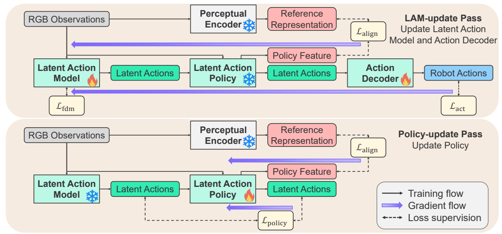
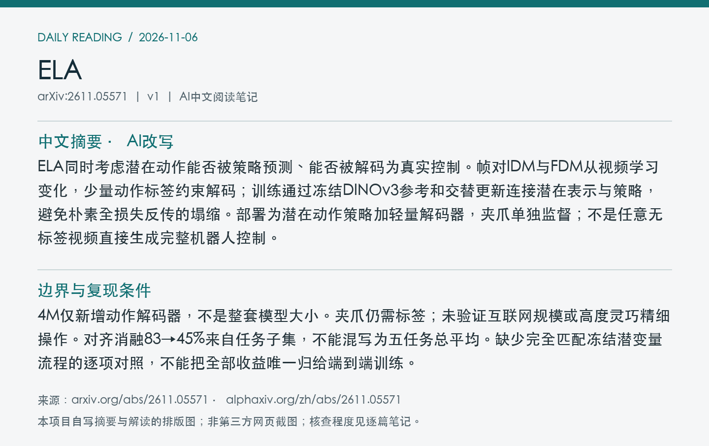
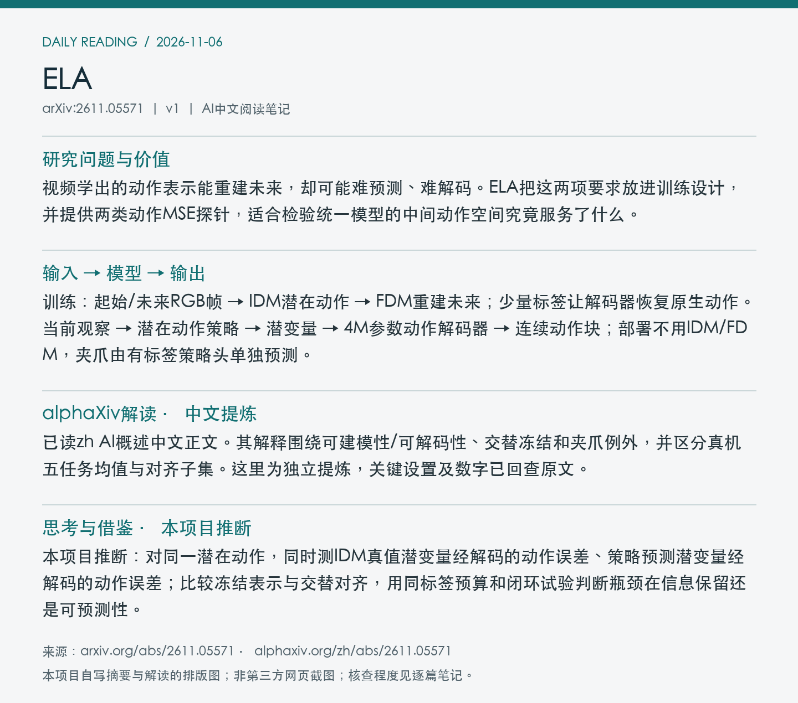

# 2611.05571 · ELA

ELA: End-to-End Latent Action Policy Learning from Video Demonstrations

[arXiv原文](https://arxiv.org/abs/2611.05571) · [v1 HTML](https://arxiv.org/html/2611.05571v1) · [alphaXiv zh中文概述](https://www.alphaxiv.org/zh/abs/2611.05571) · [作者项目页](https://end2end-latent-action.github.io/)

v1首次提交：2026-11-04T04:03:16+08:00（Asia/Shanghai）；2026-11-06首次收录。方向：latent-action、video-learning、representation-alignment、cross-embodiment。此次为首次归档；早于成功边界的提交纳入7天补漏，不把归档日期当首发日期。

**阅读程度**：选读原文第3节方法、第4节仿真/真机/表示分析和局限，附录B真机协议、C部分实现中的夹爪解码与训练日程；已读alphaXiv zh AI概述中文正文、作者项目页，查看PDF第5页图3。未核查实现或复现。

## 中文摘要 · 本项目AI改写

ELA同时考虑潜在动作能否被策略预测、能否被解码为真实控制。帧对IDM与FDM从视频学习变化，少量动作标签约束解码；训练通过冻结DINOv3参考和交替更新连接潜在表示与策略，避免朴素全损失反传的塌缩。部署为潜在动作策略加轻量解码器，夹爪单独监督；不是任意无标签视频直接生成完整机器人控制。

## 核心问题与方法

视频学出的动作表示能重建未来，却可能难预测、难解码。ELA把这两项要求放进训练设计，并提供两类动作MSE探针，适合检验统一模型的中间动作空间究竟服务了什么。

**输入 → 模型处理 → 输出**：训练：起始/未来RGB帧 → IDM潜在动作 → FDM重建未来；少量标签让解码器恢复原生动作。当前观察 → 潜在动作策略 → 潜变量 → 4M参数动作解码器 → 连续动作块；部署不用IDM/FDM，夹爪由有标签策略头单独预测。

采用iFSQ瓶颈限制图像记忆；先5k步只训练未来重建与动作重建，再交替LAM更新和策略更新。LAM更新冻结策略，以对齐、动作和FDM目标塑造潜变量；策略更新冻结LAM。两者对齐同一冻结DINOv3参考，不是每次梯度贯穿全部模块。目标任务微调时IDM和解码器冻结。

Figure 3：上为LAM更新，冻结策略但允许通过固定策略运算塑造潜变量；下为策略更新，冻结LAM。火焰/雪花表示当前更新范围，不是部署模块。 来源：[v1 PDF](https://arxiv.org/pdf/2611.05571v1)第5页；左上角point坐标[105, 69, 505, 256]，3倍渲染。PDF SHA256、抓取时间及图像哈希见[元数据](metadata.json)。已逐张目视核查；完整PDF不入Git。

## 主要证据与局限

LIBERO-10每任务50演示，其中仅5条带动作标签，三随机种子；ELA将DP31→54%、UWM19→59%。先在全部任务数据预训练，再单任务微调，不是仅5条轨迹完成所有训练。真机五任务每项10机器人标签＋40人类视频、20次评估：ELA-DP平均70%，DP48%，open-oven反而30%对35%。

4M仅新增动作解码器，不是整套模型大小。夹爪仍需标签；未验证互联网规模或高度灵巧精细操作。对齐消融83→45%来自任务子集，不能混写为五任务总平均。缺少完全匹配冻结潜变量流程的逐项对照，不能把全部收益唯一归给端到端训练。

### 把表示探针和控制结果分开

在20条留出真机机器人演示上，可解码性用帧对IDM潜变量解码后的动作MSE；可建模性用策略预测潜变量解码后的动作MSE。完整ELA两者较低；无对齐版本可解码但难被策略预测。这与作者解释一致，不能把两者视作完全独立的因果量，也不应把论文所称MSE下界当作一般数学保证。

同标签预算真机对照中，Villa-X原模型27%，在本数据微调21%、从头训6%，ELA70%；基模/表示结构不同，不能据此唯一归因表示对齐。图5(b)去对齐83→45%来自任务子集，与五任务总平均70%不是同一条件。

Franka Panda，单场景相机作策略输入，另一个相机只评估；10Hz OSC，末端增量位姿。潜变量不包含夹爪开合，独立策略头以二值记录监督。默认16个4维寄存器是潜变量token设置，不能机械等同所有原生动作块长度。新增解码器约4M，部署仍有策略本身；未核算总成本。

## alphaXiv zh AI概述 · 中文提炼

已读zh AI概述中文正文。其解释围绕可建模性/可解码性、交替冻结和夹爪例外，并区分真机五任务均值与对齐子集。这里为独立提炼，关键设置及数字已回查原文。

[中文版来源](https://www.alphaxiv.org/zh/abs/2611.05571)，实际读取2026-11-06T11:00:41+08:00。已核实AI概述正文中文，非仅检查zh入口；不是全文转载。

## 研究联系与下一步 · 本项目推断

本项目推断：对同一潜在动作，同时测IDM真值潜变量经解码的动作误差、策略预测潜变量经解码的动作误差；比较冻结表示与交替对齐，用同标签预算和闭环试验判断瓶颈在信息保留还是可预测性。

## 代码、权重与数据状态

作者项目页可访问；本次未取得官方代码、训练后权重或该真人/机器人演示下载入口。页面模板仓库和比较方法的权重链接不当作ELA资源。未核查实现，训练总费用未核实。

## 自写摘要与阅读卡片

以下为自写内容排版，非第三方网页截图。

[论文目录](../README.md) · [当日日报](../../reports/2026/11/06.md)
