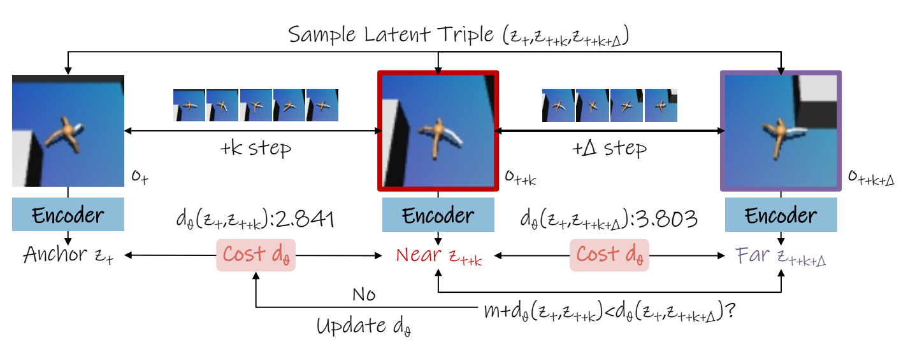
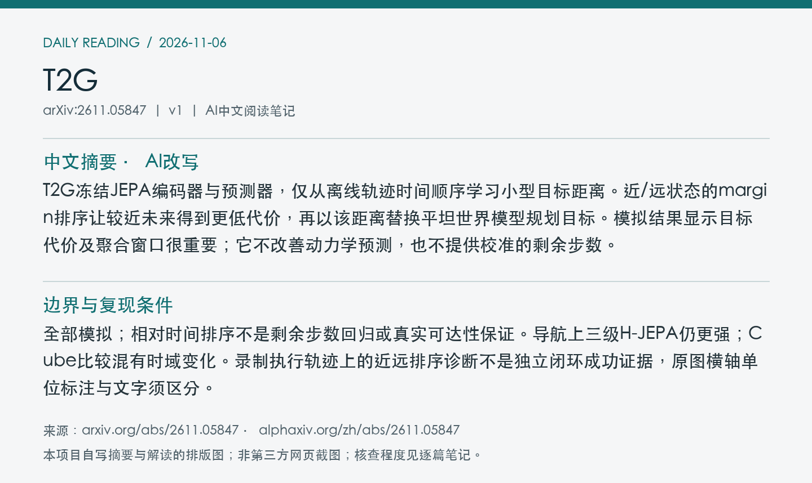
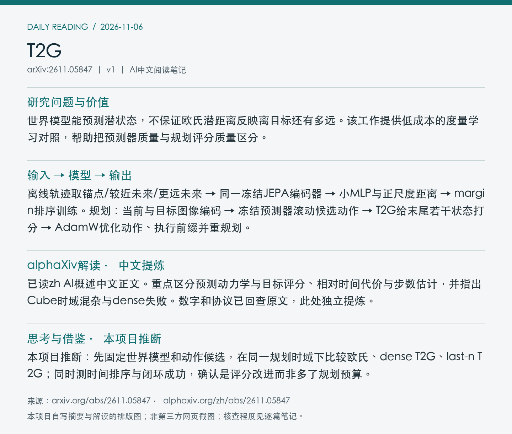

# 2611.05847 · T2G

Time-to-Goal: Learned Temporal Metrics for Long-Horizon Planning with JEPA World Models

[arXiv原文](https://arxiv.org/abs/2611.05847) · [v1 HTML](https://arxiv.org/html/2611.05847v1) · [alphaXiv zh中文概述](https://www.alphaxiv.org/zh/abs/2611.05847) · [官方仓库](https://github.com/yrluestc/T2G-JEPA) · [README](https://github.com/yrluestc/T2G-JEPA/blob/main/README.md)

v1首次提交：2026-11-04T10:36:31+08:00（Asia/Shanghai）；2026-11-06首次收录。方向：world-model、JEPA、planning-cost、temporal-metric。此次为首次归档；早于成功边界的提交纳入7天补漏，不把归档日期当首发日期。

**阅读程度**：选读原文第2节分析/训练/规划、第3节全部主实验及实现/评估设置；已读alphaXiv zh AI概述中文正文、官方仓库README，查看PDF第4页图3。未逐项验证数学推导、核查实现或复现。

## 中文摘要 · 本项目AI改写

T2G冻结JEPA编码器与预测器，仅从离线轨迹时间顺序学习小型目标距离。近/远状态的margin排序让较近未来得到更低代价，再以该距离替换平坦世界模型规划目标。模拟结果显示目标代价及聚合窗口很重要；它不改善动力学预测，也不提供校准的剩余步数。

## 核心问题与方法

世界模型能预测潜状态，不保证欧氏潜距离反映离目标还有多远。该工作提供低成本的度量学习对照，帮助把预测器质量与规划评分质量区分。

**输入 → 模型处理 → 输出**：离线轨迹取锚点/较近未来/更远未来 → 同一冻结JEPA编码器 → 小MLP与正尺度距离 → margin排序训练。规划：当前与目标图像编码 → 冻结预测器滚动候选动作 → T2G给末尾若干状态打分 → AdamW优化动作、执行前缀并重规划。

只训练度量与尺度，新增约0.18M参数；不使用奖励或策略标签。last-n取末尾状态平均，dense取所有预测状态。比较中Cube还把初始规划时域由4改2，其他三个环境保持基线设置，不能把四环境全部差异都归给度量。

Figure 3：从同一轨迹采样锚点、近未来和远未来，仅训练时间度量。图中示例距离不是校准剩余时间。 来源：[v1 PDF](https://arxiv.org/pdf/2611.05847v1)第4页；左上角point坐标[69, 60, 544, 240]，3倍渲染。PDF SHA256、抓取时间及图像哈希见[元数据](metadata.json)。已逐张目视核查；完整PDF不入Git。

## 主要证据与局限

四模拟环境各50个相同起点—目标任务、种子42/43/44：flat→last-n成功率AntMaze18.0→58.7%、Cube32.0→63.3%、FourRoom40.7→78.7%、Push-T40.0→51.3%。四环境均值32.7→63.0%；dense在Cube仅4.0%，窗口并非次要细节。

全部模拟；相对时间排序不是剩余步数回归或真实可达性保证。导航上三级H-JEPA仍更强；Cube比较混有时域变化。录制执行轨迹上的近远排序诊断不是独立闭环成功证据，原图横轴单位标注与文字须区分。

### 同环境、同协议比较

| 规划代价 | AntMaze | Cube | FourRoom | Push-T |
| --- | ---: | ---: | ---: | ---: |
| flat LeWM | 18.0% | 32.0% | 40.7% | 40.0% |
| T2G dense | 48.3% | 4.0% | 81.3% | 42.0% |
| T2G last-n | 58.7% | 63.3% | 78.7% | 51.3% |
| H-JEPA三级 | 73.3% | 60.0% | 96.0% | 17.3% |

表为原文三种子均值，各环境50固定任务；不同环境不能池化为统一机器人能力。last-n在前三者以外的Cube为1，其他为2；模型步与环境步有5倍时间压缩，不能混写时域单位。Cube flat起始H=4而T2G H=2，须额外同H对照定位代价净收益。

AntMaze/FourRoom各50条记录执行的长偏移诊断：近远排序53.44→67.69%、50.27→61.53%，仅说明所记录状态上的排序。较好度量不消除平坦模型的长时序预测误差，也不说明层级规划已无用。

## alphaXiv zh AI概述 · 中文提炼

已读zh AI概述中文正文。重点区分预测动力学与目标评分、相对时间代价与步数估计，并指出Cube时域混杂与dense失败。数字和协议已回查原文，此处独立提炼。

[中文版来源](https://www.alphaxiv.org/zh/abs/2611.05847)，实际读取2026-11-06T11:00:41+08:00。已核实AI概述正文中文，非仅检查zh入口；不是全文转载。

## 研究联系与下一步 · 本项目推断

本项目推断：先固定世界模型和动作候选，在同一规划时域下比较欧氏、dense T2G、last-n T2G；同时测时间排序与闭环成功，确认是评分改进而非多了规划预算。

## 代码、权重与数据状态

官方T2G-JEPA仓库可访问，已读README；其称包含四环境seed42度量权重，并提供上游数据/JEPA检查点入口，未下载或核验二进制。README提示默认配置混有dense和terminal，复现需显式选择last-n。未核查实现、未复现。

## 自写摘要与阅读卡片

以下为自写内容排版，非第三方网页截图。

[论文目录](../README.md) · [当日日报](../../reports/2026/11/06.md)
