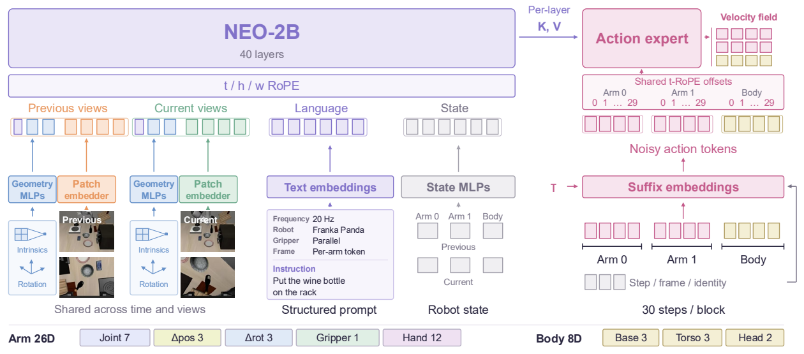
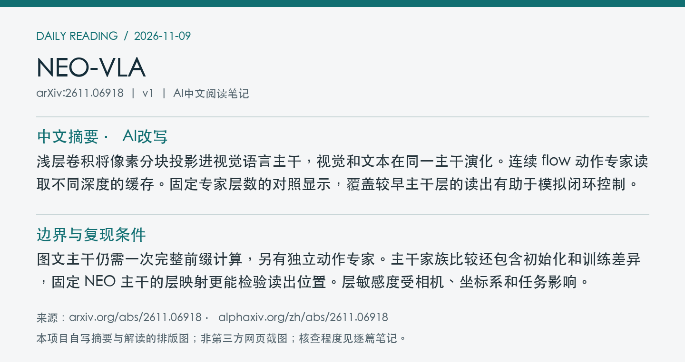
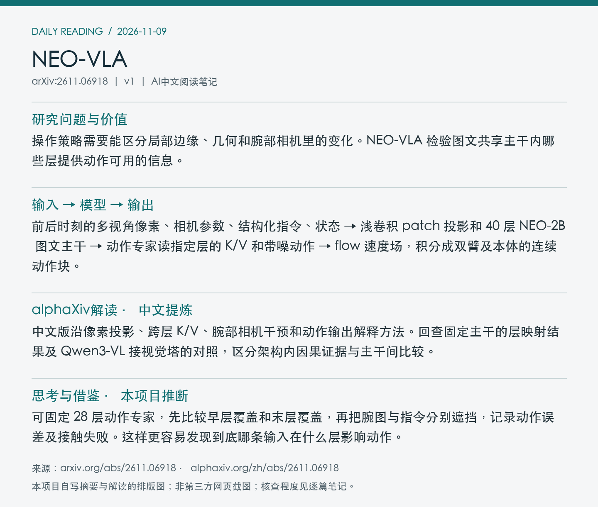

# 2611.06918 · NEO-VLA

From Pixels to Actions - Towards Native Vision-Language-Action Policies

[arXiv原文](https://arxiv.org/abs/2611.06918) · [v1 HTML](https://arxiv.org/html/2611.06918v1) · [alphaXiv zh中文概述](https://www.alphaxiv.org/zh/abs/2611.06918) · [官方 VLAKit](https://github.com/EvolvingLMMs-Lab/NEO/tree/main/VLAKit) · [权重库](https://huggingface.co/weepiess2383/NEO-VLA) · [数据更新提交](https://huggingface.co/datasets/weepiess2383/NEO-VLA-Action-Pretrain/commit/bdcd6c7e411358f0da9aed6c9d2c08a9f09bff02)

v1首次提交于2026-11-05T02:59:58+08:00（Asia/Shanghai）。本次在7天重叠检索中首次收录。研究方向包括VLA、native-visual-tokens、layer-routing、flow-matching。

**阅读程度**：选读原文第3节和第5节主干、层连接、图文共训、推理计时，核对PDF图2。已读alphaXiv中文AI概述。核对官方VLAKit目录和Hub清单及提交，未运行实现。

## 中文摘要 · 本项目AI改写

浅层卷积将像素分块投影进视觉语言主干，视觉和文本在同一主干演化。连续 flow 动作专家读取不同深度的缓存。固定专家层数的对照显示，覆盖较早主干层的读出有助于模拟闭环控制。

## 核心问题与方法

操作策略需要能区分局部边缘、几何和腕部相机里的变化。NEO-VLA 检验图文共享主干内哪些层提供动作可用的信息。

**输入 → 模型处理 → 输出**：前后时刻的多视角像素、相机参数、结构化指令、状态 → 浅卷积 patch 投影和 40 层 NEO-2B 图文主干 → 动作专家读指定层的 K/V 和带噪动作 → flow 速度场，积分成双臂及本体的连续动作块。

视觉按时间、高度、宽度使用分轴旋转位置，图像块内双向注意。相机内参与旋转分别映射，缺失本体维度掩码。层映射可让 28 层动作专家从全部深度均匀取层，或只连接后 28 层。两组保留同一个完整 40 层主干。

图2展示像素和多模态条件进入主干，分层 K/V 向 flow 动作专家提供条件。 摘自[v1 PDF](https://arxiv.org/pdf/2611.06918v1)第4页。裁剪采用左上角point坐标[99, 60, 519, 245]，3倍渲染。已目视核查。PDF SHA256、抓取时间及图像哈希见[元数据](metadata.json)。

## 主要证据与局限

LIBERO 四套件每套 500 回合，等步数对照中 skip-28 与 end-28 的冻结主干成功率为 90.9% 对 86.7%，全量微调为 95.3% 对 92.5%。在 Qwen3-VL 同一对照中，直接读视觉塔中间层使冻结设置从 79.5% 到 64.9%，全量微调近乎持平。NEO 附着点的替换实验发现早层更影响平移误差，腕部图像与指令的敏感深度不同。

图文主干仍需一次完整前缀计算，另有独立动作专家。主干家族比较还包含初始化和训练差异，固定 NEO 主干的层映射更能检验读出位置。层敏感度受相机、坐标系和任务影响。

单 RTX 3090、BF16、30 步原始动作块的计时中，10 次 Euler 的编译前向 282.5 ms，其中前缀 84.8 ms、动作采样 163.4 ms。评测区分前向、请求到动作与请求到可执行计划。2B 为主干大小，非整套策略参数。

## alphaXiv zh AI概述 · 中文提炼

中文版沿像素投影、跨层 K/V、腕部相机干预和动作输出解释方法。回查固定主干的层映射结果及 Qwen3-VL 接视觉塔的对照，区分架构内因果证据与主干间比较。

[中文版来源](https://www.alphaxiv.org/zh/abs/2611.06918)，实际读取2026-11-09T10:48:55+08:00。已核实并独立提炼中文AI概述正文。

## 研究联系与下一步 · 本项目推断

可固定 28 层动作专家，先比较早层覆盖和末层覆盖，再把腕图与指令分别遮挡，记录动作误差及接触失败。这样更容易发现到底哪条输入在什么层影响动作。

## 代码、权重与数据状态

[官方 VLAKit](https://github.com/EvolvingLMMs-Lab/NEO/tree/main/VLAKit)含训练、配置和实现目录。已核实[权重库](https://huggingface.co/weepiess2383/NEO-VLA)和[动作预训练数据入口](https://huggingface.co/datasets/weepiess2383/NEO-VLA-Action-Pretrain)的公开清单。11-08 15:03 的数据提交移除镜像视频并改用上游相机来源。22:04 的权重库提交调整 README 检查点表排序，未认定为新权重上传。

## 自写摘要与阅读卡片

以下两张卡片由本项目根据自写内容排版。

[论文目录](../README.md) · [当日日报](../../reports/2026/11/09.md)
