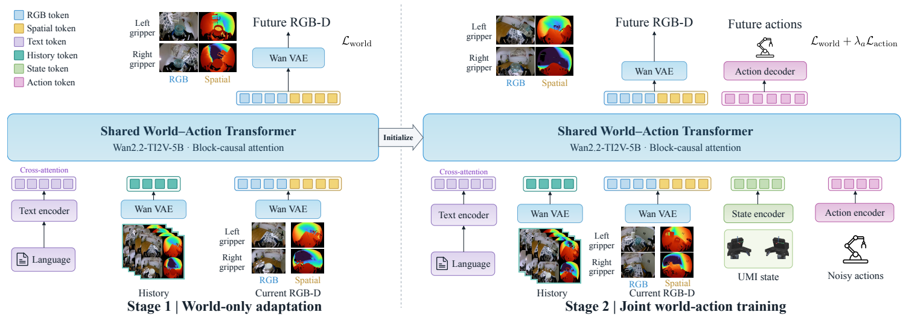
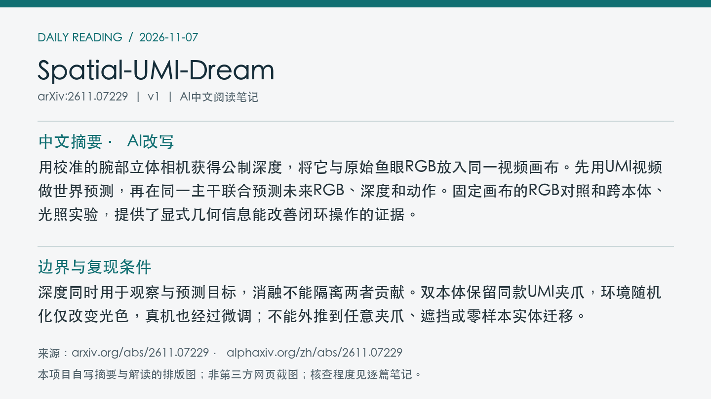
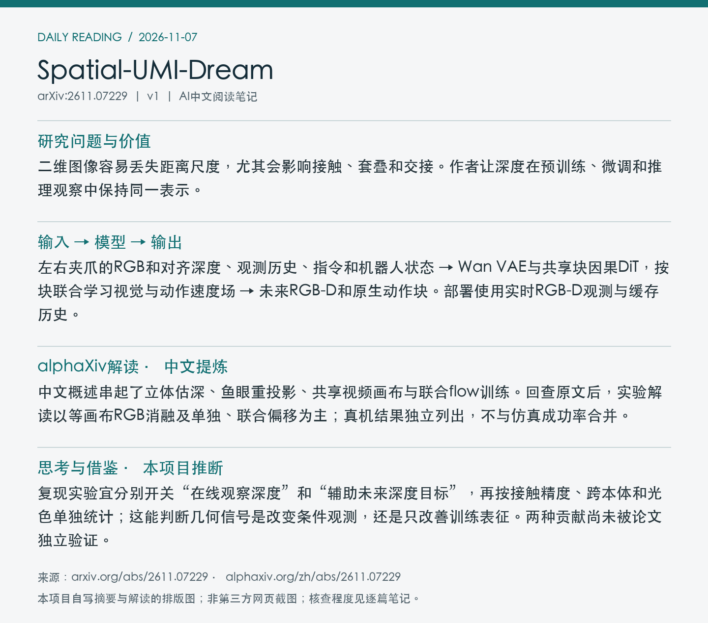

# 2611.07229 · Spatial-UMI-Dream

Spatial-UMI-Dream: Scaling World Action Models with Metric Geometry for UMI Manipulation

[arXiv原文](https://arxiv.org/abs/2611.07229) · [v1 HTML](https://arxiv.org/html/2611.07229v1) · [alphaXiv zh中文概述](https://www.alphaxiv.org/zh/abs/2611.07229) · [作者项目](https://weiduoyuan.com/spatial-umi-dream/) · [官方模型代码](https://github.com/Yewandou7/spatial_umi_dream) · [仿真基准](https://github.com/ZeYuan06/RoboTwin-UMI) · [官方权重入口](https://huggingface.co/Yewandou/spatial-umi-dream) · [仿真示范入口](https://huggingface.co/datasets/zeyuan0611/RoboTwin-UMI-data)

v1首次提交：2026-11-05T07:34:19+08:00（Asia/Shanghai）；2026-11-07首次收录。方向：WAM、metric-depth、UMI、cross-embodiment。此次为首次归档；早于成功边界的提交纳入7天补漏，不把归档日期当首发日期。

**阅读程度**：选读原文第III节方法、第IV–V节评测及消融、附录训练设置；核对PDF图2，已读alphaXiv zh中文概述。核对官方项目与两个仓库的文件列表及README；未运行代码。

## 中文摘要 · 本项目AI改写

用校准的腕部立体相机获得公制深度，将它与原始鱼眼RGB放入同一视频画布。先用UMI视频做世界预测，再在同一主干联合预测未来RGB、深度和动作。固定画布的RGB对照和跨本体、光照实验，提供了显式几何信息能改善闭环操作的证据。

## 核心问题与方法

二维图像容易丢失距离尺度，尤其会影响接触、套叠和交接。作者让深度在预训练、微调和推理观察中保持同一表示。

**输入 → 模型处理 → 输出**：左右夹爪的RGB和对齐深度、观测历史、指令和机器人状态 → Wan VAE与共享块因果DiT，按块联合学习视觉与动作速度场 → 未来RGB-D和原生动作块。部署使用实时RGB-D观测与缓存历史。

每个夹爪的中、右相机先校正，再由Fast FoundationStereo估视差；将公制Z深度投到中相机原始鱼眼平面。深度限幅并作Turbo三通道映射，两个夹爪各一行，RGB与深度各一列，每块160×160，共320×320，复用Wan VAE。用Wan2.2-TI2V-5B初始化，在605小时UMI语料上先以历史、文本预测未来RGB-D，不使用状态、动作；再以动作标注子集加入状态和带噪动作。共享注意力块允许同一世界—动作块双向交互，训练使用真实视觉历史，两种预测以加权flow损失共同优化。

图2：左为仅世界预测的适配阶段，右为加入状态和动作的联合训练。 来源：[v1 PDF](https://arxiv.org/pdf/2611.07229v1)第3页；左上角point坐标[55, 53, 557, 231]，3倍渲染。PDF SHA256、抓取时间及图像哈希见[元数据](metadata.json)。已逐张目视核查；完整PDF不入Git。

## 主要证据与局限

RoboTwin-UMI：20任务，每任务50条干净Aloha-AgileX示范，评测每任务每条件100回合。干净同分布成功率79.10%，π0.5为74.45%；只随机光色时73.35%对66.15%；换ARX-X5并随机光色时72.15%对61.85%。同画布RGB复制对照固定数据和训练日程，干净场景73.35%对79.10%，双偏移相差8.25个百分点。Dexmate Vega1六项真机任务各20回合，使用下游示范微调后平均整回合成功85.0%，π0.5为60.8%。

深度同时用于观察与预测目标，消融不能隔离两者贡献。双本体保留同款UMI夹爪，环境随机化仅改变光色，真机也经过微调；不能外推到任意夹爪、遮挡或零样本实体迁移。

原文报告两阶段各30,000步、24张RTX PRO 6000；每项下游微调8卡。605小时为语料量，两个阶段并非都用全量动作标签；未核实完整GPU小时或费用。

## alphaXiv zh AI概述 · 中文提炼

中文概述串起了立体估深、鱼眼重投影、共享视频画布与联合flow训练。回查原文后，实验解读以等画布RGB消融及单独、联合偏移为主；真机结果独立列出，不与仿真成功率合并。

[中文版来源](https://www.alphaxiv.org/zh/abs/2611.07229)，实际读取2026-11-07T18:44:36+08:00。已核实AI概述正文中文，非仅检查zh入口；不是全文转载。

## 研究联系与下一步 · 本项目推断

复现实验宜分别开关“在线观察深度”和“辅助未来深度目标”，再按接触精度、跨本体和光色单独统计；这能判断几何信号是改变条件观测，还是只改善训练表征。两种贡献尚未被论文独立验证。

## 代码、权重与数据状态

[模型仓库](https://github.com/Yewandou7/spatial_umi_dream)与[RoboTwin-UMI](https://github.com/ZeYuan06/RoboTwin-UMI)可访问。两仓库创建时间分别为11-06 04:30:29、11:19:03（北京时间），不是精确的首次公开时刻。README列出[预训练与基准微调权重](https://huggingface.co/Yewandou/spatial-umi-dream)及[仿真训练示范](https://huggingface.co/datasets/zeyuan0611/RoboTwin-UMI-data)；HF文件清单请求超时，未独立确认文件与发布日期。未核实605小时预训练语料或真机数据发布。

**2026-11-09 资源补查。** 官方 Hub 清单已确认预训练、仿真微调权重及 RoboTwin-UMI 示范。 [文件清单核验](../../data/source-checks/2026-11-09-hub.json)。

## 自写摘要与阅读卡片

以下为自写内容排版，非第三方网页截图。

[论文目录](../README.md) · [当日日报](../../reports/2026/11/07.md)
