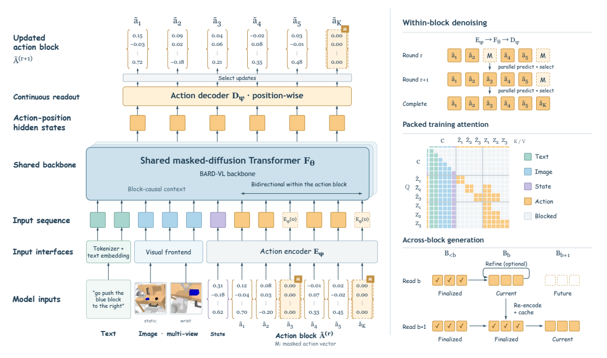
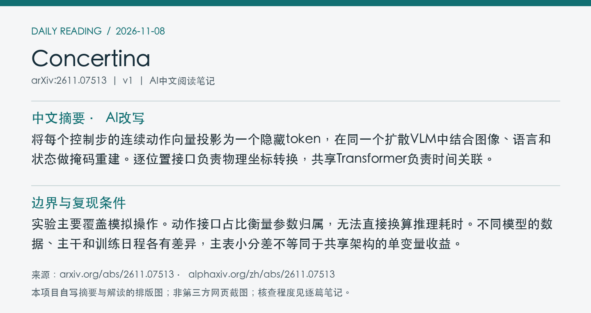
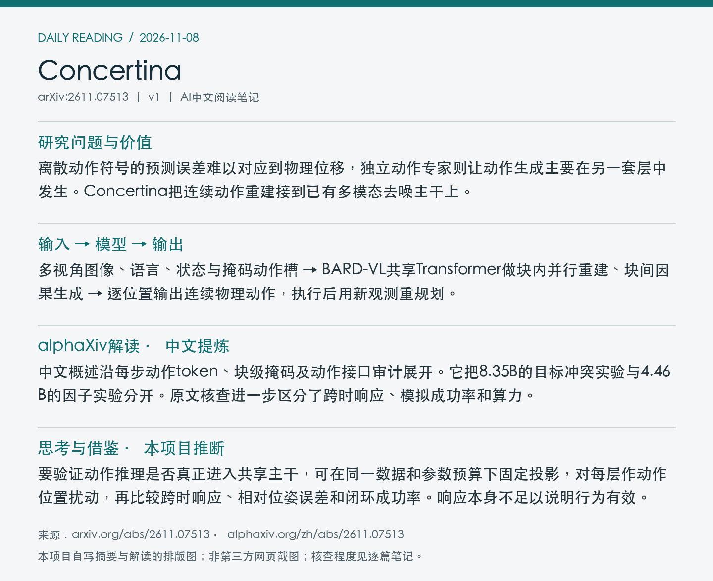

# 2611.07513 · Concertina

Concertina: Embodying Manipulation and Cognition in One Diffusion Vision-Language Model

[arXiv原文](https://arxiv.org/abs/2611.07513) · [v1 HTML](https://arxiv.org/html/2611.07513v1) · [alphaXiv zh中文概述](https://www.alphaxiv.org/zh/abs/2611.07513) · [官方代码](https://github.com/lose4578/Concertina) · [作者权重入口](https://huggingface.co/collections/Traly/concertina)

v1首次提交于2026-11-05T14:20:37+08:00（Asia/Shanghai）。本次在7天重叠检索中首次收录。研究方向包括unified-multimodal、continuous-action、masked-diffusion、VLA。

**阅读程度**：选读原文第3、4节、表2、5、6和附录A及B.1，核对PDF图1。已读alphaXiv中文AI概述及官方GitHub README和目录。未运行实现或基准。

## 中文摘要 · 本项目AI改写

将每个控制步的连续动作向量投影为一个隐藏token，在同一个扩散VLM中结合图像、语言和状态做掩码重建。逐位置接口负责物理坐标转换，共享Transformer负责时间关联。

## 核心问题与方法

离散动作符号的预测误差难以对应到物理位移，独立动作专家则让动作生成主要在另一套层中发生。Concertina把连续动作重建接到已有多模态去噪主干上。

**输入 → 模型处理 → 输出**：多视角图像、语言、状态与掩码动作槽 → BARD-VL共享Transformer做块内并行重建、块间因果生成 → 逐位置输出连续物理动作，执行后用新观测重规划。

每个时间步只占一个连续token，异构本体用维度有效性掩码。训练把图文前缀、腐化动作与教师强制的干净动作打包，待重建位置只能读同块腐化动作与更早的干净块。监督直接施加在归一化动作坐标。推理缓存前缀和已定稿的块，轻量风险头可对高误差槽重掩码。

图1展示共享掩码扩散主干、逐位置动作读写、打包训练可见性及跨块缓存。 摘自[v1 PDF](https://arxiv.org/pdf/2611.07513v1)第3页。裁剪采用左上角point坐标[118, 75, 492, 296]，3倍渲染。已目视核查。PDF SHA256、抓取时间及图像哈希见[元数据](metadata.json)。

## 主要证据与局限

表2普通LIBERO四套件、每任务50回合、总2,000回合，平均成功98.15%。LIBERO-Plus覆盖10,030个扰动任务，成功8,615次（85.9%）。CALVIN ABC–D的1,000条五任务指令链中，平均完成4.142项。动作接口审计用有限差分扰动定位跨时响应，逐位置接口本身不跨时混合，中后层共享主干出现非局部响应。4.46B模型中活跃动作投影约0.21%。

实验主要覆盖模拟操作。动作接口占比衡量参数归属，无法直接换算推理耗时。不同模型的数据、主干和训练日程各有差异，主表小分差不等同于共享架构的单变量收益。

原文报告预训练混合146,433段、80.2M帧，分60,000及30,000次更新，用8张GPU。报告了全局batch，未核实全部GPU小时。8.35B单独干预在同一相对动作模型加入冻结绝对动作读出后，CALVIN 1,000条链平均由2.970降至0.237。该实验支持目标冲突的可能性，不能分离梯度方向与其他干预影响。

## alphaXiv zh AI概述 · 中文提炼

中文概述沿每步动作token、块级掩码及动作接口审计展开。它把8.35B的目标冲突实验与4.46B的因子实验分开。原文核查进一步区分了跨时响应、模拟成功率和算力。

[中文版来源](https://www.alphaxiv.org/zh/abs/2611.07513)，实际读取2026-11-08T06:59:28+08:00。已核实并独立提炼中文AI概述正文。

## 研究联系与下一步 · 本项目推断

要验证动作推理是否真正进入共享主干，可在同一数据和参数预算下固定投影，对每层作动作位置扰动，再比较跨时响应、相对位姿误差和闭环成功率。响应本身不足以说明行为有效。

## 代码、权重与数据状态

[官方GitHub](https://github.com/lose4578/Concertina)公开训练、评测和配置目录。README列出[权重合集](https://huggingface.co/collections/Traly/concertina)、预训练和任务检查点及数据转换入口。Hub文件未独立核实，确切公开日期未核实。数据主体是既有来源，代码仓库包含处理说明。

**2026-11-09 资源补查。** 已取得 90k 预训练权重清单，其他任务权重仍待逐项核对。 [文件清单核验](../../data/source-checks/2026-11-09-hub.json)。

## 自写摘要与阅读卡片

以下两张卡片由本项目根据自写内容排版。

[论文目录](../README.md) · [当日日报](../../reports/2026/11/08.md)
