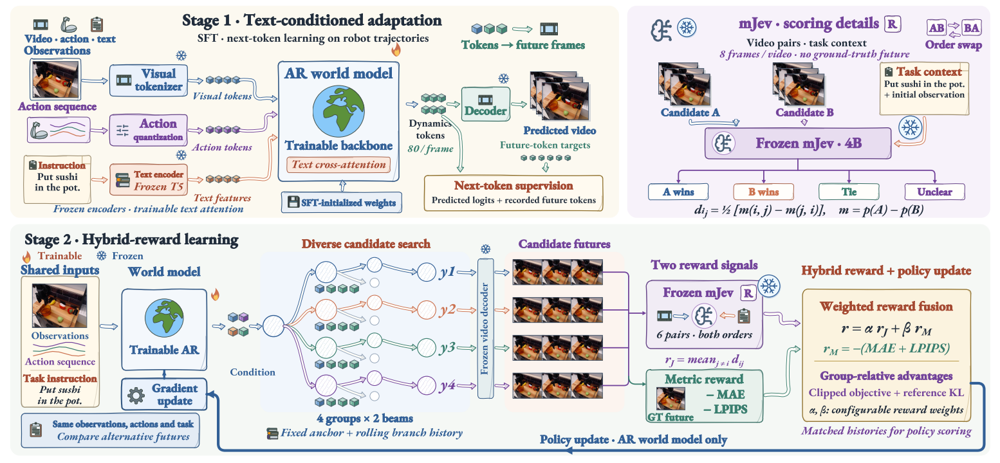
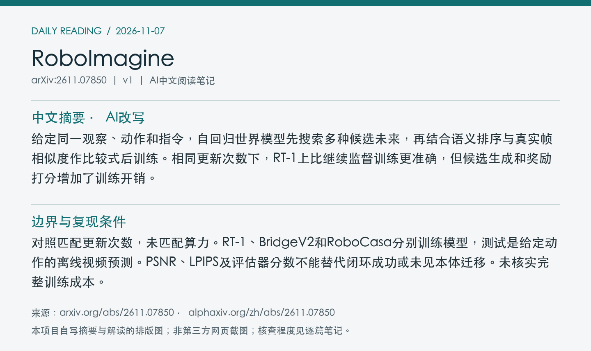

# 2611.07850 · RoboImagine

Learning Robotic World Models with Semantic and Visual Feedback

[arXiv原文](https://arxiv.org/abs/2611.07850) · [v1 HTML](https://arxiv.org/html/2611.07850v1) · [alphaXiv zh中文概述](https://www.alphaxiv.org/zh/abs/2611.07850) · [官方代码](https://github.com/Alexander-wu/RoboImagine) · [官方模型入口](https://huggingface.co/easylearning/RoboImagine)

v1首次提交：2026-11-05T19:30:01+08:00（Asia/Shanghai）；2026-11-07首次收录。方向：robot-world-model、action-conditioned-video、post-training、semantic-feedback。此次为首次归档；早于成功边界的提交纳入7天补漏，不把归档日期当首发日期。

**阅读程度**：选读原文第3–4节、表II、图7和成本说明；核对PDF图2。已读alphaXiv zh实际中文概述及官方仓库README，未核查代码实现或复现。

## 中文摘要 · 本项目AI改写

给定同一观察、动作和指令，自回归世界模型先搜索多种候选未来，再结合语义排序与真实帧相似度作比较式后训练。相同更新次数下，RT-1上比继续监督训练更准确，但候选生成和奖励打分增加了训练开销。

## 核心问题与方法

任务进展合理的视频可能仍有局部视觉错误；只做重建训练又很难直接表达语义目标。作者让同一已知动作序列的多个候选相互竞争。

**输入 → 模型处理 → 输出**：观察、已给定动作序列和指令 → 冻结视觉codec、动作量化、冻结T5及可训练文本交叉注意力，自回归生成视觉token → 解码未来视频。训练先做SFT，后用候选反馈更新世界模型；不输出机器人动作。

训练用4组×2束搜索，各组保留一条完成候选，跨组多样性以软惩罚鼓励。固定初始锚点并维护分支特定滚动历史，训练生成与回放打分用一致前缀。冻结mJev 4B接收初始上下文、指令和每候选8帧，两种呈现顺序进行成对判断；不接收数值动作或真实未来。视觉奖励以GT帧计算负MAE与LPIPS。两者混合，用组相对优势和参考约束更新生成器；部署普通束搜索，无需评估器或GT。

图2：上为文本条件监督训练与冻结语义打分；下为候选搜索、两种奖励和组相对更新。 来源：[v1 PDF](https://arxiv.org/pdf/2611.07850v1)第4页；左上角point坐标[47, 45, 565, 285]，3倍渲染。PDF SHA256、抓取时间及图像哈希见[元数据](metadata.json)。已逐张目视核查；完整PDF不入Git。

## 主要证据与局限

同一50,000步SFT初始化后各做500次更新，在同128条RT-1留出轨迹、32帧、同解码器下，继续SFT的21.31 dB提升到22.57 dB，LPIPS相对降低11.93%。仅后训练循环用时1.06与28.15 GPU小时。固定候选搜索，在同97条有有效语义评估的RT-1轨迹上，独立Qwen的平均语义分从仅视觉奖励7.972到组合8.301；视觉单项的像素/感知保真更好。

对照匹配更新次数，未匹配算力。RT-1、BridgeV2和RoboCasa分别训练模型，测试是给定动作的离线视频预测。PSNR、LPIPS及评估器分数不能替代闭环成功或未见本体迁移。未核实完整训练成本。

## alphaXiv zh AI概述 · 中文提炼

中文概述强调比较式反馈和固定锚点与滚动历史的配合，也明确区分等更新与等计算量。原文补充显示，合成奖励改善评估器的任务语义打分，却不一定给出最好的视觉保真。

[中文版来源](https://www.alphaxiv.org/zh/abs/2611.07850)，实际读取2026-11-07T18:44:36+08:00。已核实AI概述正文中文，非仅检查zh入口；不是全文转载。

## 研究联系与下一步 · 本项目推断

把多候选语义评分迁移到VLA前，先用带反事实动作的配对数据验证“视频预测排序能否恢复真实动作优劣”，再验证闭环，避免把表面进展当作动作因果有效性。

## 代码、权重与数据状态

[官方仓库](https://github.com/Alexander-wu/RoboImagine)可访问。README列出[模型入口](https://huggingface.co/easylearning/RoboImagine)及三个数据域对应的模型和SFT检查点、少量示例；官方模型文件清单请求超时，未核实权重可下载及发布日期。RT-1、BridgeV2和RoboCasa是原有数据源，示例不能当作全量训练数据发布。

**2026-11-09 资源补查。** 官方 Hub 清单已确认 RT-1、Bridge 和 RoboCasa 各自的主模型与 SFT 权重。 [文件清单核验](../../data/source-checks/2026-11-09-hub.json)。

## 自写摘要与阅读卡片

以下为自写内容排版，非第三方网页截图。

[论文目录](../README.md) · [当日日报](../../reports/2026/11/07.md)
