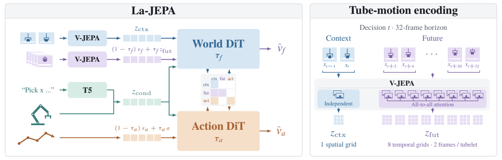
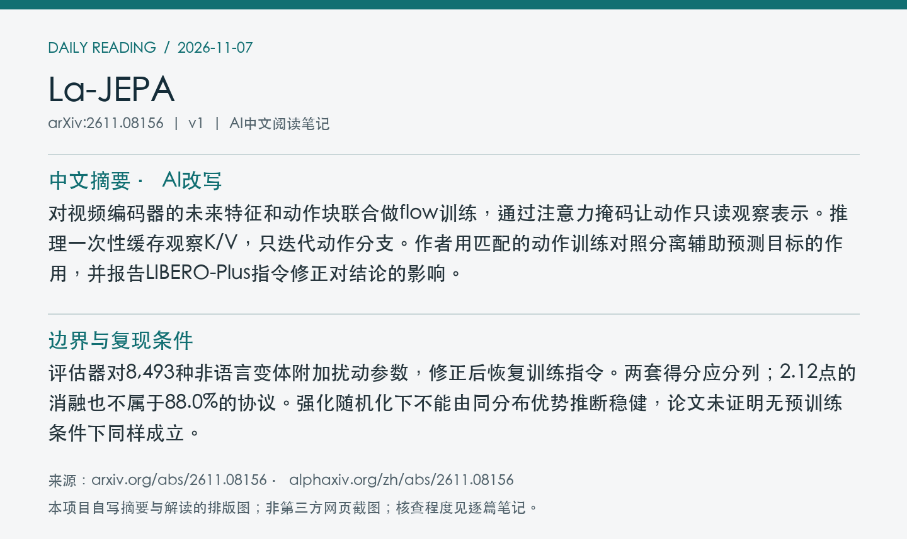
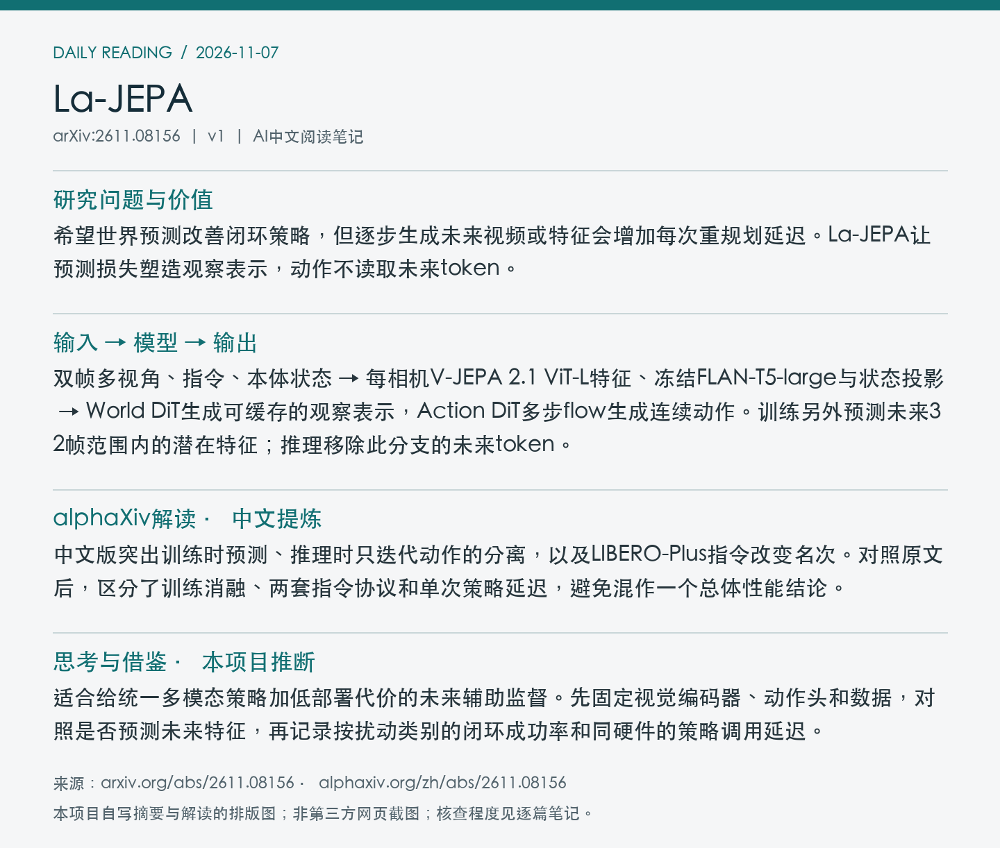

# 2611.08156 · La-JEPA

La-JEPA: Compact Robot Policies with Latent World Modeling

[arXiv原文](https://arxiv.org/abs/2611.08156) · [v1 HTML](https://arxiv.org/html/2611.08156v1) · [alphaXiv zh中文概述](https://www.alphaxiv.org/zh/abs/2611.08156) · [作者仓库（空）](https://github.com/mt-clemente/lajepa)

v1首次提交：2026-11-05T23:16:38+08:00（Asia/Shanghai）；2026-11-07首次收录。方向：latent-world-model、flow-matching、VLA、efficient-inference。此次为首次归档；早于成功边界的提交纳入7天补漏，不把归档日期当首发日期。

**阅读程度**：选读原文第3–5节、附录B.2、C.1及指令修正表；核对PDF图2。已读alphaXiv zh实际中文概述。核实GitHub仓库存在但无内容，未核查实现。

## 中文摘要 · 本项目AI改写

对视频编码器的未来特征和动作块联合做flow训练，通过注意力掩码让动作只读观察表示。推理一次性缓存观察K/V，只迭代动作分支。作者用匹配的动作训练对照分离辅助预测目标的作用，并报告LIBERO-Plus指令修正对结论的影响。

## 核心问题与方法

希望世界预测改善闭环策略，但逐步生成未来视频或特征会增加每次重规划延迟。La-JEPA让预测损失塑造观察表示，动作不读取未来token。

**输入 → 模型处理 → 输出**：双帧多视角、指令、本体状态 → 每相机V-JEPA 2.1 ViT-L特征、冻结FLAN-T5-large与状态投影 → World DiT生成可缓存的观察表示，Action DiT多步flow生成连续动作。训练另外预测未来32帧范围内的潜在特征；推理移除此分支的未来token。

World/Action DiT从头训练；最终方案对视觉编码器用LoRA。观察只看观察，未来可看观察与未来，动作可看观察与动作；未来和动作噪声时间独立。未来损失通过共享的World DiT影响观察表示，动作不依赖预测未来token；推理仍要运行视觉编码器和观察侧World DiT。

图2：潜在世界分支与动作分支的注意力连接，以及未来32帧范围内的tube-motion编码。 来源：[v1 PDF](https://arxiv.org/pdf/2611.08156v1)第4页；左上角point坐标[107, 82, 505, 209]，3倍渲染。PDF SHA256、抓取时间及图像哈希见[元数据](metadata.json)。已逐张目视核查；完整PDF不入Git。

## 主要证据与局限

固定架构比较动作单目标与加入未来特征目标：RoboTwin用2,500条干净示范，每条件5,000回合，干净/随机分别+7.0/+3.7个百分点，两个策略各自使用评估回合集。原始LIBERO-Plus评估协议下，训练用全量1,743条LIBERO示范，三种子平均74.35%→76.47%。正式表1中L部署参数1.78B（含编码器）；共同评测协议的10,030回合内，修正指令时L 88.0%、NowWAM 86.2%；发布指令时L 84.1%、NowWAM 86.2%。

评估器对8,493种非语言变体附加扰动参数，修正后恢复训练指令。两套得分应分列；2.12点的消融也不属于88.0%的协议。强化随机化下不能由同分布优势推断稳健，论文未证明无预训练条件下同样成立。

附录C批量1，单消费级GPU，20次预热后100次调用中位数：同为10去噪步，优化后的La-JEPA S为17.78 ms，Fast-WAM为88.09 ms。测量是完整策略调用，未覆盖通信与机器人执行；具体GPU型号本次未核实。

## alphaXiv zh AI概述 · 中文提炼

中文版突出训练时预测、推理时只迭代动作的分离，以及LIBERO-Plus指令改变名次。对照原文后，区分了训练消融、两套指令协议和单次策略延迟，避免混作一个总体性能结论。

[中文版来源](https://www.alphaxiv.org/zh/abs/2611.08156)，实际读取2026-11-07T18:44:37+08:00。已核实AI概述正文中文，非仅检查zh入口；不是全文转载。

## 研究联系与下一步 · 本项目推断

适合给统一多模态策略加低部署代价的未来辅助监督。先固定视觉编码器、动作头和数据，对照是否预测未来特征，再记录按扰动类别的闭环成功率和同硬件的策略调用延迟。

## 代码、权重与数据状态

[作者GitHub仓库](https://github.com/mt-clemente/lajepa)存在，但contents查询返回空仓库；当前未核实代码、模型权重或新增数据发布。论文使用已有LIBERO及RoboTwin等任务数据；完整训练成本未核实。

## 自写摘要与阅读卡片

以下为自写内容排版，非第三方网页截图。

[论文目录](../README.md) · [当日日报](../../reports/2026/11/07.md)
