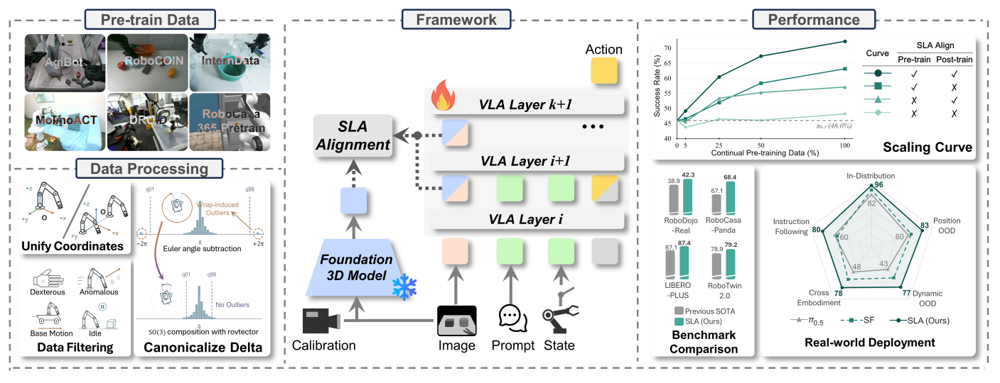
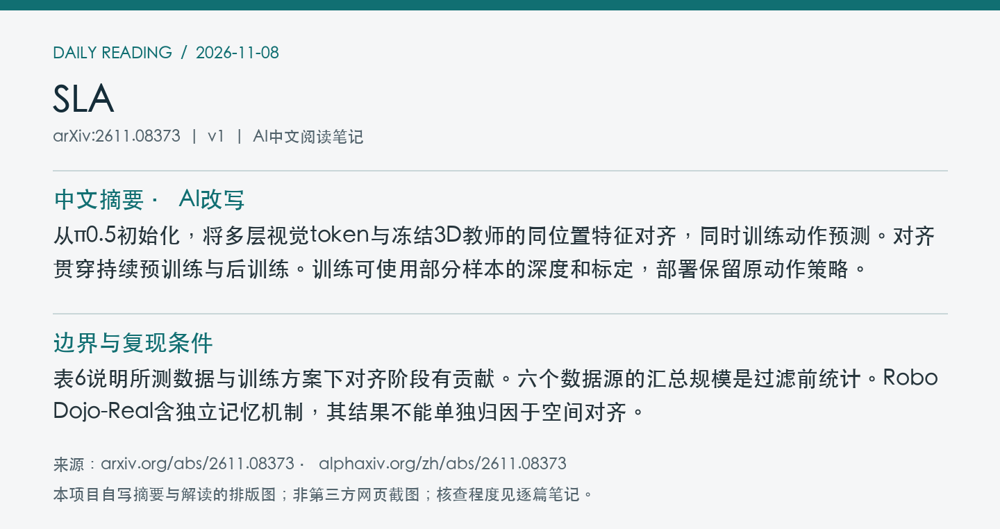
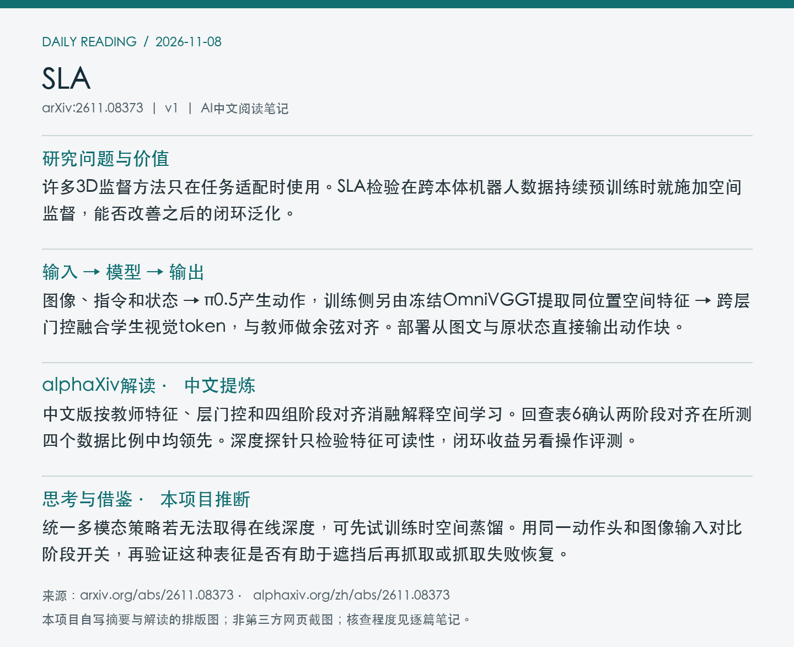

# 2611.08373 · SLA

SLA: Scaling Spatial-Language-Action Model via Continual Pre-training

[arXiv原文](https://arxiv.org/abs/2611.08373) · [v1 HTML](https://arxiv.org/html/2611.08373v1) · [alphaXiv zh中文概述](https://www.alphaxiv.org/zh/abs/2611.08373) · [官方代码](https://github.com/OpenHelix-Team/Spatial-Forcing/tree/master/SLA) · [SLA release提交](https://github.com/OpenHelix-Team/Spatial-Forcing/commit/501813c3795e31b1f5ed15e51fd3b6320cb8dd08)

v1首次提交于2026-11-06T01:52:16+08:00（Asia/Shanghai）。本次在7天重叠检索中首次收录。研究方向包括VLA、spatial-alignment、continual-pretraining、robot-data。

**阅读程度**：选读原文第3节方法与数据、第4节实验和表6至10，核对PDF图1。已读alphaXiv中文AI概述。核对官方SLA代码目录、README和发布提交，未复现实验。

## 中文摘要 · 本项目AI改写

从π0.5初始化，将多层视觉token与冻结3D教师的同位置特征对齐，同时训练动作预测。对齐贯穿持续预训练与后训练。训练可使用部分样本的深度和标定，部署保留原动作策略。

## 核心问题与方法

许多3D监督方法只在任务适配时使用。SLA检验在跨本体机器人数据持续预训练时就施加空间监督，能否改善之后的闭环泛化。

**输入 → 模型处理 → 输出**：图像、指令和状态 → π0.5产生动作，训练侧另由冻结OmniVGGT提取同位置空间特征 → 跨层门控融合学生视觉token，与教师做余弦对齐。部署从图文与原状态直接输出动作块。

教师可融合部分样本可用的深度及相机标定。共享投影和逐token逐通道的门控将不同视觉语言层对齐，联合优化动作与空间损失。训练随机移除整个状态段。跨本体数据统一末端坐标，旋转相对变化按SO(3)组合。部署移除教师、投影和门控。RoboDojo-Real另加历史记忆，部署保留历史图像。

图1概览机器人数据统一、冻结3D教师对齐与实验结果。 摘自[v1 PDF](https://arxiv.org/pdf/2611.08373v1)第1页。裁剪采用左上角point坐标[72, 507, 541, 687]，3倍渲染。已目视核查。PDF SHA256、抓取时间及图像哈希见[元数据](metadata.json)。

## 主要证据与局限

RoboTwin 2.0用50项双臂任务、每项50条干净示范、每条件100回合/任务。表6全量数据的Clean2Random任务均值为无对齐48.2%、仅后训练57.1%、仅持续预训练63.2%、两阶段均对齐72.3%。双对齐在5/25/50/100%预训练数据下为49.2/60.5/67.4/72.3%。

表6说明所测数据与训练方案下对齐阶段有贡献。六个数据源的汇总规模是过滤前统计。RoboDojo-Real含独立记忆机制，其结果不能单独归因于空间对齐。

论文报告持续预训练36k次更新，约48张H100运行110小时。六来源筛选前约170万回合、14,330小时。预训练的完整处理后数据量和全部实验成本未核实。

## alphaXiv zh AI概述 · 中文提炼

中文版按教师特征、层门控和四组阶段对齐消融解释空间学习。回查表6确认两阶段对齐在所测四个数据比例中均领先。深度探针只检验特征可读性，闭环收益另看操作评测。

[中文版来源](https://www.alphaxiv.org/zh/abs/2611.08373)，实际读取2026-11-08T06:58:46+08:00。已核实并独立提炼中文AI概述正文。

## 研究联系与下一步 · 本项目推断

统一多模态策略若无法取得在线深度，可先试训练时空间蒸馏。用同一动作头和图像输入对比阶段开关，再验证这种表征是否有助于遮挡后再抓取或抓取失败恢复。

## 代码、权重与数据状态

[官方SLA代码目录](https://github.com/OpenHelix-Team/Spatial-Forcing/tree/master/SLA)可访问，SLA release提交为北京时间11-06 05:45:18。README列出[基础权重](https://huggingface.co/haofuly/SLA_base)、[基准权重](https://huggingface.co/haofuly/SLA_benchmark_ckpts)和[真机示范](https://huggingface.co/datasets/haofuly/SLA_real_world_demo)，Hub文件未独立核实。作者标明持续预训练语料组成可查，处理后的全量预训练数据未发布。

## 自写摘要与阅读卡片

以下两张卡片由本项目根据自写内容排版。

[论文目录](../README.md) · [当日日报](../../reports/2026/11/08.md)
