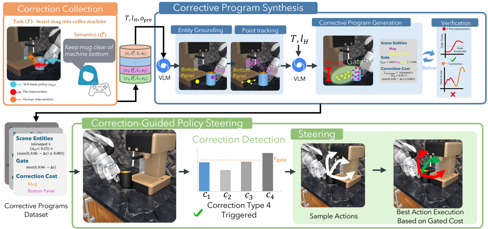
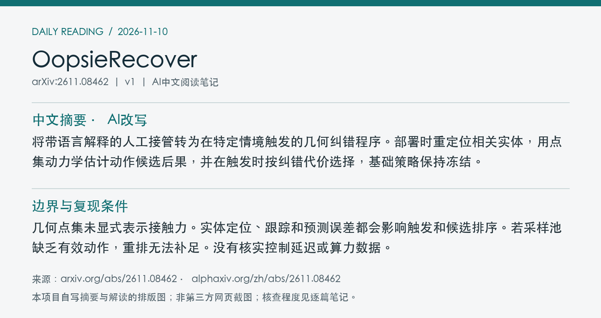
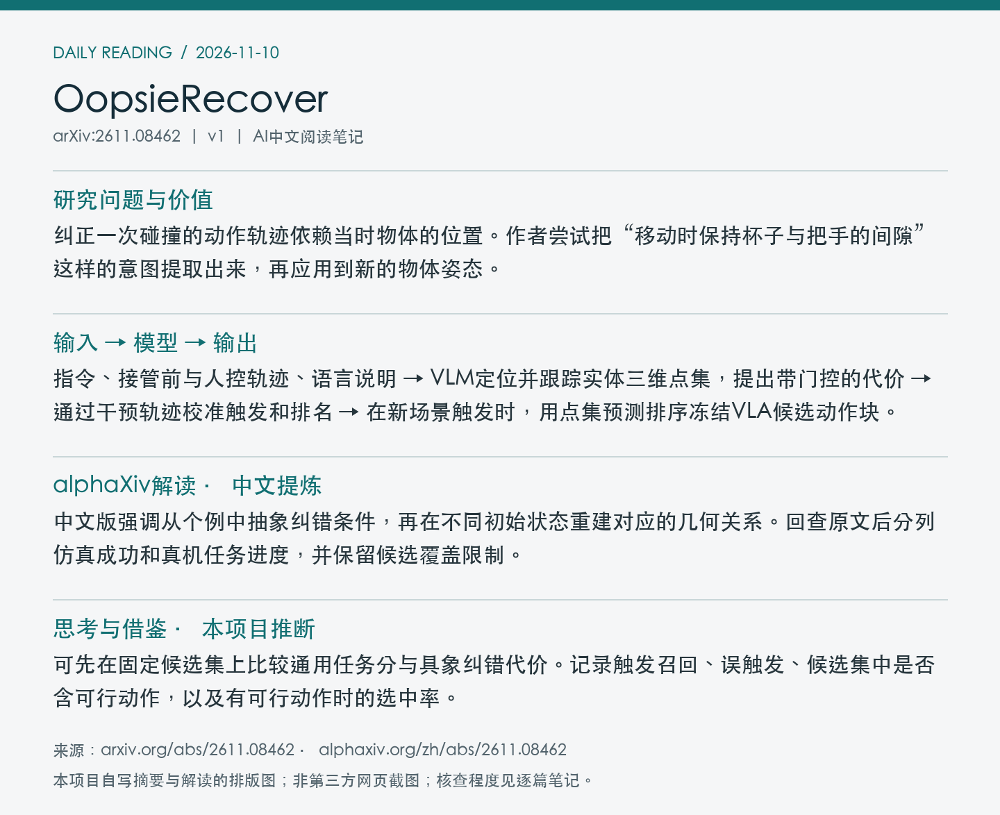

# 2611.08462 · OopsieRecover

OopsieRecover: Learning Transferable VLA Corrections from Semantic Interventions

[arXiv原文](https://arxiv.org/abs/2611.08462) · [v1 HTML](https://arxiv.org/html/2611.08462v1) · [alphaXiv zh中文概述](https://www.alphaxiv.org/zh/abs/2611.08462) · [作者项目](https://robin-lab.cs.utexas.edu/oopsierecover/)

v1首次提交于2026-11-06T02:53:16+08:00（Asia/Shanghai）。本次在7天重叠检索中首次收录。研究方向包括VLA、failure-recovery、human-intervention、inference-time-steering。

**阅读程度**：选读原文第III节、第IV节实验与第V节局限，核对PDF图2。已读alphaXiv中文AI概述及作者项目页，未运行代码。

## 中文摘要 · 本项目AI改写

将带语言解释的人工接管转为在特定情境触发的几何纠错程序。部署时重定位相关实体，用点集动力学估计动作候选后果，并在触发时按纠错代价选择，基础策略保持冻结。

## 核心问题与方法

纠正一次碰撞的动作轨迹依赖当时物体的位置。作者尝试把“移动时保持杯子与把手的间隙”这样的意图提取出来，再应用到新的物体姿态。

**输入 → 模型处理 → 输出**：指令、接管前与人控轨迹、语言说明 → VLM定位并跟踪实体三维点集，提出带门控的代价 → 通过干预轨迹校准触发和排名 → 在新场景触发时，用点集预测排序冻结VLA候选动作块。

代价由触发门、纠错项和保留任务进展的项组成。系统检查程序能否在接管前触发，并将人的纠正排在失败片段之前。部署触发后，点集动力学沿每个候选向前预测，选择折扣累计代价最低者。可加入少量方向性候选以提高覆盖。

图2展示语义接管采集、纠错程序合成与验证，以及部署时的门控动作筛选。 摘自[v1 PDF](https://arxiv.org/pdf/2611.08462v1)第4页。裁剪采用左上角point坐标[52, 49, 559, 287]，3倍渲染。已目视核查。PDF SHA256、抓取时间及图像哈希见[元数据](metadata.json)。

## 主要证据与局限

RoboCasa三任务按纠正状态、同场景新物体姿态和未见场景分难度。图4显示方法在后两档处于独立领先组。图5 CoffeeMug 在 25 个同场景随机化留出状态中，用 8 次带语义纠正达 84% 二元成功率。HG-DAgger 的 28% 是 30 次纠正时的结果，标注内容与训练过程也不同。三个真机任务报告已完成阶段比例。

几何点集未显式表示接触力。实体定位、跟踪和预测误差都会影响触发和候选排序。若采样池缺乏有效动作，重排无法补足。没有核实控制延迟或算力数据。

在图4的仿真汇总中，正文提到每任务5–8次纠正，也另述累计采集55–88次。两处采用的样本范围未完全澄清，因此不将该比较写成严格的等标注预算实验。

## alphaXiv zh AI概述 · 中文提炼

中文版强调从个例中抽象纠错条件，再在不同初始状态重建对应的几何关系。回查原文后分列仿真成功和真机任务进度，并保留候选覆盖限制。

[alphaXiv 中文入口](https://www.alphaxiv.org/zh/abs/2611.08462)，核查时间为2026-11-10T10:49:33+08:00。已核实并独立提炼中文AI概述正文。

## 研究联系与下一步 · 本项目推断

可先在固定候选集上比较通用任务分与具象纠错代价。记录触发召回、误触发、候选集中是否含可行动作，以及有可行动作时的选中率。

## 代码、权重与数据状态

[作者项目](https://robin-lab.cs.utexas.edu/oopsierecover/)可访问，有仿真及真机结果展示。本次未核实专用实现、干预数据或纠错程序权重公开。

## 自写摘要与阅读卡片

以下两张卡片由本项目根据自写内容排版。

[论文目录](../README.md) · [当日日报](../../reports/2026/11/10.md)
