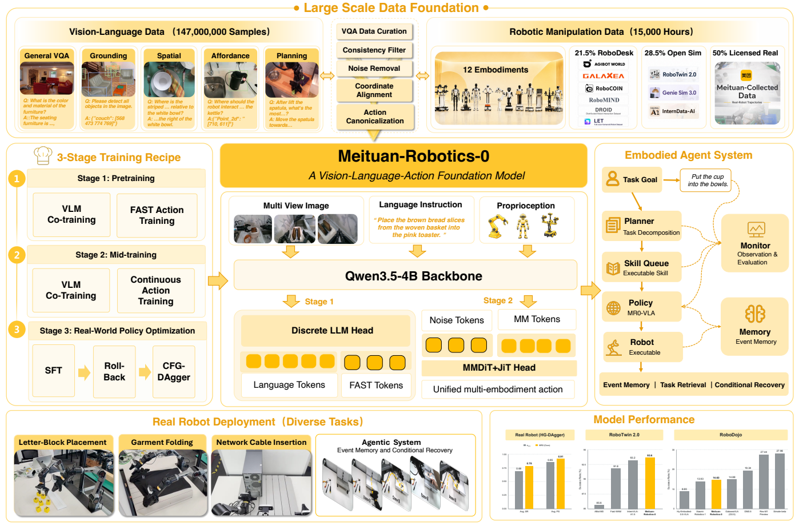
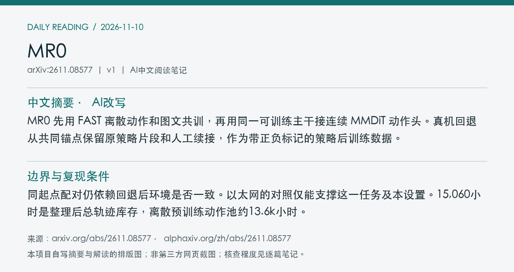
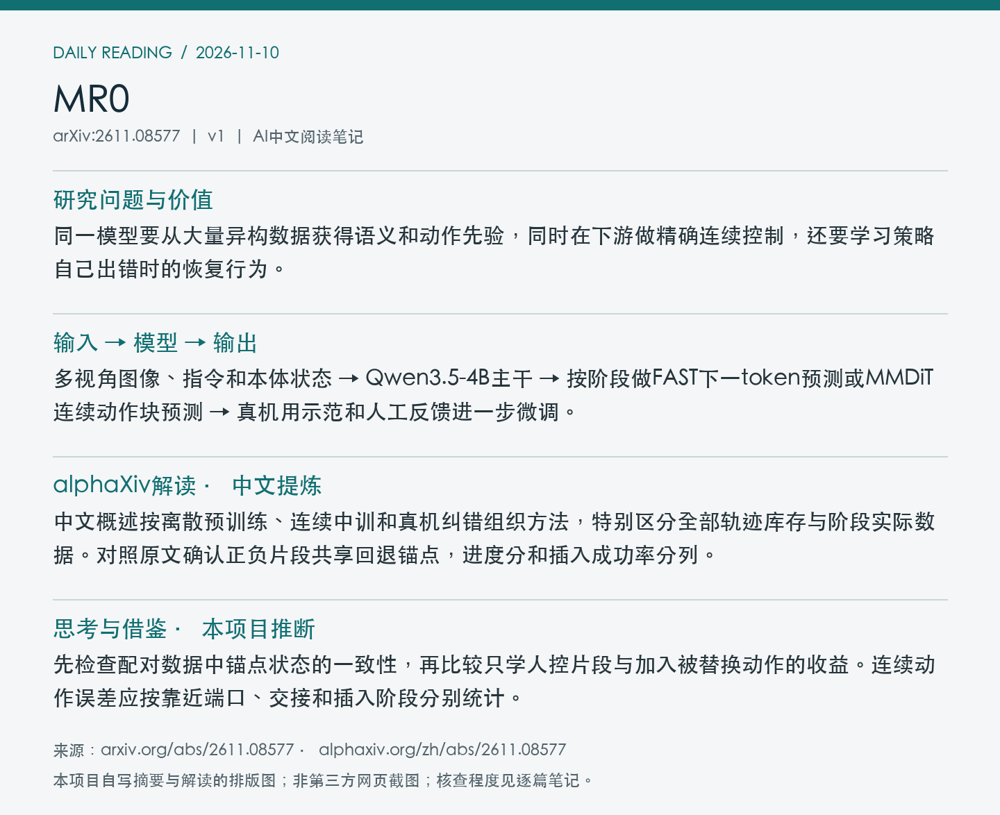

# 2611.08577 · MR0

Meituan-Robotics-0: A Vision-Language-Action Foundation Model for Desktop Manipulation

[arXiv原文](https://arxiv.org/abs/2611.08577) · [v1 HTML](https://arxiv.org/html/2611.08577v1) · [alphaXiv zh中文概述](https://www.alphaxiv.org/zh/abs/2611.08577) · [作者项目](https://meituan-robotics.github.io/Meituan-Robotics-0/) · [官方代码](https://github.com/Meituan-Robotics/Meituan-Robotics-0) · [基础权重发布提交](https://huggingface.co/MeituanRobotics/Meituan-Robotics-0/commit/1b2cc5329d98abfc2495f5dbe4ff823e1b3772d6)

v1首次提交于2026-11-06T02:55:42+08:00（Asia/Shanghai）。本次在11月9日arXiv机器人公告中首次收录。研究方向包括VLA、discrete-to-continuous、flow-matching、human-intervention。

**阅读程度**：选读原文第2、3节数据与三阶段训练、第4节系统和第5.2节真机对照，核对PDF图1。已读alphaXiv中文AI概述，核对官方代码目录、项目页、Hub文件及提交，未运行实现。

## 中文摘要 · 本项目AI改写

MR0 先用 FAST 离散动作和图文共训，再用同一可训练主干接连续 MMDiT 动作头。真机回退从共同锚点保留原策略片段和人工续接，作为带正负标记的策略后训练数据。

## 核心问题与方法

同一模型要从大量异构数据获得语义和动作先验，同时在下游做精确连续控制，还要学习策略自己出错时的恢复行为。

**输入 → 模型处理 → 输出**：多视角图像、指令和本体状态 → Qwen3.5-4B主干 → 按阶段做FAST下一token预测或MMDiT连续动作块预测 → 真机用示范和人工反馈进一步微调。

预训练对图文和FAST动作共同做下一token监督。中训新建连续动作头，以JiT预测干净动作再转成flow速度，20维双臂末端槽位用掩码处理本体差异。Rollback从历史锚点收集同起点的策略和人工片段，用于CFG-DAgger。事件代理在外层管理记忆、任务队列和条件恢复。

图1概览异构数据整理、离散到连续训练、策略后训练及事件驱动代理。 摘自[v1 PDF](https://arxiv.org/pdf/2611.08577v1)第2页。裁剪采用左上角point坐标[73, 72, 539, 379]，3倍渲染。已目视核查。PDF SHA256、抓取时间及图像哈希见[元数据](metadata.json)。

## 主要证据与局限

以太网插入真机对照每策略30次，初始条件和数据匹配，使用同一中训检查点。完整Rollback数据下，CFG-DAgger成功70%、进度0.90，RECAP为60%和0.67。进度是抓取、交接、插入三阶段的完成比例。跨任务记忆和等待恢复为定性演示。

同起点配对仍依赖回退后环境是否一致。以太网的对照仅能支撑这一任务及本设置。15,060小时是整理后总轨迹库存，离散预训练动作池约13.6k小时。

原文总量包含12种本体和约1.47亿视觉语言样本。RoboDesk是其中公开语料部分。主干4B为初始化主干大小，完整系统参数量与训练总费用未核实。

## alphaXiv zh AI概述 · 中文提炼

中文概述按离散预训练、连续中训和真机纠错组织方法，特别区分全部轨迹库存与阶段实际数据。对照原文确认正负片段共享回退锚点，进度分和插入成功率分列。

[alphaXiv 中文入口](https://www.alphaxiv.org/zh/abs/2611.08577)，核查时间为2026-11-10T10:51:53+08:00。已核实并独立提炼中文AI概述正文。

## 研究联系与下一步 · 本项目推断

先检查配对数据中锚点状态的一致性，再比较只学人控片段与加入被替换动作的收益。连续动作误差应按靠近端口、交接和插入阶段分别统计。

## 代码、权重与数据状态

[官方代码](https://github.com/Meituan-Robotics/Meituan-Robotics-0)含训练、部署、评测目录。已核实[基础](https://huggingface.co/MeituanRobotics/Meituan-Robotics-0)和[RoboTwin](https://huggingface.co/MeituanRobotics/Meituan-Robotics-0-RoboTwin)检查点文件入口及[RoboDesk](https://huggingface.co/datasets/MeituanRobotics/RoboDesk)数据目录。基础权重发布提交为北京时间11-05 21:02。11-10 01:18的新提交链接论文并刷新校验清单。未核实全量语料开放。

## 自写摘要与阅读卡片

以下两张卡片由本项目根据自写内容排版。

[论文目录](../README.md) · [当日日报](../../reports/2026/11/10.md)
