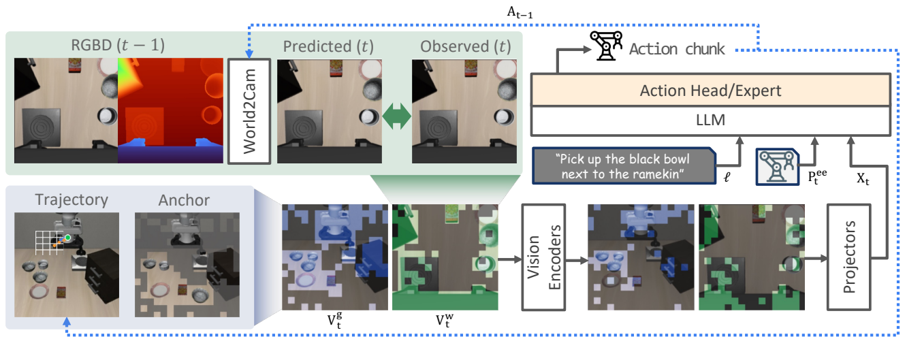

# 2611.08827 · ActPrune

ActPrune: Action-Grounded Visual Token Pruning for Efficient Vision-Language-Action Models

[arXiv原文](https://arxiv.org/abs/2611.08827) · [v1 HTML](https://arxiv.org/html/2611.08827v1) · [alphaXiv zh入口（暂无概述）](https://www.alphaxiv.org/zh/abs/2611.08827)

v1首次提交于2026-11-06T08:32:27+08:00（Asia/Shanghai）。本次在11月9日arXiv机器人公告中首次收录。研究方向包括VLA、visual-token-pruning、closed-loop、efficiency。

**阅读程度**：选读原文第IV、V节及表I、VII，核对PDF图2。alphaXiv zh页面已访问，显示暂无概述。未核查实现或复现。

## 中文摘要 · 本项目AI改写

利用上一动作块在编码前压缩视觉patch。固定相机按机械臂轨迹保留工作区，腕部相机先补偿自身运动再找重复区域。速度收益依赖动作头占比和保留预算。

## 核心问题与方法

只裁掉编码后的token无法省下视觉编码成本。直接比较腕部两帧又会把相机自身移动误判为大量新内容。

**输入 → 模型处理 → 输出**：固定视角、腕部RGB-D及前一动作块 → 固定相机投影末端轨迹，腕视角按手眼几何补偿运动 → 保留信息块，将冗余合并为粗略上下文 → 编码及注意力裁剪 → 原VLA输出动作。

固定视角把执行路径和外推区域投影到图像，加首帧语义锚点。腕视角用深度重投影前帧，再以patch相似度识别冗余，保留视域不匹配区域。编码前预算与编码中注意力预算分配无需重新训练基础策略。

图2展示腕部重投影、固定视角路径与语义锚点，以及编码前后两级视觉裁剪。 摘自[v1 PDF](https://arxiv.org/pdf/2611.08827v1)第3页。裁剪采用左上角point坐标[88, 49, 532, 215]，3倍渲染。已目视核查。PDF SHA256、抓取时间及图像哈希见[元数据](metadata.json)。

## 主要证据与局限

OpenVLA-OFT在LIBERO四套件共2,000回合，25%保留时96.1%对原96.5%，延迟53.61对86.17 ms，FLOPs从4.739T到1.921T。论文讨论中，π0.5降约38% FLOPs只获1.03倍速度。真机Franka四任务用π0.5，50%保留的平均成功为50%，完整视觉为60%。

腕部补偿依赖RGB-D和标定。移动目标、遮挡和动作预测误差可能改变需要保留的区域。强裁剪的真机结果低于完整输入，视觉开销的节省无法直接换算成闭环速度。

表I的延迟按论文的推理计时口径比较。实际部署仍需分别记录图像预处理、动作专家、通信与控制时延。

## alphaXiv zh AI概述 · 中文提炼

本次alphaXiv zh页面显示暂无概述，未取得中文正文。上文中文摘要和解读依据arXiv原文独立撰写。

[alphaXiv 中文入口](https://www.alphaxiv.org/zh/abs/2611.08827)，核查时间为2026-11-10T10:49:31+08:00。已检查该入口，页面显示暂无概述。

## 研究联系与下一步 · 本项目推断

可以把运动补偿后新增区域比例作为自适应保留预算的输入，在遮挡、快速腕部运动和不同动作头上固定闭环成功下限后比较延迟。

## 代码、权重与数据状态

未找到可核实的专用实现、权重或数据入口。评测采用论文列出的现有OpenVLA-OFT、π0.5与基准数据。

## 自写摘要与阅读卡片

以下两张卡片由本项目根据自写内容排版。

[论文目录](../README.md) · [当日日报](../../reports/2026/11/10.md)
