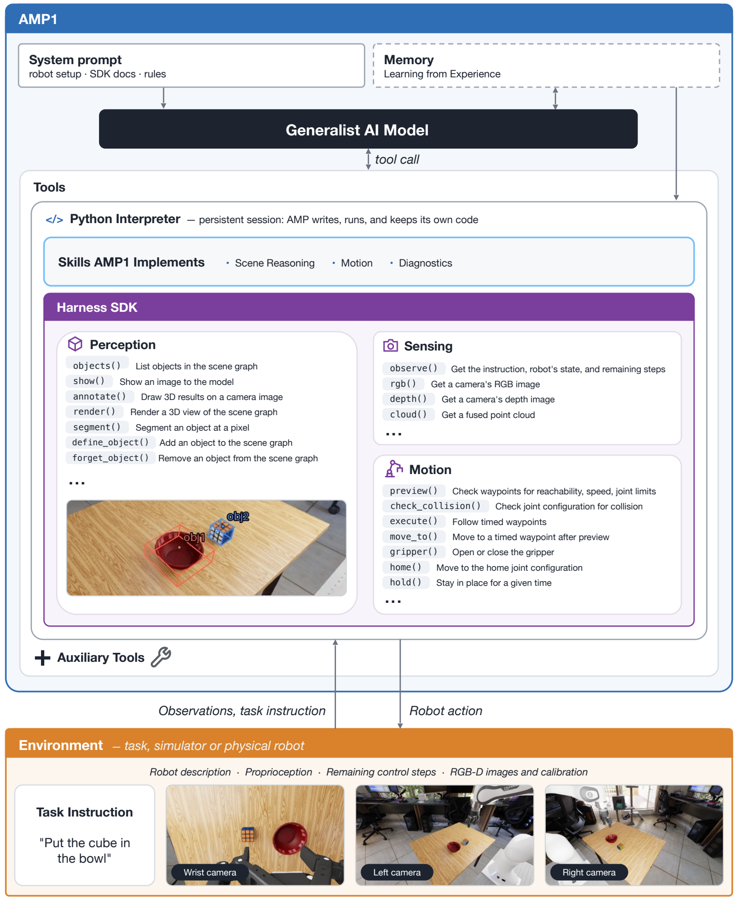
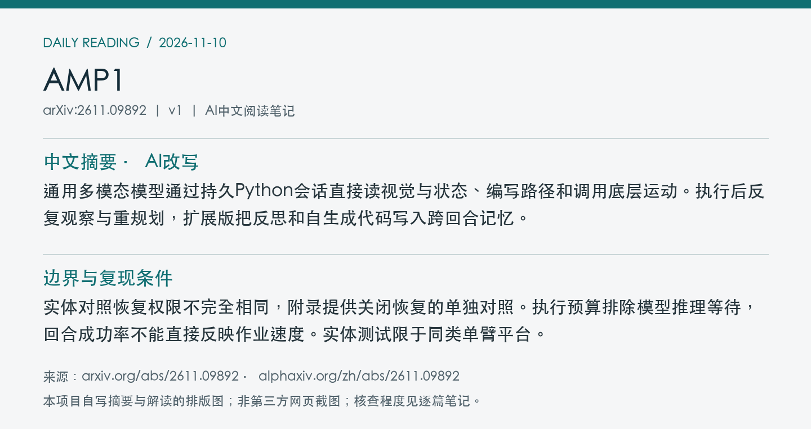
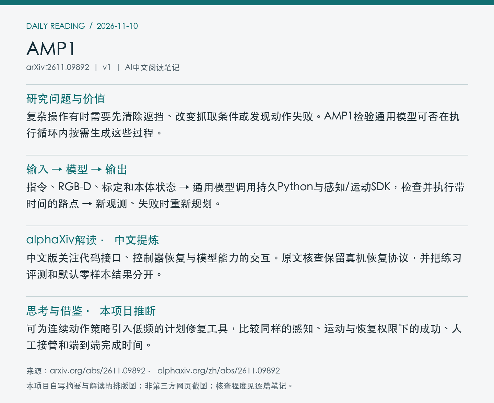

# 2611.09892 · AMP1

On Agentic Manipulation Policies

[arXiv原文](https://arxiv.org/abs/2611.09892) · [v1 HTML](https://arxiv.org/html/2611.09892v1) · [alphaXiv zh中文概述](https://www.alphaxiv.org/zh/abs/2611.09892) · [Apple官方项目](https://apple-aiml-research.github.io/ml-amp/) · [公开代码](https://github.com/apple-aiml-research/ml-amp)

v1首次提交于2026-11-07T02:59:34+08:00（Asia/Shanghai）。本次在11月9日arXiv机器人公告中首次收录。研究方向包括agentic-manipulation、closed-loop、code-as-policy、failure-recovery。

**阅读程度**：选读原文第2节仿真与实体实验、第4节接口及附录S1，核对PDF图6。已读alphaXiv中文AI概述，核对Apple项目和官方代码目录，未运行。

## 中文摘要 · 本项目AI改写

通用多模态模型通过持久Python会话直接读视觉与状态、编写路径和调用底层运动。执行后反复观察与重规划，扩展版把反思和自生成代码写入跨回合记忆。

## 核心问题与方法

复杂操作有时需要先清除遮挡、改变抓取条件或发现动作失败。AMP1检验通用模型可否在执行循环内按需生成这些过程。

**输入 → 模型处理 → 输出**：指令、RGB-D、标定和本体状态 → 通用模型调用持久Python与感知/运动SDK，检查并执行带时间的路点 → 新观测、失败时重新规划。

SDK提供分割、点云与可达性/碰撞预览，模型用接口自行生成操作过程。AMP1+可在有成败反馈的练习回合提取策略和代码记忆，模型权重保持固定。实体测试用Opus 5.5高推理设置，恢复函数允许控制器错误后继续同一试验。

图6展示通用模型、持久Python会话、感知与运动SDK以及环境之间的闭环。 摘自[v1 PDF](https://arxiv.org/pdf/2611.09892v1)第14页。裁剪采用左上角point坐标[42, 47, 564, 683]，3倍渲染。已目视核查。PDF SHA256、抓取时间及图像哈希见[元数据](metadata.json)。

## 主要证据与局限

真机12任务、3台同型号Franka平台、每台每任务3次。AMP1成功104/108，FLUX 3 Action为49/108、π0.5为30/108。关闭AMP1控制器恢复后为94/108。RoboLab-120默认指令每任务10次，Gemini 4 Argon为85.6%，Opus 5.5为82.8%。

实体对照恢复权限不完全相同，附录提供关闭恢复的单独对照。执行预算排除模型推理等待，回合成功率不能直接反映作业速度。实体测试限于同类单臂平台。

带记忆的RoboDojo练习结果从26.4%到84.1%，来自每任务五次练习中选择表现最好的运行后评估，报告的单次随机任务顺序持续学习另为57.6%。这两套协议应分开读。

## alphaXiv zh AI概述 · 中文提炼

中文版关注代码接口、控制器恢复与模型能力的交互。原文核查保留真机恢复协议，并把练习评测和默认零样本结果分开。

[alphaXiv 中文入口](https://www.alphaxiv.org/zh/abs/2611.09892)，核查时间为2026-11-10T10:49:30+08:00。已核实并独立提炼中文AI概述正文。

## 研究联系与下一步 · 本项目推断

可为连续动作策略引入低频的计划修复工具，比较同样的感知、运动与恢复权限下的成功、人工接管和端到端完成时间。

## 代码、权重与数据状态

[Apple官方项目](https://apple-aiml-research.github.io/ml-amp/)及[AMP1代码](https://github.com/apple-aiml-research/ml-amp)可访问，已核对仓库目录和论文中的SDK接口，未核实新训练数据或模型权重发布。论文使用的通用模型与框架代码分开。

## 自写摘要与阅读卡片

以下两张卡片由本项目根据自写内容排版。

[论文目录](../README.md) · [当日日报](../../reports/2026/11/10.md)
