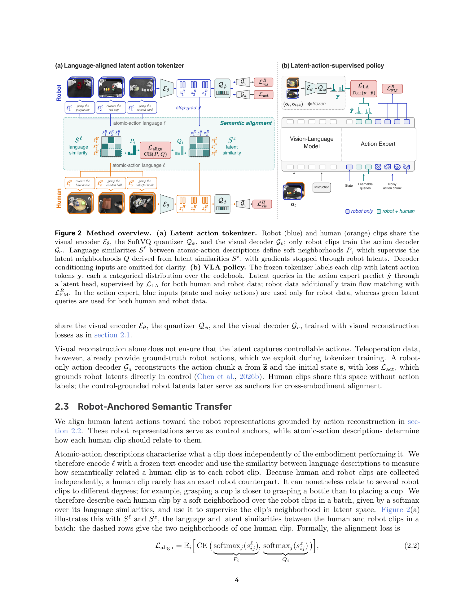
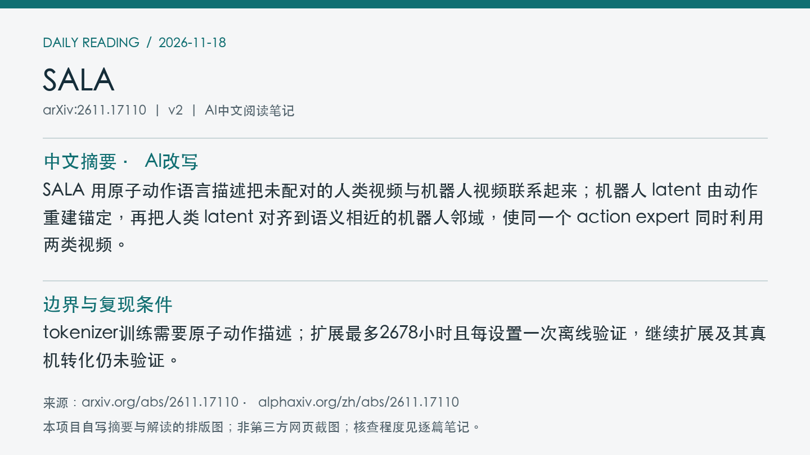
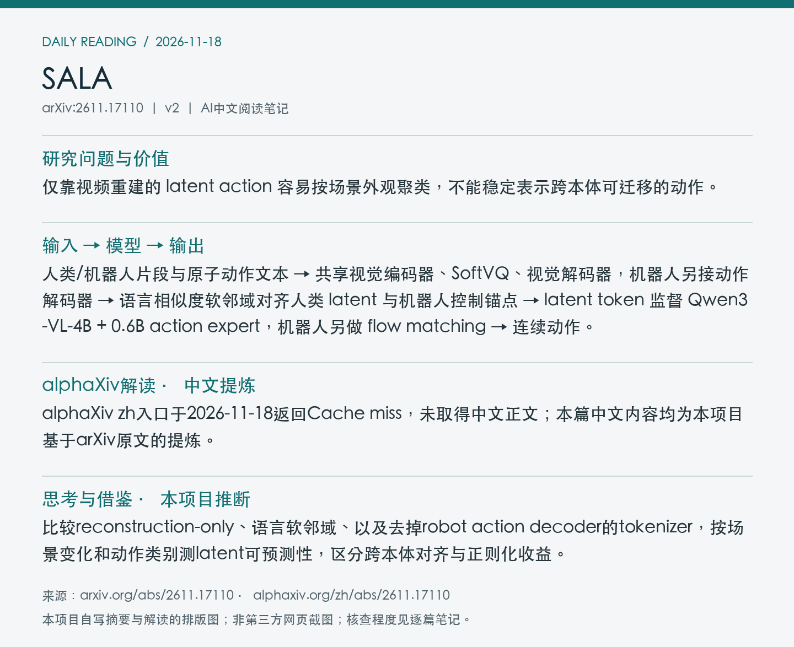

# 2611.17110 · SALA

SALA: Semantically Aligned Latent Actions Enable Dual-Axis Scaling of Embodied Foundation Models

[arXiv原文](https://arxiv.org/abs/2611.17110) · [v1 HTML](https://arxiv.org/html/2611.17110v1) · [alphaXiv zh中文入口](https://www.alphaxiv.org/zh/abs/2611.17110) · [作者项目](https://sala-vla.github.io/)

v1 于 2026-11-13 01:04:50（北京时间）提交；v2 于 2026-11-15 22:43:43 提交。本期报告以 v1 HTML 的方法、实验、消融和结论为主，记录 v2 作为重要修订。已选读原文第2、3、5节及附录实现细节，核对方法图2、实验图4和表5；未核查代码。alphaXiv zh入口本次工具不可访问，未取得中文 AI Overview 正文。

## 中文摘要 · 本项目AI改写

SALA 用原子动作语言描述把未配对的人类视频与机器人视频联系起来。机器人潜在动作先由动作重建锚定在可控空间，再把人类潜在动作拉向语义相近的机器人邻域，使同一个 action expert 能同时从机器人轨迹和人类视频学习。

## 核心问题与方法

仅靠视频重建的 latent action 容易按场景外观聚类，不能稳定表示跨本体可迁移的动作。

**输入 → 模型处理 → 输出**：人类/机器人观测片段与原子动作文本 → 共享视觉编码器、SoftVQ（8 token、256 code）和视觉解码器；机器人片段另用动作解码器重建 action chunk → 语言相似度形成软邻域，监督人类 latent 对齐到机器人控制锚点；冻结 tokenizer 给 VLA 产生 latent token，Qwen3-VL-4B 与 0.6B action expert 共同预测 latent token，机器人数据另做 flow matching → 连续机器人动作。

图2（PDF第4页）展示语言对齐的 latent-action tokenizer 与 latent-action-supervised policy。来源：[v1 PDF](https://arxiv.org/pdf/2611.17110v1)，裁剪坐标为整页 [0,0,612,792] point，抓取时间 2026-11-18T10:49:00+08:00，版本 v1，PDF SHA256 为 `5c7db7198401448437520351dccd83d22ba4c045ff1ad39b538b465a7ed0702e2`。本图为原文页面摘录，已目视检查边界与清晰度。

## 主要证据与局限

在 63-DoF 真机（含两只 22-DoF 灵巧手）上，通用人类视频预训练量从 0 增至 2,678 小时，固定机器人数据时验证集动作 L1 误差持续下降；以 2,678 小时预训练为起点，任务级人类视频后训练从 10% 增至 100%，四任务平均成功率由 53.75% 升至 72.5%。RoboTwin 2.0 的 Aloha-AgileX 消融中，完整 SALA clean/random 成功率为 80.2/48.6%，去掉 semantic alignment 为 75.5/36.8%。这些数值分别来自原文对应设置，不能与其他日报的不同机器人或任务直接比较。

作者明确指出：tokenizer 训练需要原子动作描述；扩展趋势在最多 2,678 小时、单次离线验证设置下观察，能否继续扩展并稳定转化为更高真机成功率仍未验证。代码状态为作者项目“Code soon”，本期未核实权重或数据发布。

## alphaXiv zh AI概述 · 状态记录

2026-11-18 检查 `https://www.alphaxiv.org/zh/abs/2611.17110` 时工具返回 Cache miss，未取得正文。因此本篇中文摘要、方法与实验数字均为本项目基于 arXiv 原文的提炼，不冒充 alphaXiv 中文概述。

## 研究联系与下一步 · 本项目推断

SALA 把“动作表示是否按语义组织”与“动作头是否能从人类视频受益”连接起来。可在小规模实验中固定同一 Qwen3-VL/action expert，比较 reconstruction-only、语言软邻域、以及语言软邻域但无 robot action decoder 三种 tokenizer；同时按场景变化和动作类别分别测 latent 可预测性，验证收益究竟来自跨本体对齐还是额外的正则化。

## 代码、权重与数据状态

作者项目页公开论文、方法图和演示，代码链接标为即将发布；本期未发现可核实的代码、权重或数据仓库。

## 自写摘要与阅读卡片

[论文目录](../README.md) · [2026-11-18 日报](../../reports/2026/11/18.md)
