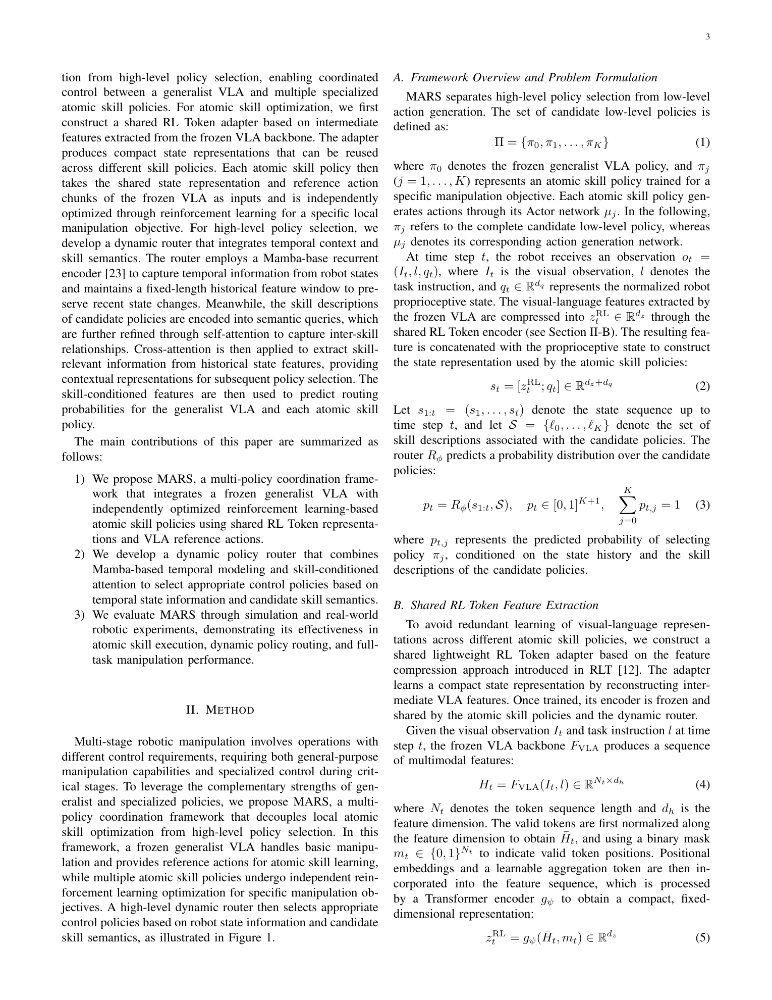
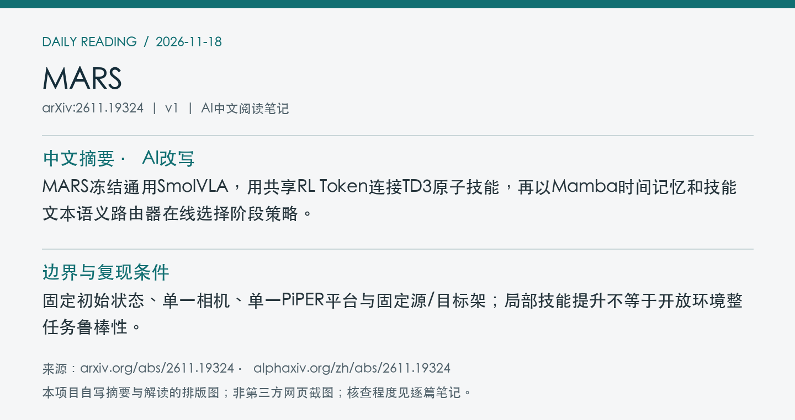
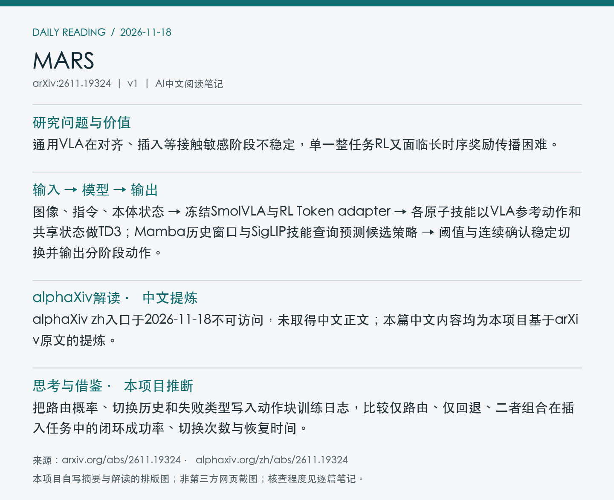

# 2611.19324 · MARS

MARS: Dynamic Routing of Reinforcement-Learned Atomic Skills for Multi-Stage Robotic Manipulation

[arXiv原文](https://arxiv.org/abs/2611.19324) · [v1 HTML](https://arxiv.org/html/2611.19324v1) · [alphaXiv zh中文入口](https://www.alphaxiv.org/zh/abs/2611.19324)

v1 于 2026-11-14 18:40:17（北京时间）首次提交。本期已选读原文第II、III节，核对图1、表III—VI；未找到可核实的代码、权重或数据仓库。alphaXiv zh入口本次工具不可访问，未取得中文 AI Overview 正文。

## 中文摘要 · 本项目AI改写

MARS 冻结一个通用 SmolVLA，把中间多模态特征压成共享 RL Token；针对抓取、放置、对齐、插入等关键阶段分别训练 TD3 原子技能，再由结合 Mamba 时间记忆和技能文本语义的路由器在线切换。它把“单一策略兼顾泛化与精度”拆成低层技能学习和高层策略选择。

## 核心问题与方法

多阶段任务中，通用 VLA 往往能搬运但在对齐、插入等接触敏感阶段不稳定；单一整任务 RL 又面临长时序奖励传播困难。

**输入 → 模型处理 → 输出**：图像、指令与本体状态 → 冻结 SmolVLA → RL Token adapter 压缩中间特征并与本体状态拼接；各原子技能以 VLA 参考动作和共享状态做 TD3，路由器用历史窗口、Mamba 与 SigLIP 技能查询预测候选策略 → 通过概率阈值和连续确认稳定切换，输出分阶段动作。

图1（PDF第3页）展示共享 RL Token、原子技能与动态路由。来源：[v1 PDF](https://arxiv.org/pdf/2611.19324v1)，裁剪坐标为整页 [0,0,612,792] point，抓取时间 2026-11-18T10:49:00+08:00，版本 v1，PDF SHA256 为 `92e4f41804c01b8dddd25ec648988b333d47f4eac1db7777f0cc1bb8edff5fc7`。本图为原文页面摘录，已目视检查边界与清晰度。

## 主要证据与局限

在 LIBERO 四套件固定轨迹路由评估中，完整 MARS 平均 Macro-F1 为 90.47%，比 MLP 路由器高 7.08 个百分点；去掉时间记忆或技能语义后降至 84.97%/86.38%。闭环仿真中四套件平均成功率 89.25%，高于冻结 VLA 的 64.14% 和 Monolithic RLT 的 78.73%；自定义 Tube Transport 的成功率/样本完成率为 85.67%/91.11%。在 AgileX PiPER 真机同任务中，MARS 74.00% 成功率、83.33%样本完成率，冻结 VLA 为 12.00%/27.33%，成功回合平均时间 31.96s 对 39.53s。

这些结果依赖固定初始状态、单一相机与一台 RTX 4090 的实验设置；真机任务仍是固定源架和目标架的三管插入。作者也指出，局部原子技能提升不等于整任务成功，路由错误和误差累积仍需开放环境评估。

## alphaXiv zh AI概述 · 状态记录

2026-11-18 检查 `https://www.alphaxiv.org/zh/abs/2611.19324` 时工具报告页面不可访问，未取得中文版正文。因此本篇中文内容均为本项目基于 arXiv 原文的提炼。

## 研究联系与下一步 · 本项目推断

MARS 与 MR0 的事件/纠错机制互补：MARS 在动作生成前做阶段级路由，MR0 在失败后做回退与恢复。一个小规模验证是把 MARS 的路由概率、切换历史和局部失败类型写入 VLA 的 action chunk 训练日志，比较仅路由、仅回退和二者组合对插入任务的闭环成功率、切换次数与恢复时间。

## 代码、权重与数据状态

原文、HTML与实验配置可访问；本期未找到可核实的官方代码、权重或数据发布入口。

## 自写摘要与阅读卡片

[论文目录](../README.md) · [2026-11-18 日报](../../reports/2026/11/18.md)
