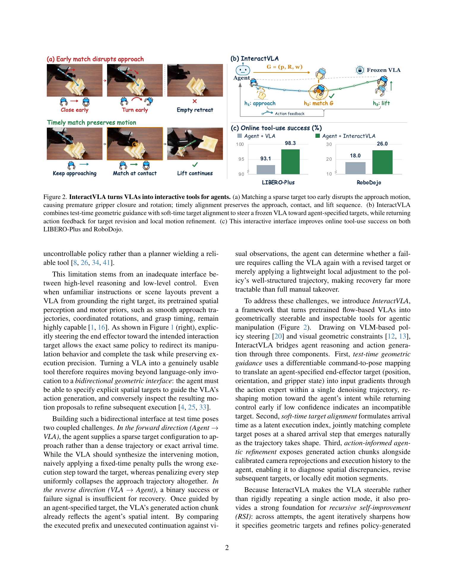
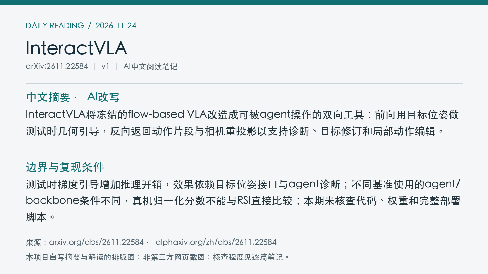
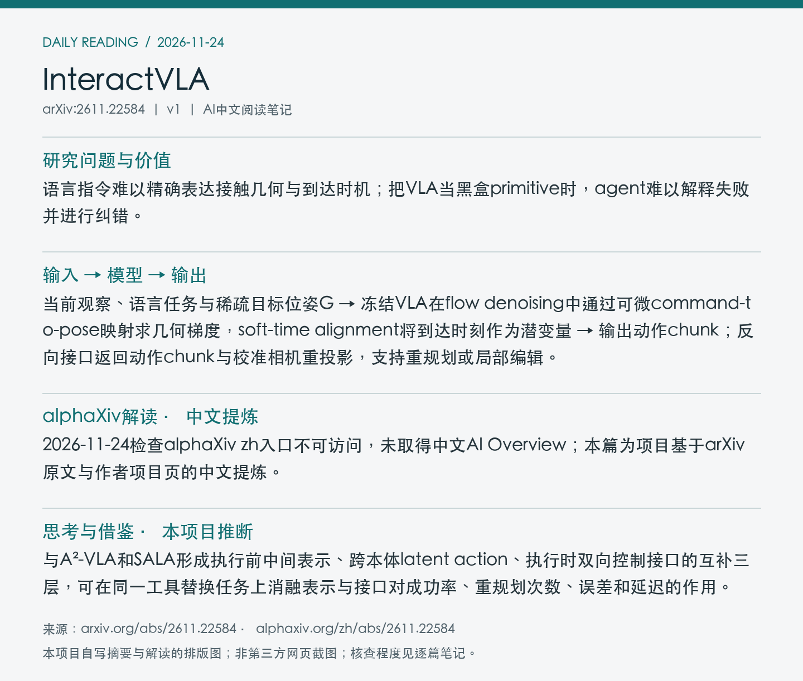

# 2611.22584 · InteractVLA

InteractVLA: Turning VLAs into Interactive Tools for Agentic Robotic Manipulation

[arXiv原文](https://arxiv.org/abs/2611.22584) · [v1 HTML](https://arxiv.org/html/2611.22584v1) · [项目页](https://lingwupro.github.io/InteractVLA/) · [alphaXiv zh中文入口（本次不可访问）](https://www.alphaxiv.org/zh/abs/2611.22584)

v1 于北京时间 **2026-11-17 19:07:45** 首次提交。本期已选读原文第2—3.4节、图2，并核对项目页中的 RSI 与在线工具使用结果；未核查代码实现。alphaXiv zh入口不可访问，未取得中文版 AI Overview。

## 中文摘要 · 本项目AI改写

InteractVLA 不重新训练一个更大的 VLA，而是把冻结的 flow-based VLA 改造成可被 agent 操作的工具：前向接口允许 agent 用目标位姿引导动作去噪，反向接口返回动作片段及相机重投影，使 agent 能诊断失败、修订目标或局部编辑动作。

## 核心问题与方法

语言指令对接触点、到达时机和几何约束的表达不够精确；把 VLA 当作黑盒 primitive 时，agent 很难知道失败原因，也难以在不重训策略的情况下纠错。

**输入 → 模型处理 → 输出**：当前观察、语言任务与稀疏目标位姿 (G=(p^*,R^*,w^*)) → 冻结 VLA 的 action expert 在 flow denoising 中通过可微 command-to-pose 映射计算几何梯度；soft-time alignment 将目标到达时刻视为潜变量，并以软权重保留接近目标的过程 → 输出动作 chunk。随后反向接口把动作 chunk 与校准相机重投影交给 agent，触发目标修订、局部运动编辑或重规划。

图2（PDF第2页）展示 InteractVLA 的双向几何接口、early-match disruption 与在线工具使用。来源：[v1 PDF](https://arxiv.org/pdf/2611.22584v1)，裁剪坐标为整页 `[0,0,612,792]` point，抓取时间 2026-11-24T06:59:49+08:00，版本 v1，PDF SHA256 为 `437dea941f9755c368b9176c9aa012984d2d44feb6c0012bb0c28de73ba46cb9`。本图为原文页面摘录，已目视检查边界与清晰度；图像 SHA256 为 `9232944896c493de7e05f28dbee80e96298b7eec382bdde50591079afeaee8e7`。

## 主要证据与局限

作者报告 RSI（Robotic System Intelligence）在 LIBERO-Plus、RoboDojo、RoboCasa365 上分别为 **99.4%**、**48.62%**、**89.4%**；三项使用的 agent/backbone 条件并不完全相同。在线工具使用中，MR-0 backbone 的 LIBERO-Plus 从 93.1% 提升到 98.3%，RoboDojo 从 18.0% 提升到 26.0%。真机实验以每个任务/方法 30 次试验的归一化任务分数报告，不能与上述二元 RSI 直接比较。结果支持测试时几何引导和动作反馈有助于 agent 修正，但梯度引导带来额外推理开销，效果依赖目标位姿接口、agent 诊断能力和 benchmark 条件；本期未复核代码、权重或完整部署脚本。

## alphaXiv zh AI概述 · 状态记录

2026-11-24 检查 `https://www.alphaxiv.org/zh/abs/2611.22584` 时工具返回不可访问，未取得正文。因此本篇中文内容均为本项目基于 arXiv 原文与作者项目页的提炼，不冒充 alphaXiv 中文 AI Overview。

## 研究联系与下一步 · 本项目推断

A²-VLA 在执行前发现并编码工具 affordance，SALA 学习跨本体语义 latent action，而 InteractVLA 在执行时向冻结 VLA 注入几何目标并读取动作反馈。可做一个小规模三路消融：原始 VLA、加入 affordance/latent token、加入 InteractVLA 双向接口；在同一工具替换任务中同时测成功率、动作 chunk 重规划次数、目标到达误差与推理延迟，以区分“更好的中间表示”和“更好的测试时控制接口”。这是本项目推断，非作者已验证结论。

## 代码、权重与数据状态

项目页提供代码入口链接，但本期未核查仓库内容、权重或数据可下载性；原文、v1 HTML 与项目页可访问。

## 自写摘要与阅读卡片

[论文目录](../README.md) · [2026-11-24 日报](../../reports/2026/11/24.md)
