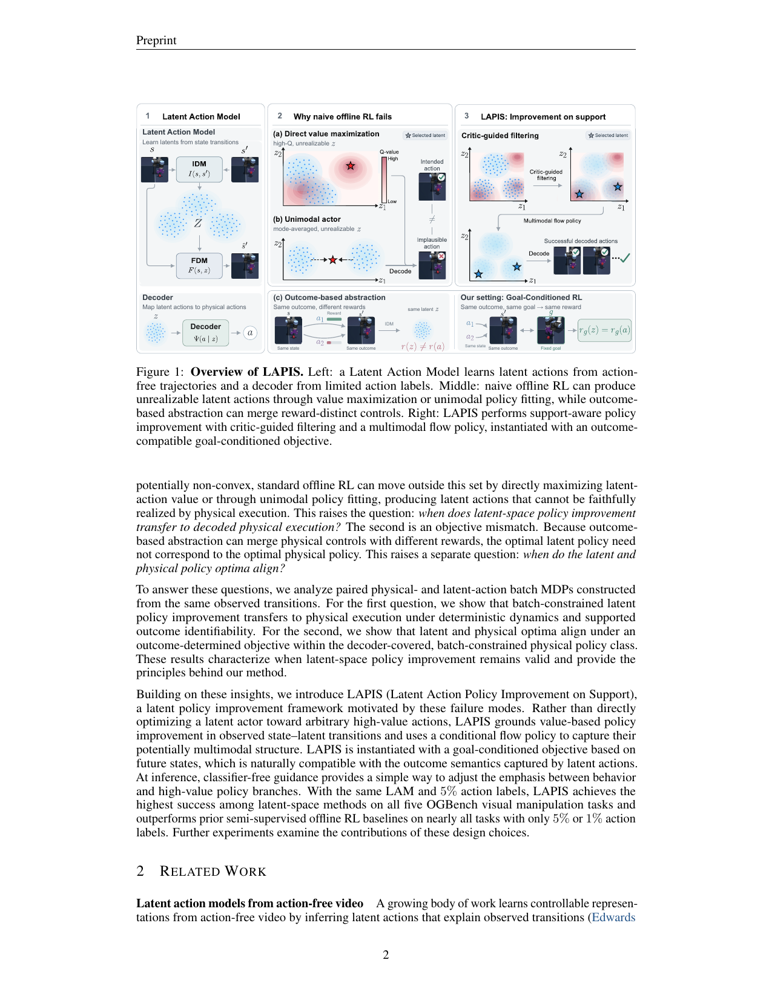
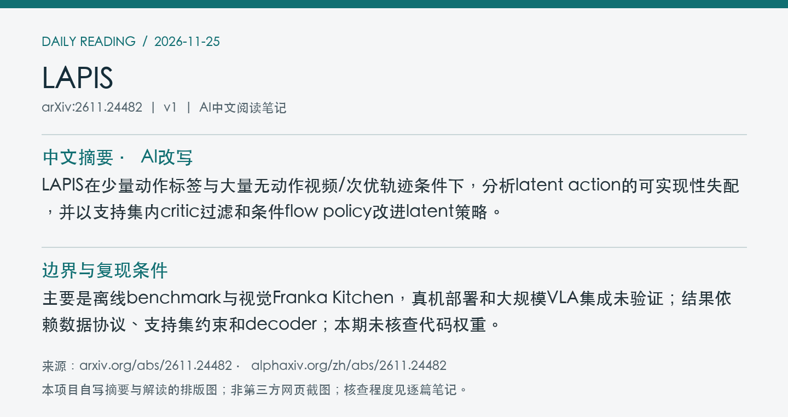
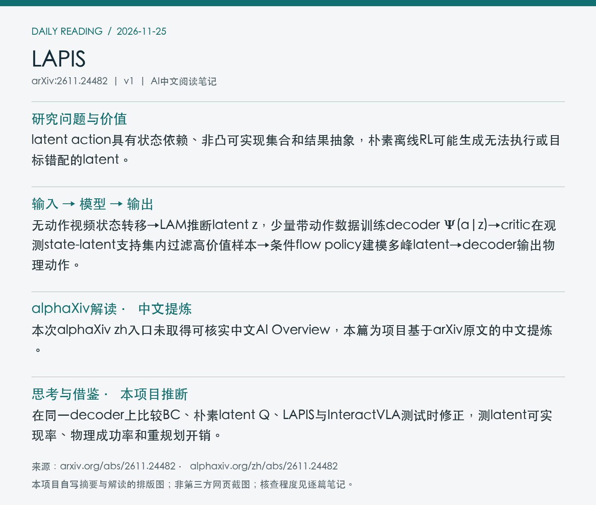

# 2611.24482 · LAPIS

Latent Action Policies from Suboptimal Data

[arXiv原文](https://arxiv.org/abs/2611.24482) · [v1 HTML](https://arxiv.org/html/2611.24482v1) · [alphaXiv zh中文入口](https://www.alphaxiv.org/zh/abs/2611.24482)

v1 于北京时间 **2026-11-18 22:18:09** 首次提交。本期已读原文第1—7节及附录E、G关键实验设置；核对图1与主要结论，未核查代码。alphaXiv zh正文本次未取得。

## 中文摘要 · 本项目AI改写

LAPIS研究如何在只有少量动作标签、但拥有大量无动作视频和次优轨迹时，直接改进 latent-action policy。作者先刻画 latent action 的可实现性与结果抽象造成的离线RL失配，再用支持集内的 critic-guided filtering 和条件 flow policy 做多模态策略改进。

## 核心问题与方法

Latent action 可能依赖当前状态、可实现集合非凸，且不同物理控制可能被压到同一 latent；直接最大化 latent Q 值或拟合单峰策略，可能产生无法执行的动作。

**输入 → 模型处理 → 输出**：无动作视频中的状态转移 → LAM 通过 inverse/forward dynamics 推断 latent (z)，少量带动作数据训练 decoder (Psi(a|z)) → 在观测到的 state-latent transition 支持集内训练 critic，过滤高价值样本，并用条件 flow policy 建模多峰 latent 分布 → 采样 latent 后经 decoder 输出物理动作。

图1（PDF第2页）展示 LAM、decoder、朴素离线RL失败模式与 LAPIS 的支持集内策略改进。来源：[v1 PDF](https://arxiv.org/pdf/2611.24482v1)，裁剪坐标为整页，版本 v1，抓取时间 2026-11-25T07:03:25+08:00，PDF SHA256 为 `43a084e6211e57a27b6b58dc45767899af9050cf64faa50761c12fb02e58ffb7`；图像 SHA256 为 `98f3c62e25de8e505a0b05aa81b96fcbb0cb26f4436e087b2a264d873e9741bc`，已目视检查。

## 主要证据与局限

在 OGBench 五个视觉操作任务上，作者报告 LAPIS 在相同 LAM 和 5% 动作标签下取得 latent-space 方法最高成功率；在 5% 或 1% 动作标签的半监督离线RL比较中，多数任务优于基线。论文强调这些结果依赖支持集约束、目标条件目标和多模态 flow policy，不能把 1% 标签结果与不同数据协议直接横比。实验主要是离线 benchmark 与视觉 Franka Kitchen，真机部署与大规模 VLA 集成尚未验证；本期未核查代码和权重。

## alphaXiv zh AI概述 · 状态记录

本次检查 `https://www.alphaxiv.org/zh/abs/2611.24482` 未取得可核实的中文 AI Overview；本篇内容为本项目基于 arXiv 原文的中文提炼。

## 研究联系与下一步 · 本项目推断

LAPIS把 SALA/ELA 一类 latent action 从“可预测表示”推进到“可被离线RL改进的策略空间”，而 InteractVLA关注执行时对动作生成器的几何引导。可在同一动作 decoder 上比较 BC、朴素 latent Q 优化、LAPIS 与 InteractVLA 的测试时修正，分别测 latent 可实现率、物理动作成功率和重规划开销。

## 代码、权重与数据状态

原文与实验细节公开；本期未核查官方代码、权重或数据入口。

## 自写摘要与阅读卡片

[论文目录](../README.md) · [2026-11-25 日报](../../reports/2026/11/25.md)
