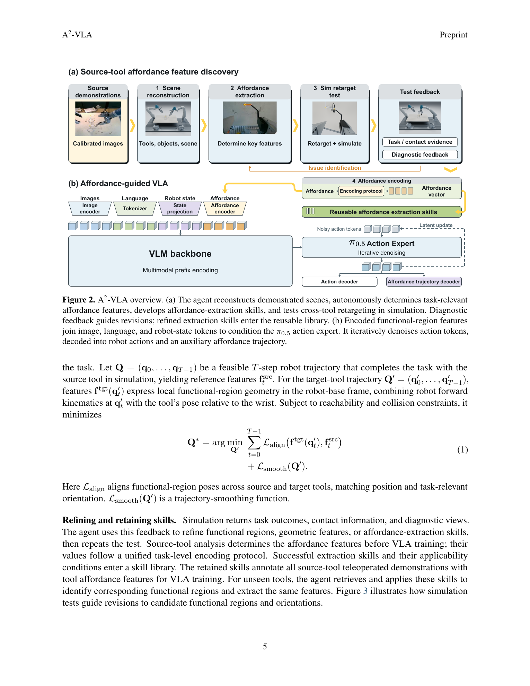
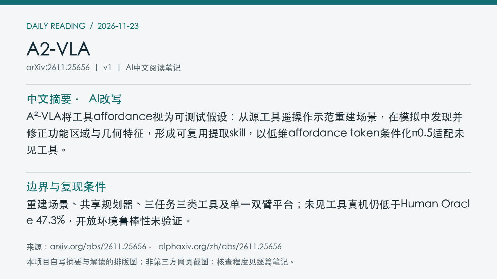
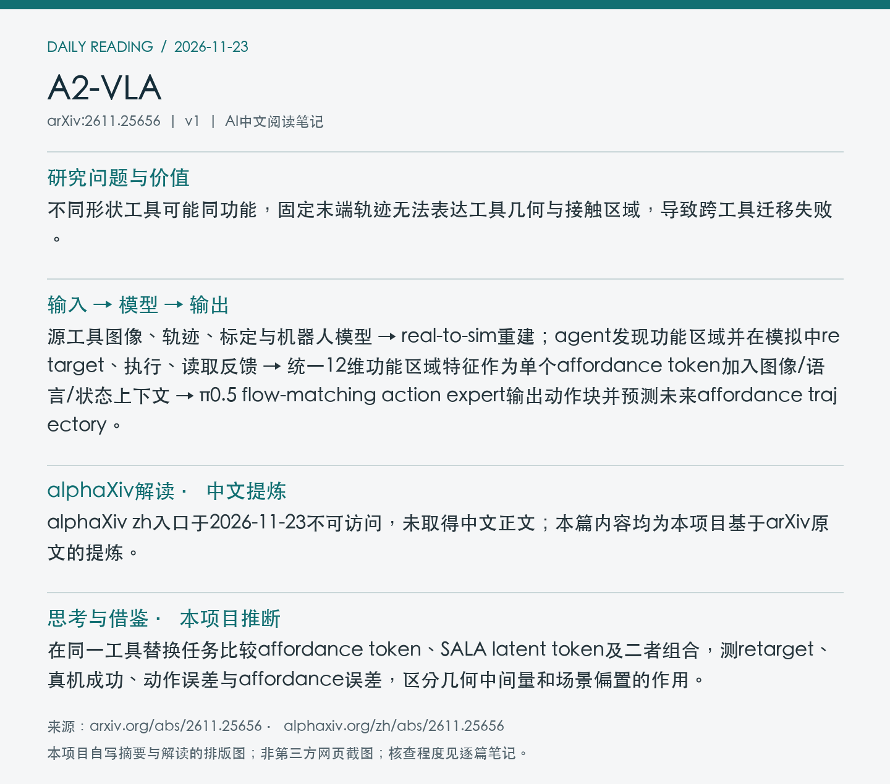

# 2611.25656 · A2-VLA

A²-VLA: Adapting Vision-Language-Action Policies to New Tools through Agentic Affordance Discovery

[arXiv原文](https://arxiv.org/abs/2611.25656) · [v1 HTML](https://arxiv.org/html/2611.25656v1) · [alphaXiv zh中文入口（本次不可访问）](https://www.alphaxiv.org/zh/abs/2611.25656)

v1 于北京时间 **2026-11-19 15:38:47** 首次提交。本期已选读原文第3—5节、附录A—C，核对图2、表1—3和训练/推理细节；未核查代码。alphaXiv zh入口不可访问，未取得中文版 AI Overview。

## 中文摘要 · 本项目AI改写

A²-VLA 将工具 affordance 当作可构造、可测试、可修正的假设：从少量源工具遥操作示范重建场景，在模拟器中发现功能区域及几何特征，反复 retarget 与验证，形成可复用的 affordance-extraction skill，再用这些低维特征条件化 π₀.₅ 以适配未见工具。

## 核心问题与方法

不同形状的工具可能具有相同功能，但直接迁移固定末端轨迹会忽视工具几何和接触区域。

**输入 → 模型处理 → 输出**：源工具图像、轨迹、相机标定与机器人模型 → real-to-sim 重建；agent 识别功能区域/方向，构造提取 skill，在模拟中 retarget、执行并读取接触与失败反馈 → 统一编码 12 维功能区域特征，作为单个 affordance token 加入图像、语言和状态上下文 → π₀.₅ action expert 通过 flow matching 输出动作块，同时预测未来 affordance trajectory。

图2（PDF第5页）展示源工具 affordance 发现、模拟验证与 affordance-guided VLA。来源：[v1 PDF](https://arxiv.org/pdf/2611.25656v1)，裁剪坐标为整页 [0,0,612,792] point，抓取时间 2026-11-23T19:55:00+08:00，版本 v1，PDF SHA256 为 `c8c1f1c253110ce6c06b21d0cfdc3f037284472586afb42e22d1a6b5a2c4591a`。本图为原文页面摘录，已目视检查边界与清晰度。

## 主要证据与局限

在统一模拟 retarget 评估中，A²-VLA 三任务平均成功率为 **86.1%**，Raw VLM 为 37.8%，但该实验使用重建场景和共享轨迹规划。Dobot Nova 2 双臂真机、三台 RealSense D405、每个 VLA 方法 50 回合的未见工具评估中，A²-VLA 平均成功率为 **35.3%**，π₀.₅ 为 4.7%；源工具上为 46.0% 对 22.0%。使用模拟反馈的迭代从第0到第6轮，Cut Sand/Reset Plate/Pnp Ring 成功率分别提升 23.8、18.3、30.0 个百分点。结果支持“测试—修正 affordance”有用，但未见工具真机成功仍明显低于 Human Oracle 的 47.3%，工具、任务和平台规模有限。

附录中的编码将功能区域位置、无符号轴外积和有符号任务方向组合为 12 维向量；action expert 输出 14 维 flow velocity，辅助头预测逐步 affordance。训练含 10% counterfactual trajectory-retargeting 数据；训练预算为 35,000 steps、batch size 32。代码、权重和数据发布状态本期未核实。

## alphaXiv zh AI概述 · 状态记录

2026-11-23 检查 `https://www.alphaxiv.org/zh/abs/2611.25656` 时工具报告页面不可访问，未取得正文。因此本篇中文内容均为本项目基于 arXiv 原文的提炼。

## 研究联系与下一步 · 本项目推断

A²-VLA 与 SALA 都把跨本体迁移从“复制动作轨迹”转向中间表示：SALA 对齐动作语义，A²-VLA 对齐工具功能区域。可在同一工具替换任务中比较 affordance token、SALA latent token 和二者组合，分别测模拟 retarget、未见工具真机成功、动作 chunk 误差与 affordance 预测误差，判断几何中间量是否能减少 latent action 的场景偏置。

## 代码、权重与数据状态

原文与实验细节公开；本期未找到可核实的官方代码、权重或数据入口。

## 自写摘要与阅读卡片

[论文目录](../README.md) · [2026-11-23 日报](../../reports/2026/11/23.md)
